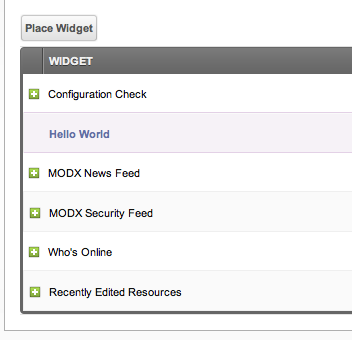

## Creating a Basic Widget

Go to the Dashboards page (**Admin → Dashboards** in the top menu), and click on the "Widgets" tab. Then click **Create**, and the Widget creation screen loads. It has these fields:

| Field | What it holds |
| --- | --- |
| **Name** | The name of the widget. It must be unique. |
| **Description** | A short description of the widget, used internally. |
| **Widget Type** | The type of the widget. For a first widget, select "HTML". |
| **Size** | One of seven sizes: Quarter, One Third, Half, Two Third, Three Quarters, Full Size and Double Size. |
| **Permission** | The manager permission a user needs for the widget to appear. Empty means the widget is shown to everyone. |
| **Namespace** | The Namespace to associate the widget with. Leave it at "core" unless you build an Extra. |
| **Lexicon** | The lexicon to load with the widget. The default is "core:dashboards". |
| **Properties** | Arbitrary properties of the widget, stored as JSON. A file or a snippet widget receives them as `$scriptProperties`. |

As you type the name, a translated version of it appears below the field. The translation looks up the key in the lexicon of the widget. Type the key of an existing entry, for example `w_configcheck`, and it shows the translated name of that entry.

Now, in the content of the widget, put this:

``` php
<p>Hello, world!</p>
```

Our widget should look like this:


Save the widget.

### Assigning the Widget to the Default Dashboard

To assign the widget to the Default Dashboard, go back to the main Dashboards page, click on the "Dashboards" tab, and find the Default Dashboard. Right-click on it and click "Edit". This loads the editing page of the Default Dashboard.

From here, click the "Place Widget" button above the Widgets grid on this page. Select the "Hello World" widget from the dropdown, and click save. To place it in position #2, drag it between the "Configuration Check" widget and the "MODX News Feed" widget:



Save your Dashboard.

> **Note:** Adding a widget through the Dashboards manager page (as described above) places it on the dashboard **template**. If the dashboard is [customizable](building-sites/client-proofing/dashboards "Dashboards"), the widget will automatically appear for all existing users of that dashboard, as well as any new users.
>
> Adding a widget directly on the dashboard page (via the dashboard view itself) only adds it for the currently logged-in user. Other users will not see it unless it is also added to the template.
>
> A widget that is added to the template arrives at the existing users with the default size and at the end of the list.
>
> On large sites with many users, adding a widget to the template creates a placement record for every user with a personal copy of that dashboard. Keep this in mind if performance is a concern.

### Viewing the Widget

Now, if you click the MODX logo in the top left, you can see your new dashboard widget in place!


## Removing a Widget

A widget is removed from the Widgets tab, and that removes it from all the Dashboards it was placed on. The widgets that ship with MODX cannot be removed.

## Other Widget Types

See the [Dashboard Widget Types](building-sites/client-proofing/dashboards/widget-types "Dashboard Widget Types") section for the other types of widgets.

## See Also

1. [Dashboards](building-sites/client-proofing/dashboards)
2. [Managing Your Dashboard](building-sites/client-proofing/dashboards/managing)
3. [Assigning a Dashboard to a User Group](building-sites/client-proofing/dashboards/usergroups)
4. [Creating a Dashboard Widget](building-sites/client-proofing/dashboards/creating-a-widget)
5. [Dashboard Widget Types](building-sites/client-proofing/dashboards/widget-types)
    1. [Dashboard Widget Type - File](building-sites/client-proofing/dashboards/widget-types/file)
    2. [Dashboard Widget Type - HTML](building-sites/client-proofing/dashboards/widget-types/html)
    3. [Dashboard Widget Type - Inline PHP](building-sites/client-proofing/dashboards/widget-types/inline-php)
    4. [Dashboard Widget Type - Snippet](building-sites/client-proofing/dashboards/widget-types/snippet)
