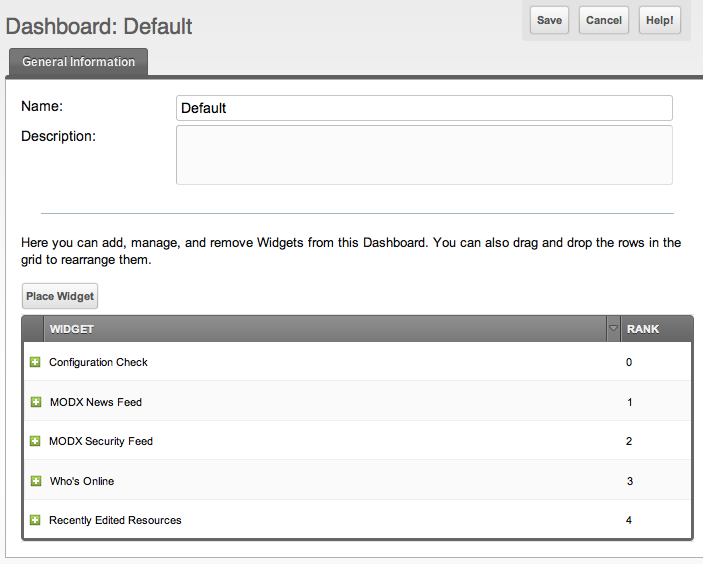

## Editing a Dashboard

Go to the main Dashboards page, which you find in the top menu under **Admin → Dashboards**. The first tab holds a grid of the Dashboards, most likely only the "Default" one. Right-click the row and choose **Edit**. This loads the editing page of the Dashboard.

You see a name and a description field, and below them a grid of the widgets of the Dashboard. You can drag the widgets to rearrange them, add widgets with the **Place Widget** button, or remove them with the right mouse button:

The name of the Default Dashboard cannot be changed in the form. The description can. It is the Dashboard every user gets when no group assigns another one.

## Creating and Removing a Dashboard

The page has a **Create** button, which makes a Dashboard of your own. The context menu of a Dashboard has **Duplicate** and **Delete** next to **Edit**. Duplicating a Dashboard copies its widgets and their placement; the copy is yours to change.

The "Default" Dashboard cannot be deleted. When a Dashboard is deleted, the groups that were assigned to it fall back to the "Default" one.

The grid of Dashboards can be filtered by a user group, which is the quickest way to find the Dashboard a certain group works with.

## Template vs Personal Changes

Changes made on this page update the Dashboard **template**. For [customizable Dashboards](building-sites/client-proofing/dashboards "Dashboards"), template changes are propagated to all users who have a personal copy of that Dashboard:

- When you **add a widget** here, it will appear on the dashboard for all existing users of that dashboard.
- When you **remove a widget** here, it will be removed from all users' personal dashboards.

Changes made on the dashboard page itself are different. The close button on a widget, or adding a widget from the dashboard view, affects only the currently logged-in user.

A widget that is added to the template arrives at the existing users with the default size and at the end of the list.

## Permissions

Every action on this page requires the permission `dashboards`.

## See Also

1. [Dashboards](building-sites/client-proofing/dashboards)
2. [Managing Your Dashboard](building-sites/client-proofing/dashboards/managing)
3. [Assigning a Dashboard to a User Group](building-sites/client-proofing/dashboards/usergroups)
4. [Creating a Dashboard Widget](building-sites/client-proofing/dashboards/creating-a-widget)
5. [Dashboard Widget Types](building-sites/client-proofing/dashboards/widget-types)
    1. [Dashboard Widget Type - File](building-sites/client-proofing/dashboards/widget-types/file)
    2. [Dashboard Widget Type - HTML](building-sites/client-proofing/dashboards/widget-types/html)
    3. [Dashboard Widget Type - Inline PHP](building-sites/client-proofing/dashboards/widget-types/inline-php)
    4. [Dashboard Widget Type - Snippet](building-sites/client-proofing/dashboards/widget-types/snippet)
