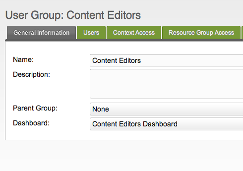

Find the User Group you want to assign the Dashboard to, and edit it. The tree of the User Groups is on the page **Access → ACLs**: right-click the group in the tree and choose **Edit User Group**.

From there, click the "Dashboard" dropdown and select the Dashboard you want to assign to this User Group. All users in this group that have this group as their Primary Group will load that Dashboard instead of the Default now.

The Dashboard is assigned in the form of the group. There is no screen that assigns a Dashboard to groups in the other direction.

## Customizable Dashboards and User Groups

If the assigned dashboard has the **Customizable** setting checked, MODX creates a personal copy of the widget layout for each user on first login. Users can then rearrange, add, or remove widgets on their own copy without affecting other group members.

When an administrator later updates the dashboard template, those changes are applied to all existing users' personal dashboards. The template is edited through the Dashboards manager page. See [Managing Your Dashboard](building-sites/client-proofing/dashboards/managing "Managing Your Dashboard") for more on how template changes propagate.

## See Also

1. [Dashboards](building-sites/client-proofing/dashboards)
2. [Managing Your Dashboard](building-sites/client-proofing/dashboards/managing)
3. [Assigning a Dashboard to a User Group](building-sites/client-proofing/dashboards/usergroups)
4. [Creating a Dashboard Widget](building-sites/client-proofing/dashboards/creating-a-widget)
5. [Dashboard Widget Types](building-sites/client-proofing/dashboards/widget-types)
    1. [Dashboard Widget Type - File](building-sites/client-proofing/dashboards/widget-types/file)
    2. [Dashboard Widget Type - HTML](building-sites/client-proofing/dashboards/widget-types/html)
    3. [Dashboard Widget Type - Inline PHP](building-sites/client-proofing/dashboards/widget-types/inline-php)
    4. [Dashboard Widget Type - Snippet](building-sites/client-proofing/dashboards/widget-types/snippet)
