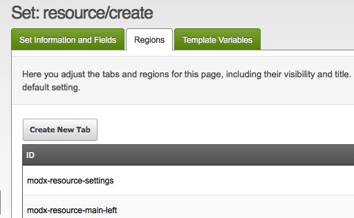

Form Customization hides or renames whole tabs of the form of a resource, and parts of those tabs.

**When a Tab is not a Tab**
Setting up Form Customization under **Admin → Form Customization** and editing a set shows a list of "Regions". The list doesn't correspond directly to the familiar "Document", "Settings", "Template Variables", and "Resource Groups". The region ids listed here refer to entire tabs or _parts_ of tabs.

## Tab Regions

These are the various tab regions whose visibility can be toggled.

| ID | Default Tab Title | Description |
| --- | --- | --- |
| modx-resource-settings | Document | A primary tab |
| modx-resource-main-left | | |
| modx-resource-content-above | | |
| modx-resource-content-below | | |
| modx-resource-main-right | | |
| modx-resource-main-right-top | | |
| modx-resource-main-right-middle | | |
| modx-resource-main-right-bottom | | |
| modx-page-settings | Settings | A primary tab |
| modx-page-settings-left | | |
| modx-page-settings-right | | |
| modx-page-settings-box-left | | |
| modx-page-settings-box-right | | |
| modx-panel-resource-tv | Template Variables | A primary tab |
| modx-resource-access-permissions | Resource Groups | A primary tab |

A set that is bound to the action **Create Resource** offers two regions less: `modx-resource-content-above` and `modx-resource-content-below`.

The list of the regions is stored in a reference table, and it is filled in when MODX is installed. A database that was upgraded from 2.x may have a shorter list.

## Adding New Tabs

Adding a new tab is quite simple. Edit your Set, and open the **Regions** tab. Press **Create**, give the region an ID like `my-new-tab` and a **Title**.

Any time you need to refer to the region, for example when moving Template Variables into the new tab, use the ID you gave it.

The id has to be unique within the set. A region created this way can be deleted again with the **Delete** item of its context menu. The regions of the form itself cannot.

## See Also

1. [Customizing the Manager](building-sites/client-proofing/form-customization)
2. [Form Customization Profiles](building-sites/client-proofing/form-customization/profiles)
3. [Form Customization Sets](building-sites/client-proofing/form-customization/sets)
   1. [Form Customization Rules](building-sites/client-proofing/form-customization/rules)
   2. [Customizing Tabs](building-sites/client-proofing/form-customization/tabs)
4. [Custom Manager Themes](building-sites/client-proofing/custom-manager-themes)
