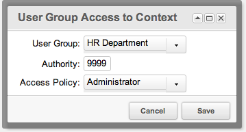

## The Security Model

Security in MODX is list-based. The rights are granted to User Groups and are tied to an object with a minimum role.

Every user can be a member of any number of User Groups. Each User Group gets its attributes from Access Control Lists (ACLs), which contain a list of Permissions. The permissions open up the different areas and actions of MODX.

An ACL usually has the following:

- **Principal** - The object that is getting the access permissions. In MODX, by default, a User Group.
- **Target** - The object they apply to, for example a Context or Resource Group.
- **Access Policy** - The list of Permissions that is gained by this ACL.
- **Authority** - The minimum Authority level required to use this ACL (see [Roles](building-sites/client-proofing/security/roles "Roles")).

A user passes the check of an ACL when the authority of their role in the group is **not greater** than the authority of that ACL. The policies are given to the group; the role is only the number that is compared with it.

Access is **allow/deny** in MODX, meaning that access is "open" by default. Once an ACL is applied to an object, such as a Context or Resource Group, only the objects with appropriate Permissions can reach it.

### The Permissions of the Page

The page of the Access Control Lists needs the permission `access_permissions`.

## What a Fresh Installation Looks Like

MODX 3 creates the following when it is installed:

| Who | What |
| --- | --- |
| The anonymous user | The policy **Load Only** on the context `web`, with the authority 9999. |
| The group `Administrator` | The policy **Administrator** on the contexts `web` and `mgr`, with the authority 0 — the role Super User. |

The anonymous user is not a group: it is an ACL with the principal `0`. There is no group "Anonymous" in the database, and the tree of the groups shows a pseudo entry "(Anonymous)".

The role **Member** has the authority 9999, so it does not pass the check of an ACL with the authority 0. A user with the role **Super User** does.

## Security Tutorial Video

Demonstrates by applying concepts to the MODX Sample Site to:

- Restrict RSS feed to Directors and up
- Restrict Blog to Staff only
- Create a 'secure' context for Directors and up only
- Restrict some element categories to administrators only

### Example: Context Access

A good example is creating a Context named 'test', and assigning an ACL to it. This can be done by editing the Context, and going to the 'Access Permissions' tab. From here, you can give a User Group (say, 'HR Dept') explicit access to this Context. Select the User Group, the 'Administrator' Access Policy, and a required Authority (say, 9999 for 'Member'):

This will restrict the 'test' Context to users who are a Member (or [Role](building-sites/client-proofing/security/roles "Roles") with more authority) of the 'HR Dept' User Group.

## Events

The behaviour of the authentication and of the accounts can be changed with a plugin. The events of the section:

| Event | When it fires |
| --- | --- |
| OnManagerLogin, OnWebLogin | After a user has logged in. |
| OnManagerAuthentication, OnWebAuthentication | While a user is being authenticated. |
| OnUserNotFound | When a login names a user that does not exist. |
| OnManagerLogout, OnWebLogout | After a user has logged out. |
| OnBeforeManagerLogout, OnBeforeWebLogout | Before a user logs out. |
| OnUserBeforeSave, OnUserSave | Before and after a user is saved. |
| OnUserBeforeRemove, OnUserRemove | Before and after a user is removed. |
| OnUserFormSave, OnBeforeUserFormSave | Before and after a user is saved from the form of the manager. |
| OnUserChangePassword | After a user has changed the password. |
| OnUserActivate, OnBeforeUserActivate | After and before a user is activated. |
| OnUserDeactivate, OnBeforeUserDeactivate | After and before a user is deactivated. |
| OnUserBeforeAddToGroup, OnUserAddToGroup | Before and after a user is added to a group. |
| OnUserBeforeRemoveFromGroup, OnUserRemoveFromGroup | Before and after a user is removed from a group. |
| OnUserGroupBeforeSave, OnUserGroupSave | Before and after a group is saved. |
| OnUserGroupBeforeRemove, OnUserGroupRemove | Before and after a group is removed. |
| OnResourceGroupBeforeSave, OnResourceGroupSave | Before and after a resource group is saved. |
| OnBeforeResourceGroupRemove, OnResourceGroupRemove | Before and after a resource group is removed. |
| OnResourceAddToResourceGroup, OnResourceRemoveFromResourceGroup | When a resource is added to or removed from a resource group. |

## See Also

1. [Security (ACLs)](building-sites/client-proofing/security)
2. [Users](building-sites/client-proofing/security/users)
3. [User Groups](building-sites/client-proofing/security/user-groups)
4. [Resource Groups](building-sites/client-proofing/security/resource-groups)
5. [Roles](building-sites/client-proofing/security/roles)
6. [Policies](building-sites/client-proofing/security/policies)
    1. [Permissions](building-sites/client-proofing/security/policies/permissions)
        1. [Administrator Policy](building-sites/client-proofing/security/policies/permissions/administrator-policy)
        2. [Resource Policy](building-sites/client-proofing/security/policies/permissions/resource-policy)
    2. [ACLs](building-sites/client-proofing/security/policies/acls)
    3. [Policy Templates](building-sites/client-proofing/security/policies/policytemplates)
7. [Security Tutorials](building-sites/client-proofing/security/security-tutorials)
    1. [Giving a User Manager Access](building-sites/client-proofing/security/security-tutorials/giving-a-user-manager-access)
    2. [Making Member-Only Pages](building-sites/client-proofing/security/security-tutorials/making-member-only-pages)
    3. [Creating a Second Super Admin User](building-sites/client-proofing/security/security-tutorials/creating-a-second-super-admin-user)
    4. [Restricting an Element from Users](building-sites/client-proofing/security/security-tutorials/restricting-an-element-from-users)
    5. [More on the Anonymous User Group](building-sites/client-proofing/security/security-tutorials/more-on-the-anonymous-user-group)
8. [Troubleshooting Security](building-sites/client-proofing/security/troubleshooting-security)
    1. [Resetting a User Password Manually](building-sites/client-proofing/security/troubleshooting-security/resetting-a-user-password-manually)
