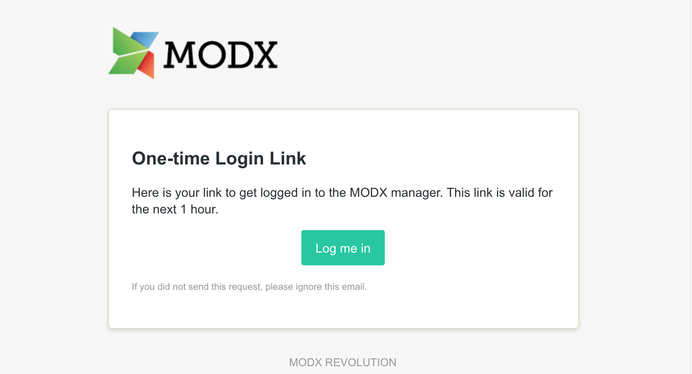

MODX 3 can log a user in without a password. With the feature activated, the login form asks for an e-mail address only, and sends a one-time login link to it. Clicking the link logs the user into the manager.

## Benefits of passwordless login

As a site administrator you should not encourage your users to choose insecure passwords. Passwordless login moves the risk of a weak password away from your MODX installation, but of course needs a secure e-mail account for your users. The traditional username and password login has the same requirement, because it also offers self-service password resets by e-mail. The gain is that the user has no password to choose, to remember or to reuse.

## The Password Is Replaced

Logging in by a link replaces the password of the user. The handler writes a generated password into the field `password`, where only its hash is stored, and logs the user in with it. The password the user chose is therefore gone after the first link — the account is left with a password that nobody knows.

## How to enable passwordless login

Set the system setting `passwordless_activated` in the area "Authentication and Security" of the core system settings to "Yes". The setting is off by default. The next time you log in you will be presented the following login screen:

Just enter the account's e-mail address and you will receive an e-mail with a personal login link.

## Configure link expiration

You can configure the expiration time of the login link via the system setting `passwordless_expiration`. By default it is set to 3600 seconds, which is enough for everyone to log in. Set it to a lower value, e.g. 600, to allow usage of the link only for 10 minutes. The validity period will also be shown in the e-mail itself.

## The Link Is Used Once

The link works only once: the record is removed from the registry as soon as it has been used. The token of the link is signed with the hash of the user's password, so a link stops working as soon as the password changes.

## Additional notes

Be aware that there will be _no error message_ if you enter an unknown e-mail address during login. This is a well-known and intended behavior to prevent user-enumeration attempts.

## See Also

1. [Security (ACLs)](building-sites/client-proofing/security)
2. [Users](building-sites/client-proofing/security/users)
3. [User Groups](building-sites/client-proofing/security/user-groups)
4. [Resource Groups](building-sites/client-proofing/security/resource-groups)
5. [Roles](building-sites/client-proofing/security/roles)
6. [Policies](building-sites/client-proofing/security/policies)
    1. [Permissions](building-sites/client-proofing/security/policies/permissions)
        1. [Administrator Policy](building-sites/client-proofing/security/policies/permissions/administrator-policy)
        2. [Resource Policy](building-sites/client-proofing/security/policies/permissions/resource-policy)
    2. [ACLs](building-sites/client-proofing/security/policies/acls)
    3. [Policy Templates](building-sites/client-proofing/security/policies/policytemplates)
7. [Security Tutorials](building-sites/client-proofing/security/security-tutorials)
    1. [Giving a User Manager Access](building-sites/client-proofing/security/security-tutorials/giving-a-user-manager-access)
    2. [Making Member-Only Pages](building-sites/client-proofing/security/security-tutorials/making-member-only-pages)
    3. [Creating a Second Super Admin User](building-sites/client-proofing/security/security-tutorials/creating-a-second-super-admin-user)
    4. [Restricting an Element from Users](building-sites/client-proofing/security/security-tutorials/restricting-an-element-from-users)
    5. [More on the Anonymous User Group](building-sites/client-proofing/security/security-tutorials/more-on-the-anonymous-user-group)
8. [Troubleshooting Security](building-sites/client-proofing/security/troubleshooting-security)
    1. [Resetting a User Password Manually](building-sites/client-proofing/security/troubleshooting-security/resetting-a-user-password-manually)
