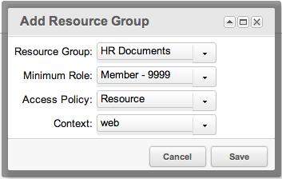
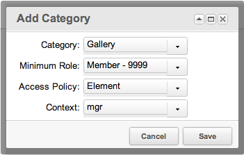
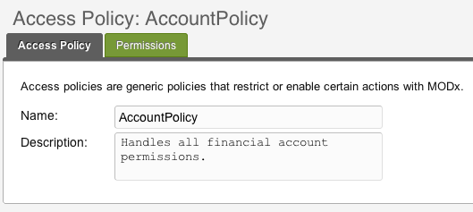
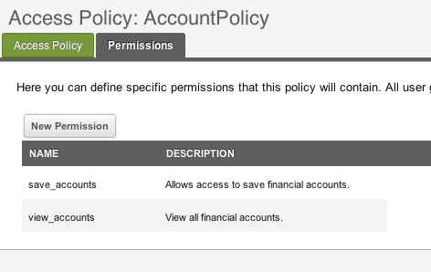

## What is an Access Policy?

An Access Policy is a list of [Permissions](building-sites/client-proofing/security/policies/permissions "Permissions"), defined in the manager. By default MODX comes with twelve pre-configured Access Policies:

| Policy | What it is | Policy Template |
| --- | --- | --- |
| Administrator | Context administration policy with all default permissions. | AdministratorTemplate |
| Content Editor | Context administration policy with limited, content-editing related Permissions, but no publishing Permissions (`publish_document` / `unpublish_document`). | AdministratorTemplate |
| Context | A standard Context policy that you can apply when creating Context ACLs for basic read/write and view\_unpublished access within a Context. | ContextTemplate |
| Developer | Context administration policy with all permissions of the administrator, except the administrative and the security ones. | AdministratorTemplate |
| Element | MODX Element policy with all attributes. | ElementTemplate |
| Hidden Namespace | Hides a namespace from the lists. It grants `load` and `view`, and denies `list`. | NamespaceTemplate |
| Load Only | A minimal policy with permission to load an object. | ObjectTemplate |
| Load, List and View | Provides load, list and view permissions only. | ObjectTemplate |
| Media Source Admin | Media Source administration policy. | MediaSourceTemplate |
| Media Source User | Media Source user policy, with basic viewing and using - but no editing - of Media Sources. | MediaSourceTemplate |
| Object | An Object policy with all permissions. | ObjectTemplate |
| Resource | MODX Resource Policy with all attributes. | ResourceTemplate |

The Policy Template of a policy decides which permissions it can hold at all. It is the list of checkboxes you get when you create the policy. See [Policy Templates](building-sites/client-proofing/security/policies/policytemplates "Policy Templates").

**Duplicate a default policy before you change it**
The setup script recreates the policies of the core on every update, so your changes to them can be lost.

## The Permissions of the Page

The page of the policies needs the permission `policy_view` to see the list, `policy_new` and `policy_save` to create a policy, `policy_edit` to change one, and `policy_delete` to delete one. The templates need `policy_template_view`, `policy_template_new`, `policy_template_save`, `policy_template_edit` and `policy_template_delete`.

## Creating and Editing

To create an Access Policy in the manager, navigate to

> the lock icon in the user menu → **Access Control Lists** → the tab **Policies**

From there you can add new policies. To edit an Access Policy in the manager, simply right-click the Policy you want to edit.

## Usage

Policies can be used in a myriad of different ways. Here are 3 example usages that come by default in MODX:

### Context Access

Access Policies can be assigned as [Access Control Lists](building-sites/client-proofing/security/policies/acls "ACLs") (ACLs) to a Context and User Group, with a specified Minimum [Role](building-sites/client-proofing/security/roles "Roles"). When done, all the Users in that User Group with at least the Minimum Role can use the Permissions in the Policy. This applies to the Context specified in the [ACL](building-sites/client-proofing/security/policies/acls "ACLs").

MODX comes with a default ["Administrator" Policy](building-sites/client-proofing/security/policies/permissions/administrator-policy "Permissions - Administrator Policy") that contains all the [Permissions](building-sites/client-proofing/security/policies/permissions "Permissions") one would use in a Context ACL. It's best to duplicate this policy when creating a custom access policy for restricting manager users.

Manager publish controls require `publish_document` on a Context Access ACL for the **`mgr`** context. Policies attached only to another context do not unlock those controls. Details: [ACLs: Manager publishing and multiple groups](building-sites/client-proofing/security/policies/acls#manager-publishing-and-multiple-groups).

### Resource Group Access

They can also be Resource ACLs, that limit access to Resources based on Roles and Resource Groups. MODX comes packaged with a default ["Resource" Policy](building-sites/client-proofing/security/policies/permissions/resource-policy "Resource Policy") that contains all the basic Permissions one would use in a Resource Group ACL.

An example would be to assign the "Resource" policy to a Resource Group called 'HR Documents'. Then, you would give a User Group called "HR Department" access to this Resource Group via the Resource ACL:

This would restrict all Resources in the "HR Documents" Resource Group to Users only in the "HR Department" group.

### Element Category Access

Elements can be restricted from view by ACLs on Categories. For example, say you have a User Group called 'Developers' and want its Users to be the only ones who see the Elements in the Category 'Gallery'. Create an ACL like this, in the "Element Category Access" tab of the group:

This would allow only Users in the "Developers" User Group access to see Elements in the "Gallery" Category.

## Examples

Here's an example custom policy:

and its permissions:

Any User that had access to this Policy would have the permissions `view_accounts` and `save_accounts`.

## See Also

1. [Security (ACLs)](building-sites/client-proofing/security)
2. [Users](building-sites/client-proofing/security/users)
3. [User Groups](building-sites/client-proofing/security/user-groups)
4. [Resource Groups](building-sites/client-proofing/security/resource-groups)
5. [Roles](building-sites/client-proofing/security/roles)
6. [Policies](building-sites/client-proofing/security/policies)
    1. [Permissions](building-sites/client-proofing/security/policies/permissions)
        1. [Administrator Policy](building-sites/client-proofing/security/policies/permissions/administrator-policy)
        2. [Resource Policy](building-sites/client-proofing/security/policies/permissions/resource-policy)
    2. [ACLs](building-sites/client-proofing/security/policies/acls)
    3. [Policy Templates](building-sites/client-proofing/security/policies/policytemplates)
7. [Security Tutorials](building-sites/client-proofing/security/security-tutorials)
    1. [Giving a User Manager Access](building-sites/client-proofing/security/security-tutorials/giving-a-user-manager-access)
    2. [Making Member-Only Pages](building-sites/client-proofing/security/security-tutorials/making-member-only-pages)
    3. [Creating a Second Super Admin User](building-sites/client-proofing/security/security-tutorials/creating-a-second-super-admin-user)
    4. [Restricting an Element from Users](building-sites/client-proofing/security/security-tutorials/restricting-an-element-from-users)
    5. [More on the Anonymous User Group](building-sites/client-proofing/security/security-tutorials/more-on-the-anonymous-user-group)
8. [Troubleshooting Security](building-sites/client-proofing/security/troubleshooting-security)
    1. [Resetting a User Password Manually](building-sites/client-proofing/security/troubleshooting-security/resetting-a-user-password-manually)
