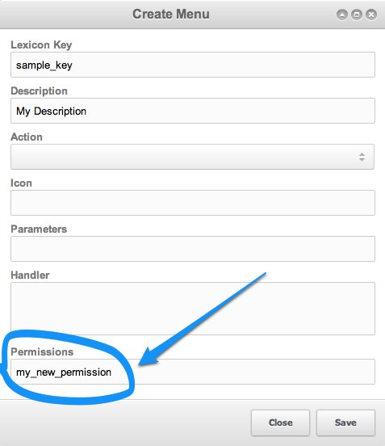

## The Administrator Policy

This policy is packaged into MODX and is given to users on the 'mgr' context who want to have full access to managing MODX content.

## Default Permissions

| Name | Description of Access |
| --- | --- |
| `about` | The About page. |
| `access_permissions` | Any Access Permission-related pages and actions. |
| `actions` | The [Actions](extending-modx/menus/actions "Actions and Menus") page. |
| `change_password` | User can change their user password. |
| `change_profile` | User can change their profile. |
| `charsets` | To view a list of charsets. |
| `class_map` | To view a list of classes in the Class Map. |
| `components` | To view the Extras menu. |
| `content_types` | The [Content Types](building-sites/resources/content-types "Content Types") page. |
| `countries` | To view a list of countries. |
| `create` | Basic "create" access on objects. |
| `credits` | View the Credits page. |
| `customize_forms` | View and manage the [Customizing the Manager](building-sites/client-proofing/form-customization "Customizing the Manager") page. |
| `dashboards` | View and manage Custom Dashboards. |
| `database` | The System Info page |
| `database_truncate` | The ability to truncate a database table. |
| `delete_category` | To delete or remove any Categories. |
| `delete_chunk` | To delete or remove any [Chunks](building-sites/elements/chunks "Chunks"). |
| `delete_context` | To delete or remove any [Contexts](building-sites/contexts "Contexts"). |
| `delete_document` | To delete or remove any [Resources](building-sites/resources "Resources"). |
| `delete_eventlog` | To empty the Event Log. |
| `delete_plugin` | To delete or remove any [Plugins](extending-modx/plugins "Plugins"). |
| `delete_propertyset` | To delete or remove any Property Sets. |
| `delete_role` | To delete or remove any [Roles](building-sites/client-proofing/security/roles "Roles"). |
| `delete_snippet` | To delete or remove any [Snippets](extending-modx/snippets "Snippets"). |
| `delete_static_resource` | To delete or remove any static resource, also requires delete\_document permission. |
| `delete_symlink` | To delete or remove any symlink, also requires delete\_document permission. |
| `delete_template` | To delete or remove any [Templates](building-sites/elements/templates "Templates"). |
| `delete_tv` | To delete or remove any [Template Variables](building-sites/elements/template-variables "Template Variables"). |
| `delete_user` | To delete or remove any [Users](building-sites/client-proofing/security/users "Users"). |
| `delete_weblink` | To delete or remove any weblink, also requires delete\_document permission. |
| `directory_chmod` | To chmod a physical directory. |
| `directory_create` | To create a physical directory. |
| `directory_list` | To list subdirectories for a physical directory. |
| `directory_remove` | To delete a physical directory. |
| `directory_update` | To rename a physical directory. |
| `edit_category` | To edit any Categories. |
| `edit_chunk` | To edit any [Chunks](building-sites/elements/chunks "Chunks"). |
| `edit_context` | To edit any [Contexts](building-sites/contexts "Contexts"). |
| `edit_document` | To edit any [Resources](building-sites/resources "Resources"). |
| `edit_locked` | Allows a user to override a lock and edit a locked Resource. |
| `edit_plugin` | To edit any [Plugins](extending-modx/plugins "Plugins"). |
| `edit_propertyset` | To edit any Property Sets. |
| `edit_role` | To edit any [Roles](building-sites/client-proofing/security/roles "Roles"). |
| `edit_snippet` | To edit any [Snippets](extending-modx/snippets "Snippets"). |
| `edit_static_resource` | To edit static resources, also requires edit\_document permission. |
| `edit_symlink` | To edit symlinks, also requires edit\_document permission. |
| `edit_template` | To edit any [Templates](building-sites/elements/templates "Templates"). |
| `edit_tv` | To edit any [Template Variables](building-sites/elements/template-variables "Template Variables"). |
| `edit_user` | To edit any [User](building-sites/client-proofing/security/users "Users"). |
| `edit_weblink` | To edit weblinks, also requires edit\_document permission. |
| `element_tree` | The ability to view the Elements Tree on the left nav. |
| `empty_cache` | To empty the site cache. |
| `error_log_erase` | To erase the error log. |
| `error_log_view` | To view the error log. |
| `events` | To view any System Events. |
| `export_static` | To export the site to static HTML. |
| `file_create` | To create a file. |
| `file_list` | To list files within a given physical directory. |
| `file_manager` | To use the file manager, including creating/deleting files. |
| `file_remove` | To delete physical files. |
| `file_tree` | To view the Files Tree on the left nav. |
| `file_unpack` | To extract zip archives. |
| `file_update` | To edit the content of physical files. <strong>WARNING: grants ability to execute arbitrary server-side code.</strong> |
| `file_upload` | To upload files to a directory. |
| `file_view` | To view the contents of a file. |
| `flush_sessions` | Can flush Sessions across the site. |
| `frames` | To use the MODX Manager UI at all. |
| `help` | To view the Help page. |
| `home` | To view the Welcome page. |
| `language` | To switch the current language in the manager. |
| `languages` | To edit or view Lexicon Languages. |
| `lexicons` | To edit or view Lexicons and [Internationalization](extending-modx/internationalization "Internationalization"). |
| `list` | Basic permission to "list" any object. List means to get a collection of objects. |
| `load` | Basic permission to "load" any object, or be able to return it as an instance at all. |
| `logout` | To be able to logout as a user. |
| `menu_reports` | Show the main menu item "Reports". |
| `menu_security` | Show the main menu item "Security". |
| `menu_site` | Show the main menu item "Site". |
| `menu_support` | Show the main menu item "Support". |
| `menu_system` | Show the main menu item "System". |
| `menu_tools` | Show the main menu item "Tools". |
| `menu_trash` | Show the main menu item "Trash Manager". |
| `menu_user` | Show the main menu item "User". |
| `menus` | To edit or save any top Menu items. |
| `messages` | To send or view any personal Messages. |
| `mgr_log_erase` | To clear the manager action log. |
| `mgr_log_view` | To view the manager action log. |
| `namespaces` | To edit or view [Namespaces](extending-modx/namespaces "Namespaces"). |
| `new_category` | To create a new Category. |
| `new_chunk` | To create a new [Chunk](building-sites/elements/chunks "Chunks"). |
| `new_context` | To create a new [Context](building-sites/contexts "Contexts"). |
| `new_document` | To create a new [Resources](building-sites/resources "Resources"). |
| `new_document_in_root` | To create a [Resource](building-sites/resources "Resources") at the site root. Replaces the removed `udperms_allowroot` setting. |
| `new_plugin` | To create a new [Plugin](extending-modx/plugins "Plugins"). |
| `new_propertyset` | To create a new Property Set. |
| `new_role` | To create a new [Role](building-sites/client-proofing/security/roles "Roles"). |
| `new_snippet` | To create a new [Snippet](extending-modx/snippets "Snippets"). |
| `new_static_resource` | To create a new Static Resource. |
| `new_symlink` | To create a new SymLink. |
| `new_template` | To create a new [Template](building-sites/elements/templates "Templates"). |
| `new_tv` | To create a new [Template Variable](building-sites/elements/template-variables "Template Variables"). |
| `new_user` | To create a new [User](building-sites/client-proofing/security/users "Users"). |
| `new_weblink` | To create a new WebLink. |
| `packages` | To use any Transport Packages in the [Package Management](extending-modx/transport-packages "Package Management") system. |
| `policy_delete` | To delete an Access Policy. |
| `policy_edit` | To edit an Access Policy. <strong>WARNING: combined with policy\_save permission, grants ability to escalate privileges, including security-related permissions.</strong> |
| `policy_new` | To create a new Access Policy. |
| `policy_save` | To save an Access Policy. |
| `policy_template_delete` | To delete an Access Policy Template. |
| `policy_template_edit` | To edit an Access Policy Template. |
| `policy_template_new` | To create a new Access Policy Template. |
| `policy_template_save` | To save an Access Policy Template. |
| `policy_template_view` | To view an Access Policy Template. |
| `policy_view` | To view an Access Policy. |
| `property_sets` | To view and edit [Properties and Property Sets](building-sites/properties-and-property-sets "Properties and Property Sets"). |
| `providers` | To view and edit [Providers](building-sites/extras/providers "Providers") across the site. |
| `publish_document` | To publish or unpublish any Resource. In the manager UI this is checked on the **`mgr`** context via `hasPermission('publish_document')`. A grant only on another context does not unlock manager publish controls. See [ACLs](building-sites/client-proofing/security/policies/acls#manager-publishing-and-multiple-groups). |
| `purge_deleted` | To empty the Recycle Bin. |
| `remove` | Basic permission to remove any object. |
| `remove_locks` | To remove all existing Locks throughout the site. |
| `resource_duplicate` | To duplicate a Resource. |
| `resource_quick_create` | To be able to use Quick Create Resource in the left-hand tree. |
| `resource_quick_update` | To be able to use Quick Edit Resource in the left-hand tree. |
| `resource_tree` | To view the Resource Tree in the left nav. |
| `resourcegroup_delete` | To delete a Resource Group. |
| `resourcegroup_edit` | To edit a Resource Group. |
| `resourcegroup_new` | To create a new Resource Group. |
| `resourcegroup_resource_edit` | To edit Resources in a Resource Group. |
| `resourcegroup_resource_list` | To view or list Resources in a Resource Group. |
| `resourcegroup_save` | To save a Resource Group. |
| `resourcegroup_view` | To list Resource Groups. |
| `save` | Basic save permission for any object. |
| `save_category` | To save any Categories. |
| `save_chunk` | To save any [Chunks](building-sites/elements/chunks "Chunks"). |
| `save_context` | To save any [Contexts](building-sites/contexts "Contexts"). |
| `save_document` | To save any [Resources](building-sites/resources "Resources"). |
| `save_plugin` | To save any [Plugins](extending-modx/plugins "Plugins"). |
| `save_propertyset` | To save any Property Sets. |
| `save_role` | To save any [Roles](building-sites/client-proofing/security/roles "Roles"). |
| `save_snippet` | To save any [Snippets](extending-modx/snippets "Snippets"). |
| `save_template` | To save any [Templates](building-sites/elements/templates "Templates"). |
| `save_tv` | To save any [Template Variables](building-sites/elements/template-variables "Template Variables"). |
| `save_user` | To save any [User](building-sites/client-proofing/security/users "Users"). |
| `search` | To use the Search page. |
| `set_sudo` | To make any User sudo. |
| `settings` | To view and edit any System Settings. |
| `source_delete` | To delete a Media Source. |
| `source_edit` | To edit a Media Source. |
| `source_save` | To create or save a Media Source. |
| `source_view` | To view and list Media Sources. |
| `sources` | To manage Media Sources and Media Source Types. |
| `steal_locks` | To "steal" locks, overriding a current lock on a document. |
| `tree_show_element_ids` | Show the IDs in the Elements tree. |
| `tree_show_resource_ids` | Show the IDs in the Resource tree. |
| `undelete_document` | To undelete any Resource. |
| `unlock_element_properties` | To be able to edit the default properties for any Element. |
| `unpublish_document` | To unpublish any Resources. |
| `usergroup_delete` | To delete a User Group. |
| `usergroup_edit` | To edit a User Group. <strong>WARNING: exposes UserGroup Settings which can override security-related System Settings, such as uploadable file types and API credentials.</strong> |
| `usergroup_new` | To create a new User Group. |
| `usergroup_save` | To save a User Group. |
| `usergroup_user_edit` | To edit Users in a User Group. |
| `usergroup_user_list` | To view or list Users in a User Group. |
| `usergroup_view` | To view a User Group. |
| `view` | Basic permission to "view" any object. |
| `view_category` | To view any Categories. |
| `view_chunk` | To view any [Chunks](building-sites/elements/chunks "Chunks"). |
| `view_context` | To view any [Contexts](building-sites/contexts "Contexts"). |
| `view_document` | To view any [Resources](building-sites/resources "Resources"). |
| `view_element` | To get a list of Elements or Element classes. |
| `view_eventlog` | To view the Event Log. |
| `view_offline` | To be able to view the site when it is in offline status. |
| `view_plugin` | To view any [Plugins](extending-modx/plugins "Plugins"). |
| `view_propertyset` | To view any Property Sets. |
| `view_role` | To view any [Roles](building-sites/client-proofing/security/roles "Roles"). |
| `view_snippet` | To view any [Snippets](extending-modx/snippets "Snippets"). |
| `view_sysinfo` | To view the system info page. |
| `view_template` | To view any [Templates](building-sites/elements/templates "Templates"). |
| `view_tv` | To view any [Template Variables](building-sites/elements/template-variables "Template Variables"). |
| `view_unpublished` | To view any unpublished [Resources](building-sites/resources "Resources"). |
| `view_user` | To view any [User](building-sites/client-proofing/security/users "Users"). |
| `workspaces` | To utilize [Package Management](extending-modx/transport-packages "Package Management"). |

## Custom Permissions

If you have created your own actions and menu items (e.g. a [Custom Manager Page](extending-modx/custom-manager-pages "Custom Manager Pages Tutorial")), then you can define custom permission items for them. Create the menu item (**Admin → Actions → Create Menu**) and let the permission items match those listed here.

## See Also

1. [Security (ACLs)](building-sites/client-proofing/security)
2. [Users](building-sites/client-proofing/security/users)
3. [User Groups](building-sites/client-proofing/security/user-groups)
4. [Resource Groups](building-sites/client-proofing/security/resource-groups)
5. [Roles](building-sites/client-proofing/security/roles)
6. [Policies](building-sites/client-proofing/security/policies)
    1. [Permissions](building-sites/client-proofing/security/policies/permissions)
        1. [Administrator Policy](building-sites/client-proofing/security/policies/permissions/administrator-policy)
        2. [Resource Policy](building-sites/client-proofing/security/policies/permissions/resource-policy)
    2. [ACLs](building-sites/client-proofing/security/policies/acls)
    3. [Policy Templates](building-sites/client-proofing/security/policies/policytemplates)
7. [Security Tutorials](building-sites/client-proofing/security/security-tutorials)
    1. [Giving a User Manager Access](building-sites/client-proofing/security/security-tutorials/giving-a-user-manager-access)
    2. [Making Member-Only Pages](building-sites/client-proofing/security/security-tutorials/making-member-only-pages)
    3. [Creating a Second Super Admin User](building-sites/client-proofing/security/security-tutorials/creating-a-second-super-admin-user)
    4. [Restricting an Element from Users](building-sites/client-proofing/security/security-tutorials/restricting-an-element-from-users)
    5. [More on the Anonymous User Group](building-sites/client-proofing/security/security-tutorials/more-on-the-anonymous-user-group)
8. [Troubleshooting Security](building-sites/client-proofing/security/troubleshooting-security)
    1. [Resetting a User Password Manually](building-sites/client-proofing/security/troubleshooting-security/resetting-a-user-password-manually)
