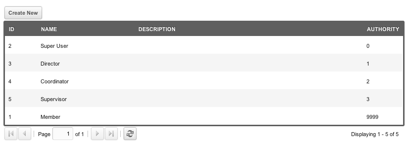
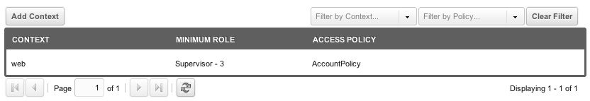

## What is a Role?

A Role groups the Users of a User Group by position or status, e.g. "Editor" or "Front-end Read Only".

Roles use an integer value called "Authority". **Lower numbers represent a stronger authority.** A user passes the check of an ACL when the authority of their role is **not greater** than the authority of the ACL. A user with a role of authority 10 passes every ACL that a user with a role of authority 11 passes.

Think of Authority as an ordinal: first, second, third. **Authority=1** is the first authority and trumps **Authority=2**.

**The authority numbers are unique**
The database will not let you create two roles with the same authority: the column has a unique index.

## The Roles of MODX

MODX 3 ships with two roles:

| Role | Authority |
| --- | --- |
| Member | 9999 |
| Super User | 0 |

The role **Super User** passes the check of every ACL, because the authority of an ACL is never below 0. The role **Member** passes only the ACLs whose authority is 9999 or more.

## The Permissions of the Page

The roles page needs these permissions:

| Permission | What it allows |
| --- | --- |
| `view_role` | See the list. |
| `new_role`, `save_role` | Create a role. |
| `edit_role` | Change a role. |
| `delete_role` | Delete a role. |

## Usage

Create roles that follow job titles. Authority has to be unique. Super User already uses 0, and Member already uses 9999.

- Director - 1
- Coordinator - 2
- Supervisor - 3
- Employee - 10

Create a User Group called "HR Department" and assign users to those roles. Several users can share one role.

John's role is Coordinator. Mark's role is Supervisor. Give the "HR Department" User Group an Access Policy called "AccountPolicy" on the "web" context, and set Minimum Role to "Supervisor":

The policy holds these permissions:

- `view_accounts`
- `save_accounts`

Mark has these permissions. He is in the User Group, and his role is at least "Supervisor".

John has them too. Coordinator has a stronger authority than Supervisor, so John has the permissions Mark has as Supervisor.

## See Also

1. [Security (ACLs)](building-sites/client-proofing/security)
2. [Users](building-sites/client-proofing/security/users)
3. [User Groups](building-sites/client-proofing/security/user-groups)
4. [Resource Groups](building-sites/client-proofing/security/resource-groups)
5. [Roles](building-sites/client-proofing/security/roles)
6. [Policies](building-sites/client-proofing/security/policies)
    1. [Permissions](building-sites/client-proofing/security/policies/permissions)
        1. [Administrator Policy](building-sites/client-proofing/security/policies/permissions/administrator-policy)
        2. [Resource Policy](building-sites/client-proofing/security/policies/permissions/resource-policy)
    2. [ACLs](building-sites/client-proofing/security/policies/acls)
    3. [Policy Templates](building-sites/client-proofing/security/policies/policytemplates)
7. [Security Tutorials](building-sites/client-proofing/security/security-tutorials)
    1. [Giving a User Manager Access](building-sites/client-proofing/security/security-tutorials/giving-a-user-manager-access)
    2. [Making Member-Only Pages](building-sites/client-proofing/security/security-tutorials/making-member-only-pages)
    3. [Creating a Second Super Admin User](building-sites/client-proofing/security/security-tutorials/creating-a-second-super-admin-user)
    4. [Restricting an Element from Users](building-sites/client-proofing/security/security-tutorials/restricting-an-element-from-users)
    5. [More on the Anonymous User Group](building-sites/client-proofing/security/security-tutorials/more-on-the-anonymous-user-group)
8. [Troubleshooting Security](building-sites/client-proofing/security/troubleshooting-security)
    1. [Resetting a User Password Manually](building-sites/client-proofing/security/troubleshooting-security/resetting-a-user-password-manually)
