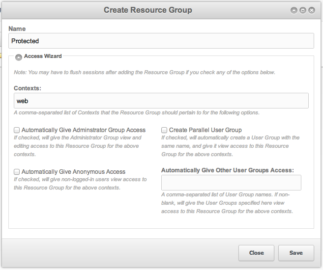
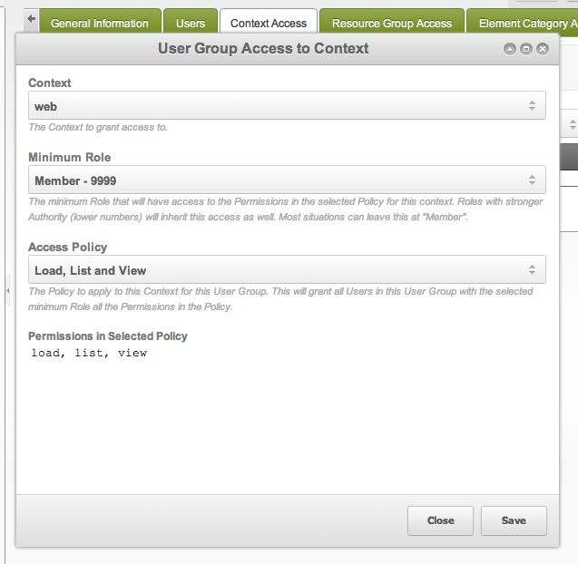

## The Steps

1. Create a Resource Group (the lock icon in the user menu → **Resource Groups** → **Create Resource Group**)
2. Link your member-only resource to the Resource Group. (By editing the resource, or by dragging them from the resource tree to the right)
3. Create a User Group (the lock icon in the user menu → **Access Control Lists** → the tab **User Groups & Users** -> New User Group)
4. Add a resource group entry on the Resource Group Access tab (context: web, minimum role: Member (9999), access policy: Resource)
5. Add users to the user group with the role of Member. (the lock icon in the user menu → **Users**)
6. Flush permissions (**Flush Your Permissions**) and try it in another browser (not just another browser window: another browser)

This tutorial describes how to protect the pages of the front end of a site so that only certain users can see them. It assumes that you already know how to let users register and log in using the components in the [Login](/extras/login "Login") package. The process described below has no effect on which resources users can see or edit in the manager.

## Access Wizard

The wizard of the resource group walks you through the whole process. The result is the same as when you set every step by hand.

### 1. Create a Resource Group

A [Resource Group](building-sites/client-proofing/security/resource-groups "Resource Groups") is a collection of resources which you can link to user groups and access list entries. When you have created a resource group, you can easily classify pages to be only visible for certain user groups, or roles within user groups.

Go to the lock icon in the user menu → **Resource Groups** and click the Create Resource Group. A window similar to this should pop up: 

Let's go over each section:

| Section | Explanation | Tutorial Default |
| --- | --- | --- |
| Name | The name of the resource group that we're generating. Make it descriptive and easy-to-remember. | Protected |
| Contexts | The context where you want the rules to apply. For this tutorial, we only have one context, "web", and we only want to hide things there. | web |
| Automatically give Administrator Group Access | Checking this box will give all users in the default administrator group access to the resource group. The default admin user is marked as a "sudo" user, and a sudo user bypasses the checks of the policies, so they see all resource groups regardless of whether the administrator group has access. However, if there are any other administrators that don't have sudo access and we want them to be able to view the resources in the resource group, we should check that box. | checked |
| Automatically give Anonymous Group Access | Checking this box will give the anonymous user access to the resource group. When someone comes to your website and is not logged in, they are the anonymous user. We want to protect our pages from users who aren't logged in, so let's leave this box unchecked for this tutorial. | unchecked |
| Create Parallel User Group | You may not wish to have everyone who can view the member-only pages be in the administrator group (if you've checked the "Automatically give Administrator Group Access" option). In this case, you can create another user group that has access to the resources in this resource group. Let's check that, as our members aren't administrators. | checked |
| Automatically Give Other User Groups Access | If you have any other user groups that you've defined previously to this tutorial to whom you want to give access, you can list them here. | |

Great! We have a resource group and a user group created. We now need to add resources to the resource group and users to that user group.

### 2. Add Resources to the Resource Group

Tell MODX which Resources to protect. Stay on the page from Step 1 (the lock icon in the user menu → **Resource Groups**). On the right, open the web context to see the pages on your site. Drag them from the right column into your Resource Group. Or edit each Resource, open the Resource Groups tab, and check **Access** on the "Protected" row.

### 3. Add Users to the User Group

Go to the lock icon in the user menu → **Access Control Lists**. In the Users Groups tab, we can see a list of all of the user groups on our site. Right click on the "Protected" User group. Select "**Add User to Group**". For the "Name", select the user you want in the user group. For the Role, let's select "Member" for now. Roles define what an individual user can do within a user group, but we don't need that fine of control for this tutorial. Click Save.

As soon as you have protected a resource by (1) assigning it to one or more resource groups and (2) linking the group to a user group with an access control, those pages no longer show up for users that are not linked to it. The default behavior in that case is displaying the 404-error page. If you would rather return the 401-error, give the anonymous user "load" permission for the resource group; more about this in a later tutorial. At this moment in the tutorial, your page is not visible yet, because you have not added it to a user group.

When you use a websignup snippet, make sure it puts the new users into the right user group.

We now have our resources in a resource group, and users in a user group. Done? Sorry, we have a few small things to do first. If you're following this tutorial and this is your first foray into MODX security, you will likely run into a small but important snag. The user group we created has no context access to our front end context, web. In other words, if we could view that context, we could view those protected resources — but we can't currently view that context. Let's give our user group permission to view it.

### 4. Add Context Access to the User Group

Go to the lock icon in the user menu → **Access Control Lists**. Right click on the protected user group. Select "Update user group". Go to the Context Access tab. Click "Add Context". We are presented with a dialog such as the one below. Let's break it down: 

| Section | Explanation | Tutorial Default |
| --- | --- | --- |
| Context | This specifies to which context we're giving access. The basic use case will have web and mgr. Web is the public front-end of your website, and mgr is the private back-end of your website (i.e., the manager that you're logged in). | web |
| Minimum Role | This specifies what user roles this rule will apply to. If we want all users in this user group, select "Member - 9999". This is where some of that fine control comes in that we talked about earlier. | Member - 9999 |
| Access Policy | This specifies what permissions we're giving to the users. Different policies will allow user groups to do different things. | Administrator |

Let's make one rule with "web", "Member - 9999", and "Load, List and View". If we want users to be able to view the manager, we can add a second rule for the mgr context: "mgr", "Member - 9999", and "Administrator". Those users get admin access. If you would prefer to limit their permissions, you could instead choose "Content Editor" or "Developer" for their access policies. Alternatively, you can make your own policy in the lock icon in the user menu → **Access Control Lists** → the tab **Policies**, if you want to be specific about what users can do.

We now have users in a user group, resources in a resource group, and that user group can view the context.

### 5. Flush Permissions

Before you can see a change, you need to reset / flush what your individual users can see and do. Go to **Flush Your Permissions**. To test this in the front end, you must use a different browser. Most of the trouble comes from not testing in a different browser or flushing your permissions. Don't be lazy: open that second browser. Congratulations, you now have members-only pages!

In some cases you may need to clear the site cache, specifically for the mgr (manager) context as elements and resources may cache their permissions.

## Still can't get it to work?

Make sure you followed everything step by step and that you flushed permissions properly. If everything seems to be alright, check again and then go to the Forums to ask for help. If you think the tutorial is misleading or inaccurate, please visit the [forum topic discussing this tutorial](https://forums.modx.com/index.php/topic,51259.0.html) and post about what is incorrect so it can be fixed.

Two further readings help with the permissions themselves: [Bob's permissions guide](http://bobsguides.com/revolution-permissions.html) covers the model in depth, and the [Login.Basic Setup](/extras/login/login.tutorials/basic-setup "Login.Basic Setup") tutorial shows a basic "Members Only" area built with the Login Snippet.

## See Also

1. [Security (ACLs)](building-sites/client-proofing/security)
2. [Users](building-sites/client-proofing/security/users)
3. [User Groups](building-sites/client-proofing/security/user-groups)
4. [Resource Groups](building-sites/client-proofing/security/resource-groups)
5. [Roles](building-sites/client-proofing/security/roles)
6. [Policies](building-sites/client-proofing/security/policies)
    1. [Permissions](building-sites/client-proofing/security/policies/permissions)
        1. [Administrator Policy](building-sites/client-proofing/security/policies/permissions/administrator-policy)
        2. [Resource Policy](building-sites/client-proofing/security/policies/permissions/resource-policy)
    2. [ACLs](building-sites/client-proofing/security/policies/acls)
    3. [Policy Templates](building-sites/client-proofing/security/policies/policytemplates)
7. [Security Tutorials](building-sites/client-proofing/security/security-tutorials)
    1. [Giving a User Manager Access](building-sites/client-proofing/security/security-tutorials/giving-a-user-manager-access)
    2. [Making Member-Only Pages](building-sites/client-proofing/security/security-tutorials/making-member-only-pages)
    3. [Creating a Second Super Admin User](building-sites/client-proofing/security/security-tutorials/creating-a-second-super-admin-user)
    4. [Restricting an Element from Users](building-sites/client-proofing/security/security-tutorials/restricting-an-element-from-users)
    5. [More on the Anonymous User Group](building-sites/client-proofing/security/security-tutorials/more-on-the-anonymous-user-group)
8. [Troubleshooting Security](building-sites/client-proofing/security/troubleshooting-security)
    1. [Resetting a User Password Manually](building-sites/client-proofing/security/troubleshooting-security/resetting-a-user-password-manually)
