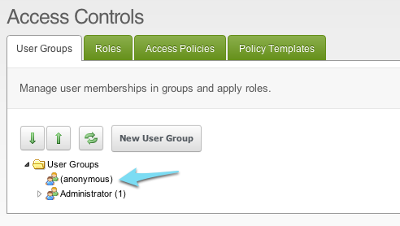
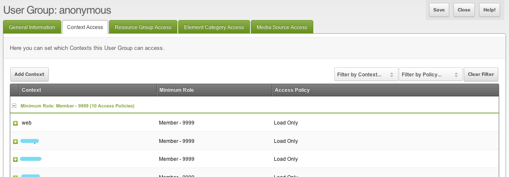
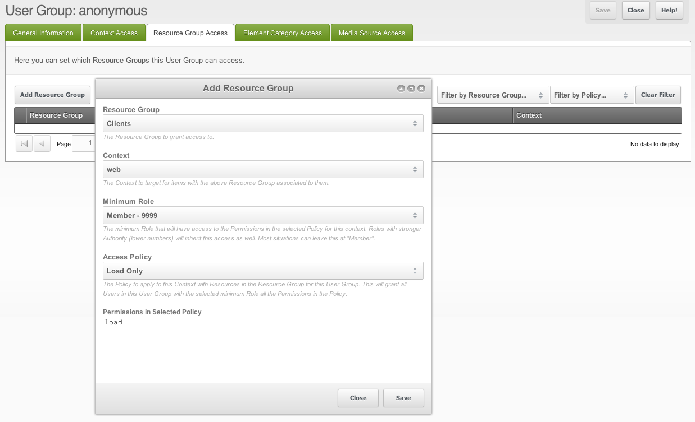

## Who's Anonymous?

Anyone who visits the site and is not logged in is the anonymous user.

**The anonymous user is not a User Group**
In the database there is no group "Anonymous". The anonymous user is an access control list with the principal `0`, and in the tree of the groups it shows up as a pseudo entry "(Anonymous)". You can edit that entry like any other group, but what you change is the access of the anonymous user.

You reach it by navigating to the lock icon in the user menu → **Access Control Lists**, the tab **User Groups & Users**. Then right-click on the "(Anonymous)" entry and select "Update User Group". 

## What Can Anonymous Users Do?

By default, the anonymous user is granted Load Only permissions in every [Context](building-sites/contexts "Contexts") except the "mgr" Context. Without Load Only permissions, requests to the Context would result in a 404 Page Not Found response.

Load Only permissions doesn't necessarily mean they can View the Resource (see below).

For example, if you create a [Resource Group](building-sites/client-proofing/security/resource-groups "Resource Groups") and grant access permissions to a specific User Group, the anonymous user cannot access it. This is the basis of [Creating Member Only Pages](building-sites/client-proofing/security/security-tutorials/making-member-only-pages "Making Member-Only Pages").

### 401 vs 404 Response on Protected Pages

When you create protected Resource Groups, the anonymous user has no Load permissions on it by default. They get a 404 Page Not Found response. To give them a 401 Unauthorized response instead, grant the anonymous user access to the Resource Group with Load Only permissions.

You can do this in the Resource Group Access tab of the editing page of the anonymous user.

Click on "Add Resource Group", select the protected Resource Group in the dropdown, and select the Context for the access (don't select the "mgr" context). Choose Load Only as the Access Policy, click "Save", and you're done.

They still will not be able to view the Resources in that protected Resource Group. They will only be able to "Load" it, and get a 401 response. You can specify a Resource ID to serve as a custom Unauthorized page by using the [Unauthorized Page System Setting](building-sites/settings/unauthorized_page "unauthorized_page").

## See Also

1. [Security (ACLs)](building-sites/client-proofing/security)
2. [Users](building-sites/client-proofing/security/users)
3. [User Groups](building-sites/client-proofing/security/user-groups)
4. [Resource Groups](building-sites/client-proofing/security/resource-groups)
5. [Roles](building-sites/client-proofing/security/roles)
6. [Policies](building-sites/client-proofing/security/policies)
    1. [Permissions](building-sites/client-proofing/security/policies/permissions)
        1. [Administrator Policy](building-sites/client-proofing/security/policies/permissions/administrator-policy)
        2. [Resource Policy](building-sites/client-proofing/security/policies/permissions/resource-policy)
    2. [ACLs](building-sites/client-proofing/security/policies/acls)
    3. [Policy Templates](building-sites/client-proofing/security/policies/policytemplates)
7. [Security Tutorials](building-sites/client-proofing/security/security-tutorials)
    1. [Giving a User Manager Access](building-sites/client-proofing/security/security-tutorials/giving-a-user-manager-access)
    2. [Making Member-Only Pages](building-sites/client-proofing/security/security-tutorials/making-member-only-pages)
    3. [Creating a Second Super Admin User](building-sites/client-proofing/security/security-tutorials/creating-a-second-super-admin-user)
    4. [Restricting an Element from Users](building-sites/client-proofing/security/security-tutorials/restricting-an-element-from-users)
    5. [More on the Anonymous User Group](building-sites/client-proofing/security/security-tutorials/more-on-the-anonymous-user-group)
8. [Troubleshooting Security](building-sites/client-proofing/security/troubleshooting-security)
    1. [Resetting a User Password Manually](building-sites/client-proofing/security/troubleshooting-security/resetting-a-user-password-manually)
