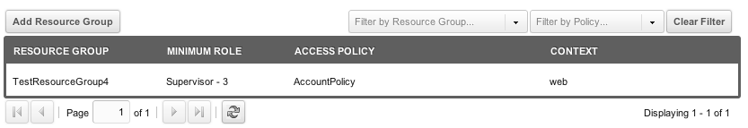

## What is a User Group?

User Groups are used by MODX to define permissions. Unlike some CMS's, in MODX a User can belong to _multiple_ User Groups.

Permissions in MODX are granted to _User Groups_, not to individual users. A User must belong to at least one User Group to have any permissions. What a User can or cannot do depends on which User Groups the User belongs to. In other CMS's this concept is sometimes referred to as a "role".

To edit the permissions of a User Group, go to the lock icon in the user menu → **Access Control Lists**. Right-click an existing User Group to update it, or create a new User Group.

A User Group can define access permissions to five areas:

- **Context Access** -- access to the manager or to a front-end login portal.
- **Resource Group Access** -- access to a Resource Group.
- **Element Category Access** -- access to only certain Chunks or to only certain fields within a resource.
- **Media Source Access** -- access to certain folders on the filesystem or S3 buckets.
- **Namespace Access** -- access to the elements of a namespace.

## Managing Members

To add or remove Users from a User Group, edit the User Group when you edit a single User. Go to the lock icon in the user menu → **Users**, right-click the User you want to edit, and view the "Access Permissions" tab.

Another way is to go to the lock icon in the user menu → **Access Control Lists**. From there you see a tree of User Groups and their respective Users. Assign a User to a User Group by right-clicking on the User Group and either:

- Adding the User via the context menu item
- Editing the User Group and adding a User on the grid there

### Assigning Policies

A quick clarification on which policies to use:

- Policies assigned on the Context Access tab should be based on the standard Administrator policy.
- Policies assigned on the Resource Group Access tab should be based on the standard Resource policy.
- Policies assigned on the Element Category Access tab should be based on the standard Element policy.

### Group Settings

The Settings tab on a User Group defines [Setting](building-sites/settings) values inherited by every member of the group. Resolution order for a user: User Setting → User Group Setting → Context Setting → System Setting. A User's own setting wins over the group's value.

## Roles in User Groups

Users can have specific Roles within a User Group, should you choose. They can also exist in the User Group without a Role. Roles allow you to fine-tune your permissions more than in previous MODX versions.

Say you want to only allow Supervisors in the "HR Department" User Group access to some Resources; no problem. Just create a Role called "Supervisor" and set its authority to some number below 9999 (let's say 3). Then add the Users to the User Group "HR Department" (via the User Group editing screen), setting any would-be supervisors to the Supervisor Role.

Then, you'll just add a Resource Policy (the packaged-in-with-modx one will do fine) to the Resource Group you want to restrict access to. It will look something like this:



And you've got a role-based access permission! This specific ACL limits all Resources in the web context and in the group "TestResourceGroup4" to Users of the "HR Department" User Group with at least a Role of Supervisor. Roles with lower authority numbers inherit the access as well. Say you had a Coordinator Role with an authority of 2: Users in this User Group would have access to this ACL too.

### The Permissions of the Page

The page of the groups needs the permission `usergroup_view` to see the list, `usergroup_new` and `usergroup_save` to create a group, `usergroup_edit` to change one, and `usergroup_delete` to delete one. To manage the members, `usergroup_user_list` shows them and `usergroup_user_edit` adds and removes them.

### Assigning User Groups and Roles via the MODX API

When working with the modUser object in the MODX API, you can assign access permissions via modUser::[joinGroup](http://api.modx.com/revolution/2.1/_model_modx_moduser.class.html#%5CmodUser::joinGroup()). Using this method, you can add a user directly to a User Group, and optionally assign a Role.

``` php
<?php
// Get modUser object
$user = $modx->getObject('modUser', array('username' => $username));
if( $user ){
    // Assign new user to User Group / Role
    $user->joinGroup('UserGroupNameOrId','OptionalRoleNameOrId');}
?>
```

## See Also

1. [Security (ACLs)](building-sites/client-proofing/security)
2. [Users](building-sites/client-proofing/security/users)
3. [User Groups](building-sites/client-proofing/security/user-groups)
4. [Resource Groups](building-sites/client-proofing/security/resource-groups)
5. [Roles](building-sites/client-proofing/security/roles)
6. [Policies](building-sites/client-proofing/security/policies)
    1. [Permissions](building-sites/client-proofing/security/policies/permissions)
        1. [Administrator Policy](building-sites/client-proofing/security/policies/permissions/administrator-policy)
        2. [Resource Policy](building-sites/client-proofing/security/policies/permissions/resource-policy)
    2. [ACLs](building-sites/client-proofing/security/policies/acls)
    3. [Policy Templates](building-sites/client-proofing/security/policies/policytemplates)
7. [Security Tutorials](building-sites/client-proofing/security/security-tutorials)
    1. [Giving a User Manager Access](building-sites/client-proofing/security/security-tutorials/giving-a-user-manager-access)
    2. [Making Member-Only Pages](building-sites/client-proofing/security/security-tutorials/making-member-only-pages)
    3. [Creating a Second Super Admin User](building-sites/client-proofing/security/security-tutorials/creating-a-second-super-admin-user)
    4. [Restricting an Element from Users](building-sites/client-proofing/security/security-tutorials/restricting-an-element-from-users)
    5. [More on the Anonymous User Group](building-sites/client-proofing/security/security-tutorials/more-on-the-anonymous-user-group)
8. [Troubleshooting Security](building-sites/client-proofing/security/troubleshooting-security)
    1. [Resetting a User Password Manually](building-sites/client-proofing/security/troubleshooting-security/resetting-a-user-password-manually)
