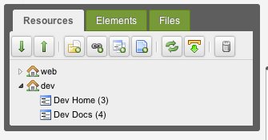

MODX 3 does not match a host with a context by itself. The gateway that starts a request chooses the context, so a second domain needs a second gateway.

Every domain here has its own virtual host and its own directory on the same machine. When several domains point at one virtual host, a Plugin picks the context. See [Using a Gateway Plugin](building-sites/contexts/gateway-plugin).

## Creating the Context

Create the context in the manager: **Admin** → **Contexts** → **Create**. The **Context Key** is `dev`. The keys `mgr`, `web` and `root` are reserved. A key starts with a letter. After that it may contain letters, digits, a hyphen, a dot and a slash. An underscore is rejected.

Then create the domain's resources in the context's branch. The tree looks like this:



## Context Settings

Four settings on the context's **Context Settings** tab decide how the domain's URLs are built:

| Setting | Value |
| --- | --- |
| `base_url` | `/` |
| `http_host` | `dev.example.com` |
| `site_start` | the ID of the resource that opens the domain |
| `site_url` | `http://dev.example.com/` — scheme, host and path, with a trailing slash |

You can override any other setting here too. `cultureKey` sets the domain's language. `session_handler_class` sets the session handler for this gateway. The value is the class name you enter. Changing a setting clears the context's cache. You do not need to clear the cache by hand.

## The Gateway Directory

The gateway is its own directory with four files:

| File | What it holds |
| --- | --- |
| `index.php` | a copy of the installation's `index.php` |
| `config.context.php` | the context key |
| `config.core.php` | a copy of the installation's `config.core.php` |
| `.htaccess` | a copy of the installation's `.htaccess` |

The three copies point at the same core and the same database. Only the context differs between the directories.

`index.php` works as it is. Set up the other three files as follows:

1. `config.context.php` holds one line:

   ``` php
   <?php
   return 'dev';
   ```

2. `config.core.php` holds the absolute path to the installation's core. The installer writes it that way:

   ``` php
   define('MODX_CORE_PATH', '/home/example.com/public_html/core/');
   ```

3. `.htaccess` needs one change. `RewriteBase` has to point at the gateway directory:

   ```
   RewriteBase /dev/
   ```

## The Virtual Host

The web server needs its own host for that directory. For Apache 2.4:

``` apache
<VirtualHost *:80>
    ServerName dev.example.com
    DocumentRoot /home/example.com/public_html/dev
</VirtualHost>
```

Restart the web server and open `http://dev.example.com/`. The resource named by `site_start` answers.

## Links Between Contexts

A link to another context's resource names that context:

```
[[~135:context=`web`]]
```

The URL is absolute when the named context is not the current one. A link without `context` stays relative when the resource belongs to the current context. When that resource belongs to another context, the link is the absolute URL of the context stored on the resource:

```
[[~135]]
```

The same holds in PHP:

``` php
$url = $modx->makeUrl(135, 'web');
```

## See Also

1. [Contexts](building-sites/contexts)
2. [Using a Gateway Plugin](building-sites/contexts/gateway-plugin)
3. [System Settings](building-sites/settings)
