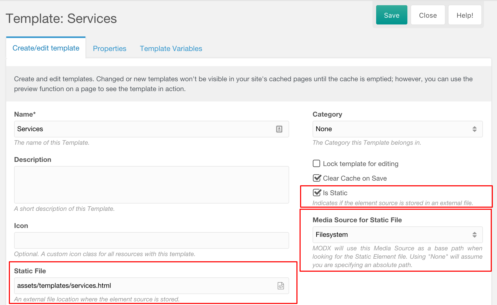

A Template, Template Variable, Chunk, Snippet, or Plugin can take its source from a file. Saving the element in the Manager writes that file.

## Creating a static element

Check **Is Static**, choose a **Media Source**, and put the file path in **Static File**. The path is relative to that media source.

The folder icon in **Static File** opens the browser only when the media source is a file source. With **(None)**, the field is plain text. Type the path yourself.

The same fields are on every element type.

### Media source (None)

Choose **(None)** in **Media Source** when you want to type a path yourself.

An absolute path is used as written when that file already exists. If the file is not there yet, MODX creates it under the system setting `element_static_path`. That setting is not included with MODX. Create it, or new files go in `core/components/`.

`static_elements_basepath` is not that folder. It is the prefix written into **Static File** when automatic paths are on.

## Files and the database

MODX still keeps a copy of the source in the database. A cached Chunk or Template inside a cached Resource keeps the old source until you clear the cache or call the element uncached (`[[!$name]]`). A Snippet or Plugin that actually runs picks up a newer file by its modification time. Plugins are not cached.

Some extras create the element for you, or clear the cache. This page does not name them.

## Automatic static files

The Manager can mark the element static and fill in **Static File** for you.

Open **Admin** → **System Settings** and filter by **Static Elements**.

1. Turn on `static_elements_automate_templates`, `static_elements_automate_tvs`, `static_elements_automate_chunks`, `static_elements_automate_snippets`, or `static_elements_automate_plugins` for the types you want.
2. Set `static_elements_default_mediasource` to the media source id you want on new elements.
3. Set `static_elements_basepath` to the prefix inside that media source, for example `components/static/elements/`. With **(None)**, do not start this prefix with `components/` or the new file is created under `core/components/components/`.
4. Optionally set `static_elements_default_category`.

### Where the file is written

The path is `{basepath}/{type}/{category}/{name}{suffix}`.

The name and the category are lowercased, and spaces become `-`. A `--` in the category becomes `/`.

| Type | Suffix |
| --- | --- |
| templates | `.template` plus `static_elements_html_extension` (default `.tpl`) |
| tvs | `.tv` plus the same extension |
| chunks | `.chunk` plus the same extension |
| snippets | `.snippet.php` |
| plugins | `.plugin.php` |

`static_elements_html_extension` is not added to Snippets or Plugins.

A Chunk named `my-footer` in the category `html`, with base path `components/site/elements/` and a file media source, is stored as `components/site/elements/chunks/html/my-footer.chunk.tpl`.

### When the file is deleted

With automation on for that type, saving a new path removes the previous file. Deleting the element removes the file only when automation is on and the media source is a file source. With **(None)**, the file stays on disk. Delete it yourself. If another element uses the same static file, the file is kept.

After you drag the element to another category, the file can land in a different folder than the form would use. Open the element and save it so the Manager recalculates the path.

## Static element settings

| Setting | Default | What it does |
| --- | --- | --- |
| `static_elements_automate_templates` | `false` | Fill in a static file for new Templates. |
| `static_elements_automate_tvs` | `false` | Fill in a static file for new Template Variables. |
| `static_elements_automate_chunks` | `false` | Fill in a static file for new Chunks. |
| `static_elements_automate_snippets` | `false` | Fill in a static file for new Snippets. |
| `static_elements_automate_plugins` | `false` | Fill in a static file for new Plugins. |
| `static_elements_default_mediasource` | `0` | Media source id written on a new automatic element. |
| `static_elements_default_category` | `0` | Category id written on a new automatic element. |
| `static_elements_basepath` | `''` | Prefix written into **Static File**, inside the chosen media source. |
| `static_elements_html_extension` | `.tpl` | Extension after `.template`, `.tv`, and `.chunk`. |
