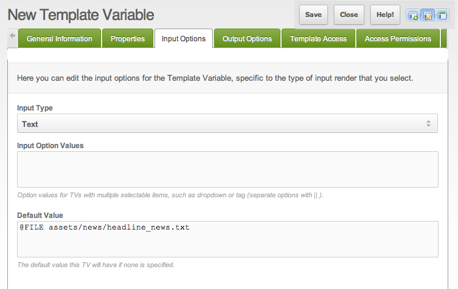

## What is the @FILE Binding?

The @FILE Binding returns the contents of any specified file.

## Syntax

``` php
@FILE file_path
```

Binds the variable to a file. MODX opens the path exactly as you write it. It does not add the site root the way `@DIRECTORY` does. A path such as `assets/news/headline_news.txt` works only when that path exists as written. If the file cannot be opened, the TV outputs ` Could not retrieve document '…'.`, with a space before `Could`.

The file may use `||` and `==` as separators between values.

## Usage

Create a Template Variable and put `@FILE` in **Default Value**, pointing at the file:

> @FILE assets/news/headline\_news.txt

The binding returns the file as one string. A newline in the file stays a newline. The Delimiter output type splits that string on `||`.




## See Also

- [Template Variables](building-sites/elements/template-variables "Template Variables")
- [Bindings](building-sites/elements/template-variables/bindings "Bindings")