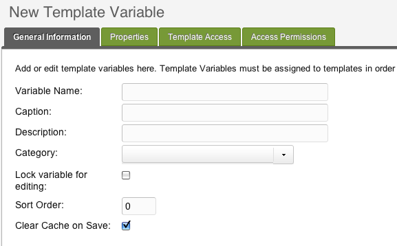
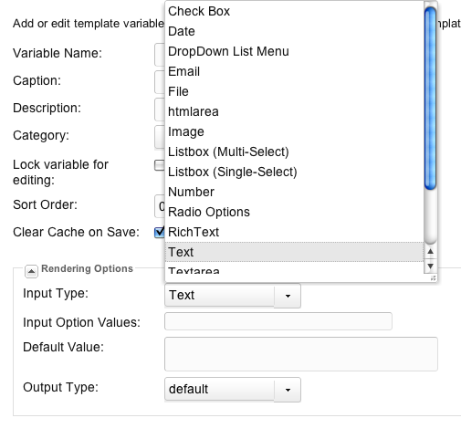
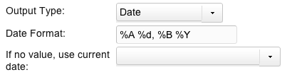

This page defines a Template Variable. What a TV is: [Template Variables](building-sites/elements/template-variables "Template Variables").

## Explanation

"Create a Template Variable" can mean two things:

- type a value into a custom field while you edit a Resource
- define that field so Resources can use it

This page is the second one. The definition is the blueprint. Each Resource then stores its own value.

## Creating the Template Variable

### 1. Log into the MODX manager

Log in to the Manager as an Administrator, or as a user with the same access.

### 2. Add the Template Variable

 On the left-hand resource-tree pane, click on the **Elements** tab


### 3. Define the General Information

When we define a TV, we have to define a lot of information about the behavior of this custom field. The "General Information" tab contains the basic information for this variable.



- **Name**: the placeholder in your templates, for example **bio** = `[[*bio]]`. The name must be unique.

> [!WARNING]
> **Name** cannot match a Resource field. MODX rejects `id`, `type`, `pagetitle`, `longtitle`, `description`, `alias`, `alias_visible`, `link_attributes`, `published`, `pub_date`, `unpub_date`, `parent`, `isfolder`, `introtext`, `content`, `richtext`, `template`, `menuindex`, `searchable`, `cacheable`, `createdby`, `createdon`, `editedby`, `editedon`, `deleted`, `deletedby`, `deletedon`, `publishedon`, `publishedby`, `menutitle`, `content_dispo`, `hidemenu`, `class_key`, `context_key`, `content_type`, `uri`, `uri_override`, `hide_children_in_tree`, `show_in_tree`, and `properties`.

- **Caption**: This is the primary label for your variable that appears when you edit a resource that uses this TV
- **Description**: This is the secondary label for your variable
- **Category**: This affects which sub-tab the variable appears on
- **Sort Order**: If you're using more than one TV, this will determine which appear at the top (1 = top, bigger numbers sink to the bottom)


The name should be unique. The picture shows the same fields on the Resource.

### 4. Define the Input Options

Open the **Input Options** tab and choose the field: text, a dropdown, a rich text editor, and so on. The full list is [Template Variable Input Types](building-sites/elements/template-variables/input-types "Template Variable Input Types").

- **Input Type**: Your field might be a simple text field, a dropdown, a reference to another page, or many other types of field.
- **Input Options**: Some Input Types ignore this field, but others may require it. E.g. a dropdown list requires a list of possible values. Again, see the page on [Template Variable Input Types](building-sites/elements/template-variables/input-types "Template Variable Input Types") for more info.
- **Default**: this affects what the default value for the field will be. This can be a simple value, or it can utilize one of the MODX [Bindings](building-sites/elements/template-variables/bindings "Bindings") to do things like select a value from the database or inherit a value from a parent page.

 

### 5. Configure Template Access

 Click the **Template Access** tab: you must define which template(s) will actually use this custom field that you've defined – once you've defined this custom field, you can choose which template(s) can actually use it.

 Any time you create a Resource that uses a template to which a TV has been attached, the TV will be available for editing. **Make sure you attached the TV to at least one template.**

### 6. Save the TV definition

 When you edit a page that uses a template associated to this TV, you'll be able to add data to that TV field.

### 7. Use it: Create a Resource

 Now that you've defined your TV and added it to a Template, create a Resource. Right-click in the Resource tree and choose **Create** → **Document**. Select a Template that uses this TV.

### 8. Edit the Value

When the Resource uses the Template that contains this TV, open the Resource's **Template Variables** tab and fill in the field.

## Output Rendering Options

Choose an output type, for example Date. Extra fields appear under that choice. Which fields appear depends on the output type:

 

Those fields are the options for that output type.

## Properties

A TV can have default properties. A textarea TV named `viewingSS` might contain:

``` php
Viewing: [[+subsection]]
```

Add a property `subsection` on the grid. A property set can override it. Create a property set `CarsSectionTVPS`, set `subsection` to `Cars`, and attach the set where the TV is used:

``` php
[[*viewingSS@CarsSectionTVPS]]
```

The TV then prints:

> Viewing: Cars

## Template and Resource Group Access

Assign the TV to a [Template](building-sites/elements/templates "Templates"). Resources that use that Template can then edit the TV.

Restrict the TV to Resource Groups in the **Access Permissions** grid.

## See Also

1. [Creating a Template Variable](building-sites/elements/template-variables/step-by-step)
2. [Bindings](building-sites/elements/template-variables/bindings)
   1. [CHUNK Binding](building-sites/elements/template-variables/bindings/chunk-binding)
   2. [DIRECTORY Binding](building-sites/elements/template-variables/bindings/directory-binding)
   3. [FILE Binding](building-sites/elements/template-variables/bindings/file-binding)
   4. [INHERIT Binding](building-sites/elements/template-variables/bindings/inherit-binding)
   5. [RESOURCE Binding](building-sites/elements/template-variables/bindings/resource-binding)
   6. [SELECT Binding](building-sites/elements/template-variables/bindings/select-binding)
3. [Template Variable Input Types](building-sites/elements/template-variables/input-types)
4. [Template Variable Output Types](building-sites/elements/template-variables/output-types)
   1. [Date TV Output Type](building-sites/elements/template-variables/output-types/date)
   2. [Delimiter TV Output Type](building-sites/elements/template-variables/output-types/delimiter)
   3. [HTML Tag TV Output Type](building-sites/elements/template-variables/output-types/html)
   4. [Image TV Output Type](building-sites/elements/template-variables/output-types/image)
   5. [URL TV Output Type](building-sites/elements/template-variables/output-types/url)
5. [Adding a Custom TV Type - MODX 2.2](extending-modx/custom-tvs)
6. [Creating a multi-select box for related pages in your template](building-sites/tutorials/multiselect-related-pages)
7. [Accessing Template Variable Values via the API](extending-modx/snippets/accessing-tvs)
