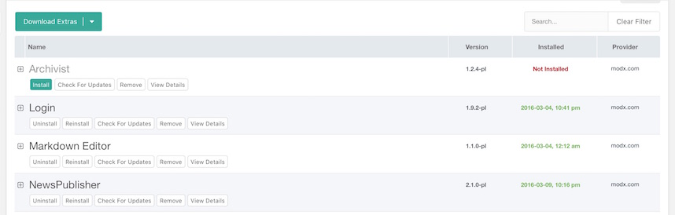

Package Management installs, updates and removes transport packages. A package is a zip archive with a component's code and data.

## Where the Page Is

Open **Extras** in the top menu, then **Installer**. The page has two tabs: **Packages** and **Providers**.

Without the cURL extension you see a warning above the page. MODX replaces **Download Extras** with **Search Locally for Packages**. See [cURL Is Missing](building-sites/extras/troubleshooting#curl-is-missing).

## Downloading a Package

**Download Extras** opens the Package Browser. The provider's categories are on the left, packages on the right. **Download** in a row saves that package into `core/packages/`.

The arrow beside **Download Extras** opens a menu:

- **Select a Provider** chooses the provider to download from.
- **Search Locally for Packages** looks for archives in `core/packages/`.
- **Upload a package** sends an archive into `core/packages/` from your computer.

## Package Actions

MODX sets the row's buttons when the list loads.

| Action | When it is there |
| --- | --- |
| **Install** | the package is not installed yet |
| **Uninstall** | the package is installed |
| **Reinstall** | the package is installed. The button runs the installation again |
| **Update** | `auto_check_pkg_updates` is on and the provider has a newer version |
| **Check For Updates** | the package came from a provider, and the row does not show **Update** |
| **Remove** | on every row |
| **View Details** | on every row |

**Purge Old Packages** sits above the list. It removes earlier versions that already have an install date, except the version with the latest install date. Versions you downloaded and never installed stay.

## Installing a Package

**Install** in a row on the **Packages** tab installs the package. A panel opens first, with the tabs the package includes: **Changelog**, **Dependencies**, **Readme** and **License**. MODX shows the **Changelog**, **Readme** and **License** text as formatted text.

When the package has setup options, the panel shows **Setup Options**. MODX asks for those options in the **Setup Options** window. The installation then runs in the **Console** and reports each step.

A package that needs other packages shows **Dependencies** on the same panel. See [Dependencies](#dependencies).

## Installing a Package From an Archive

You can install a package from an archive on the server, with no provider:

1. Put `<signature>.transport.zip` into `core/packages/`.
2. Choose **Search Locally for Packages**.
3. The archive appears in the list. Install it as usual.

PHP needs write access to `core/packages/`.

**Upload a package**, in the same menu, accepts a zip only when the name ends with `.transport.zip`. It asks for the file and puts it into `core/packages/`.

## Updating a Package

When the list loads and `auto_check_pkg_updates` is on, MODX asks the provider for a newer version. The row shows **Update** when the provider has a newer version. Otherwise a package from a provider shows **Check For Updates**.

**Update** and **Check For Updates** open a window with the versions the provider returned. You install the newer version from that window. If the provider returned no versions, the window stays closed and the manager says the package is already up to date.

## Uninstalling a Package

**Uninstall** opens the window **Uninstall Package**. Pick one mode:

| Mode | What the window says |
| --- | --- |
| **Preserve** | uninstalls the newer version, keeps the prior one, and keeps new settings and values the component added |
| **Uninstall** | uninstalls all versions of the package. They stay in the list and can be installed again |
| **Restore** | restores the prior version's settings as they were before the newer version was installed |

## Removing a Package

**Remove** uninstalls the package first, so its elements are removed. MODX then deletes the archive `core/packages/<signature>.transport.zip`, the directory `core/packages/<signature>/` and the package record.

The window title is **Delete Package**. **Force Package Removal** deletes the record even when the uninstall failed.

## Package Card

**View Details** opens the card: the **Signature**, the **Provider**, the dates, the **Changelog**, the **Readme** and the **License**.

The **Packages** list shows a package's newest version. Older versions are on the card's **Uploaded Versions** tab, and you can delete a version there.

## Dependencies

Before installation, the panel lists requirements on the **Dependencies** tab. While a dependency is not installed, the buttons that continue the installation stay inactive. Their label is **Install all dependencies to continue**. Use **Download** and **Install** on that tab's rows.

A PHP or MODX requirement has no **Download** or **Install** button.

See [Package Dependencies](extending-modx/transport-packages/dependencies) for how a package declares its dependencies.

## Settings

| Setting | Default | What it does |
| --- | --- | --- |
| [auto_check_pkg_updates](building-sites/settings/auto_check_pkg_updates) | **Yes** | When the list loads, a package from a provider shows **Update** if this is **Yes** and the provider has a newer version. Otherwise that package shows **Check For Updates** |
| [auto_check_pkg_updates_cache_expire](building-sites/settings/auto_check_pkg_updates_cache_expire) | 15 minutes | how long the result of that check is kept |
| [archive_with](building-sites/settings/archive_with) | **No** | **Yes** makes MODX unpack the archive with its own means, without the PHP Zip extension |

## See Also

1. [Providers](building-sites/extras/providers)
2. [Troubleshooting Package Management](building-sites/extras/troubleshooting)
3. [Transport Packages](extending-modx/transport-packages)
