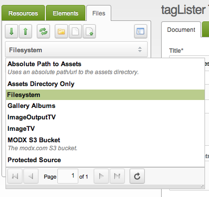

## What are Media Sources?

A Media Source tells MODX where to read and write media files. It appears in three places:

- the Files tree on the left;
- the MODX.Browser window;
- the image and file TVs.

## Source Types

Every Media Source has a Source Type that decides where the files live. MODX ships three of them:

| Source Type | Where the files are |
| --- | --- |
| [File System](building-sites/media-sources/types/media-source-type-file-system "Media Source Type - File System") | A directory on the server that runs MODX |
| [FTP](building-sites/media-sources/types/media-source-type-ftp "Media Source Type - FTP") | A remote server reached over FTP |
| [Amazon S3](building-sites/media-sources/types/media-source-type-s3 "Media Source Type - S3") | An S3 bucket |

Packages add more Source Types, and so does your own code. See [Extending Media Sources](building-sites/media-sources/extending "Extending Media Sources").

## See Also

1. [Media Sources](building-sites/media-sources)
2. [Adding a Media Source](building-sites/media-sources/creating)
3. [Assigning Media Sources to TVs](building-sites/media-sources/assigning-to-tvs)
4. [Securing a Media Source](building-sites/media-sources/securing)
   1. [Creating a Client Media Source](building-sites/media-sources/securing/clients-tutorial)
5. [Media Source Types](building-sites/media-sources/types)
   1. [Media Source Type - File System](building-sites/media-sources/types/media-source-type-file-system)
   2. [Media Source Type - FTP](building-sites/media-sources/types/media-source-type-ftp)
   3. [Media Source Type - S3](building-sites/media-sources/types/media-source-type-s3)
6. [Extending Media Sources](building-sites/media-sources/extending)
