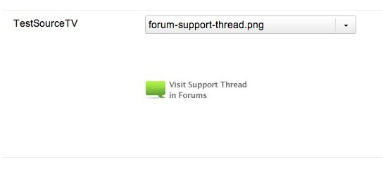

Create the source first: [Adding a Media Source](building-sites/media-sources/creating "Adding a Media Source").

## Which TVs Use Sources

Only TVs with the `image` or the `file` input type open the file browser of a source. The other input types store a plain value.

The `manipulatable_url_tv_output_types` setting holds a separate list of TV types. When such a TV is rendered on a page, its value gets the `baseUrl` of the source in front of it. The list defaults to `image,file`.

## Assigning a Source to a TV

Create the TV first, then save it. The edit page of the TV has a **Media Sources** tab. It lists the Contexts of the installation and the source assigned to each of them.

A TV can use a different source in every Context. The source of the Context that the Resource belongs to is the one that opens.

1. Create a TV called `TestSourceTV` and save it.
2. Open the **Media Sources** tab and assign the source to the Contexts you need.
3. Set the input type of the TV to `image` on the **Options** tab.
4. Assign the TV to a Template and save.

## Limiting a Source to a Folder

A source usually points at one directory, so that the users of the TV pick files from that directory and nowhere else. Set it on the source itself:

1. Create the source under **Media → Media Sources**.
2. Open the source for editing.
3. Set the properties:

| Property | Value |
| --- | --- |
| `basePath` | `assets/images/` |
| `baseUrl` | `assets/images/` |

Leave `basePathRelative` and `baseUrlRelative` on. They are on by default, and they tell MODX that the path and the address are relative to the install directory.

**Write the path without a leading slash and with a trailing one**
MODX does not check either end of the value, and a path that starts with a slash is no longer relative to the install directory.

## Editing the TV

Open the TV in a Resource and the source shows up in the field:

Opening the list loads the MODX.Browser window with the source you assigned. The browser shows the contents of `assets/` and nothing else.

Access to the source decides who may use it. See [Securing a Media Source](building-sites/media-sources/securing "Securing a Media Source") for the rules.

## See Also

1. [Media Sources](building-sites/media-sources)
2. [Adding a Media Source](building-sites/media-sources/creating)
3. [Assigning Media Sources to TVs](building-sites/media-sources/assigning-to-tvs)
4. [Securing a Media Source](building-sites/media-sources/securing)
   1. [Creating a Client Media Source](building-sites/media-sources/securing/clients-tutorial)
5. [Media Source Types](building-sites/media-sources/types)
   1. [Media Source Type - File System](building-sites/media-sources/types/media-source-type-file-system)
   2. [Media Source Type - FTP](building-sites/media-sources/types/media-source-type-ftp)
   3. [Media Source Type - S3](building-sites/media-sources/types/media-source-type-s3)
6. [Extending Media Sources](building-sites/media-sources/extending)
