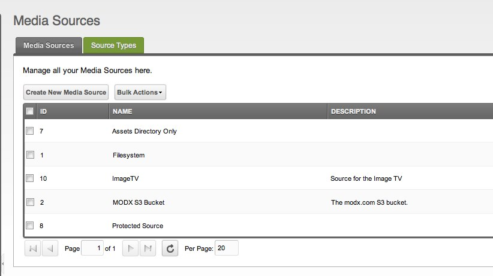
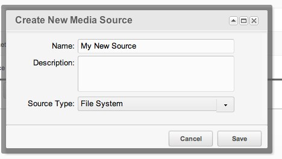

## Creating the Media Source

Media Sources live under **Media → Media Sources**. The page opens with a grid of the sources in the installation.

A Media Source has a name, a description and a Source Type. The type decides where the files live — the list of types is on [Media Source Types](building-sites/media-sources/types "Media Source Types").

Click **Create** to open the dialog:

1. Give the source a name.
2. Pick the **File System** type.
3. Save the source.

For an Amazon S3 bucket, read [Media Source Type - S3](building-sites/media-sources/types/media-source-type-s3 "Media Source Type - S3") first.

## Editing the Source

Click the name of the source in the grid, or right-click it and choose **Edit**. The edit page has two tabs: the first holds the name, the description, the type and the properties of the type, the second is **Access Permissions**.

For a File System source, set `basePath` to `assets/` and `baseUrl` to `assets/` as well. Save the source.

**Properties are not asked in the Create dialog**
The Create dialog takes only the name, the description and the type. The properties appear on the edit page, once the source exists.

## Properties

Every type has its own set of properties, and the page of the type lists them: [File System](building-sites/media-sources/types/media-source-type-file-system "Media Source Type - File System"), [FTP](building-sites/media-sources/types/media-source-type-ftp "Media Source Type - FTP"), [Amazon S3](building-sites/media-sources/types/media-source-type-s3 "Media Source Type - S3").

## The Protected "Filesystem" Source

The installation ships a source named **Filesystem**. Its name and its type cannot be changed, and it cannot be deleted. Its properties and the User Groups assigned to it stay editable.

## Settings That Point at a Source

| Setting | Default | What it does |
| --- | --- | --- |
| `default_media_source` | `1` | The source used when nothing else is chosen. |
| `default_media_source_type` | `MODX\Revolution\Sources\modFileMediaSource` | The type offered first in the Create dialog. |
| `photo_profile_source` | empty | The source the avatars of users are taken from. |
| `mgr_source_icon` | `icon-folder-open-o` | The icon of a source in the Files tree. |

## Upload Limits

| Setting | Default | What it does |
| --- | --- | --- |
| `upload_file_exists` | `true` | When on, an upload of a file that already exists ends with an error. When off, the existing file is replaced. |
| `upload_maxsize` | `1048576` | The largest file that may be uploaded, in bytes. |
| `upload_translit` | `true` | Whether the name of an uploaded file is transliterated. |
| `upload_translit_restrict_chars_pattern` | `/[\0\x0B\t\n\r\f\a&=+%#<>"~:`@\?\[\]\{\}\|\^'\\\\]/` | The characters removed from the name. |

## Using the Source

The source appears in the source list of the Files tree on the left. Select it and the tree shows the contents of the `assets/` directory, and nothing else. If the installation has no `assets/` directory yet, create it.

A TV picks the source up from its **Media Sources** tab. Read [Assigning Media Sources to TVs](building-sites/media-sources/assigning-to-tvs "Assigning Media Sources to TVs") to learn how.

## See Also

1. [Media Sources](building-sites/media-sources)
2. [Adding a Media Source](building-sites/media-sources/creating)
3. [Assigning Media Sources to TVs](building-sites/media-sources/assigning-to-tvs)
4. [Securing a Media Source](building-sites/media-sources/securing)
   1. [Creating a Client Media Source](building-sites/media-sources/securing/clients-tutorial)
5. [Media Source Types](building-sites/media-sources/types)
   1. [Media Source Type - File System](building-sites/media-sources/types/media-source-type-file-system)
   2. [Media Source Type - FTP](building-sites/media-sources/types/media-source-type-ftp)
   3. [Media Source Type - S3](building-sites/media-sources/types/media-source-type-s3)
6. [Extending Media Sources](building-sites/media-sources/extending)
