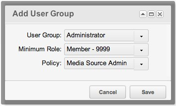

Create the source first: [Adding a Media Source](building-sites/media-sources/creating "Adding a Media Source").

## How a Source Is Secured

A source is secured with the Access Policies of MODX. On the **Access Permissions** tab of the source you attach a policy to a User Group. That policy decides what the members of the group may do with the source.

A source without a User Group attached is open: any user may use it, edit it and see it.

## The Two Core Policies

MODX ships two policies for sources:

| Policy | Criteria |
| --- | --- |
| Media Source Admin | `create`, `copy`, `load`, `list`, `save`, `remove`, `view` |
| Media Source User | `load`, `list`, `view` |

The `load` criterion is granted to every source, so only `list` and `view` of the **Media Source User** policy have an effect.

## Locking a Source to a User Group

Open the source for editing and go to the **Access Permissions** tab. The grid is empty at first. Click **Add User Group** to open the window:

Pick the User Group, the minimum role, and the policy.

**Media Source Admin** gives full access: creating, duplicating, viewing, editing, removing and listing the source. Save the source.

**Media Source User** is enough for a group that needs the files only. Add a second row to the grid, this time for the **Content Editors** group with that policy:

Save the source. The members of the group now see the source in the Files tree, may assign it to TVs and may pick files from it. They may not change the source itself.

A user who belongs to none of the User Groups of the source sees the value of a TV that uses it as plain text. Such a user cannot change the value.

Open the user menu and choose **Access → Logout All Users**, then log in again. The attributes of a user are cached in the session, so the new policy reaches the users only after that.

## The Policy Governs the Source and Its Files

The criteria of the policy apply to the source itself and to the files it holds:

| Criterion | The source | The files and folders |
| --- | --- | --- |
| `list` | — | Browse the folders and see the files |
| `view` | — | Open and download a file, unpack an archive |
| `create` | — | Create a file or a folder, upload files |
| `save` | Edit the source | Rename a file or a folder, write to a file, change the visibility |
| `remove` | Delete the source | Delete a file or a folder |
| `copy` | Duplicate the source | — |

The **Media Source User** policy has no `create` criterion, so a content editor cannot upload files or create folders in the source.

## Global Permissions

The policy of the source works together with the global permissions of the manager. A user needs both: the global permission for the action, and the criterion of the source in its policy.

| Action | Global permission | Criterion of the source |
| --- | --- | --- |
| Browse the folders and the files | `file_list`, `directory_list` | `list` |
| Open and download a file | `file_view` | `view` |
| Unpack an archive | `file_unpack` | `view` |
| Create a file | `file_create` | `create` |
| Upload files | `file_upload` | `create` |
| Create a folder | `directory_create` | `create` |
| Rename a file, write to a file | `file_update` | `save` |
| Rename a folder | `directory_update` | `save` |
| Delete a file | `file_remove` | `remove` |
| Delete a folder | `directory_remove` | `remove` |
| Change the visibility | `directory_chmod` | `save` |

The work with the sources themselves needs these global permissions:

| Permission | What it opens |
| --- | --- |
| `sources` | The **Media Sources** item of the menu. |
| `source_view` | The grid of sources. |
| `source_save` | Creating a source and saving one. |
| `source_edit` | Editing a source. |
| `source_delete` | Deleting a source. |

## Turning the Check Off

The `access_media_source_enabled` setting turns the check of the source policies off completely. It is on by default. The core does not ship it among the system settings, so a site that needs it creates a setting with that key.

## See Also

1. [Media Sources](building-sites/media-sources)
2. [Adding a Media Source](building-sites/media-sources/creating)
3. [Assigning Media Sources to TVs](building-sites/media-sources/assigning-to-tvs)
4. [Securing a Media Source](building-sites/media-sources/securing)
   1. [Creating a Client Media Source](building-sites/media-sources/securing/clients-tutorial)
5. [Media Source Types](building-sites/media-sources/types)
   1. [Media Source Type - File System](building-sites/media-sources/types/media-source-type-file-system)
   2. [Media Source Type - FTP](building-sites/media-sources/types/media-source-type-ftp)
   3. [Media Source Type - S3](building-sites/media-sources/types/media-source-type-s3)
6. [Extending Media Sources](building-sites/media-sources/extending)
