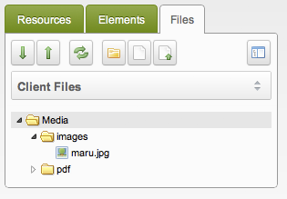

## What the Tutorial Does

This tutorial sets up a second source that your clients use. The files of the site stay out of their file manager, and they get a directory of their own.

Do it before the clients upload anything. For an installation that is already in use, read [Troubleshooting: Existing Installs](#troubleshooting-existing-installs) first.

By default the file manager looks like this:

With a separate source for the clients, it looks like this:

## Step 1: Create a Directory Structure

Make a folder `files` in `/assets/`, and inside it two more: `pdf` and `images`. The files of the clients go into these two folders.

You do not have to set the rights of the folders yourself. The core writes new files with `0644` and new folders with `0755`, and a site can change that with the `new_file_permissions` and `new_folder_permissions` system settings.

Your source should look like this:

## Step 2: Hide the Filesystem Source

1. Go to **Media → Media Sources**.
2. Open the **Filesystem** source for editing.
3. Go to the **Access Permissions** tab.
4. Click **Add User Group**.
5. Pick the **Administrator** group, the **Member** role, and the **Media Source Admin** policy. Every member of the group may then add and remove media sources.

    Keep the clients in another group. If the clients are in the administrator group, set the minimum role to **Super User**, and only the users with that role reach the source.
6. Click **Done**, then save the source.

A client that logs in now sees no files at all.

## Step 3: Add the Client Files Source

1. Go to **Media → Media Sources**.
2. Click **Create**.
3. Name the source `Client Files`, keep the **File System** type, and save it.
4. Open the source for editing and set `basePath` to `assets/files/` and `baseUrl` to `assets/files/`.
5. Save the source.

`basePath` tells MODX where on the server to look, `baseUrl` tells MODX where on the web to look. Leave `basePathRelative` and `baseUrlRelative` on, so that both values stay relative to the installation. A site that uses a different domain per context may need absolute values.

The clients can log in now, but the file manager still starts with the source they have no access to. They can switch to theirs, but that confuses them.

## Step 4: Set the Default Media Source

1. Open the user menu and choose **Admin → System Settings**.
2. Filter by area and pick **Back-end Manager**.
3. Find the **Default Media Source** setting and change it from **Filesystem** to **Client Files**.
4. Wait for MODX to save the setting.

The clients now see **Client Files** as the default source and use it as usual. Every new image or file TV points at the same place.

## Troubleshooting: Existing Installs

A site that already has TVs and uploaded images needs the paths updated after you have gone through Steps 1–4:

1. Move the files to the new location. The path relative to the source stays the same.
2. Change the TVs to the new source.

## See Also

1. [Media Sources](building-sites/media-sources)
2. [Adding a Media Source](building-sites/media-sources/creating)
3. [Assigning Media Sources to TVs](building-sites/media-sources/assigning-to-tvs)
4. [Securing a Media Source](building-sites/media-sources/securing)
   1. [Creating a Client Media Source](building-sites/media-sources/securing/clients-tutorial)
5. [Media Source Types](building-sites/media-sources/types)
   1. [Media Source Type - File System](building-sites/media-sources/types/media-source-type-file-system)
   2. [Media Source Type - FTP](building-sites/media-sources/types/media-source-type-ftp)
   3. [Media Source Type - S3](building-sites/media-sources/types/media-source-type-s3)
6. [Extending Media Sources](building-sites/media-sources/extending)
