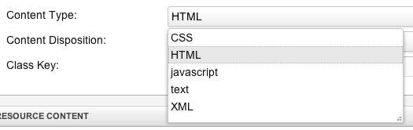
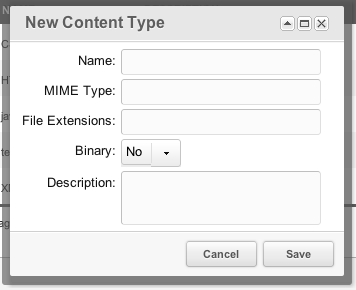

## What are Content Types?

A Content Type maps Resources to a MIME type and one or more file extensions. MODX uses it to build the Resource URI and to send the `Content-Type` header.

With Friendly URLs, MODX appends the first file extension of the Content Type to the Resource alias. A [Resource](building-sites/resources) with the alias `test` and the CSS Content Type renders as:

> test.css

instead of `test.html`. This lets you serve CSS, XML, JSON, and other files from Resources.

## Usage

When editing a Resource, open the **Settings** tab and select the Content Type:



Save the Resource to apply the type.

### Creating New Content Types

Go to **Content > Content Types** and click **New Content Type**:




- **Name** — the label in the manager. It does not affect output.
- **MIME Type** — the `Content-Type` sent to the browser, such as `text/css`.
- **File Extensions** — the extensions for this type, including the dot (`.css`). Separate several with commas: `.html,.htm`. MODX uses the first extension when it builds the URI.
- **Icon** — an optional CSS class for the Resource tree icon (MODX 3.0+), such as `icon-css`, `icon-json`, `icon-pdf`, `icon-home`, or `fa-home`.
- **Binary** — whether the file is binary. Binary types are sent as-is; text types receive a charset.
- **Description** — an optional note for manager users.
- **Custom headers** — complete HTTP header lines, one per row. See below.

Click **Save** to add the type to the grid.

### Custom headers

The **Custom headers** tab holds complete header lines, for example:

```text
X-Frame-Options: DENY
```

MODX sends these headers with every Resource that uses the Content Type. For binary Static Resources, the headers are sent before the file is streamed.

### Protected Content Types

MODX ships eight protected types:

- HTML
- XML
- Text
- CSS
- JavaScript
- RSS
- JSON
- PDF

The manager does not offer **Delete** for a protected type. Its name, MIME type, and description are read-only, while the icon and file extensions can still change. Creating, editing, or deleting a Content Type requires the `content_types` permission.

### Resource tree icons

MODX adds every applicable icon class to the Resource tree node. This includes the Content Type icon, the Template Manager Icon Class, and the type and default classes. All classes are returned, so the theme CSS decides which one is visible.

When neither the Content Type nor the Template sets an icon, MODX uses `mgr_tree_icon_{classKey}` — for example `tree-resource` for a Document. Weblinks, Symlinks, and Static Resources have their own defaults.

Core Content Types ship with icons for non-HTML MIME types: `icon-xml`, `icon-css`, `icon-js`, `icon-json`, `icon-pdf`, and similar. HTML usually has an empty Icon, so the normal document or folder icon remains.

You can edit the Icon inline in the Content Types grid or in the create/update window. See [Templates](building-sites/elements/templates) for the Template Manager Icon Class field.

## See Also

- [Resources](building-sites/resources)
- [Static Resource](building-sites/resources/static-resource)
