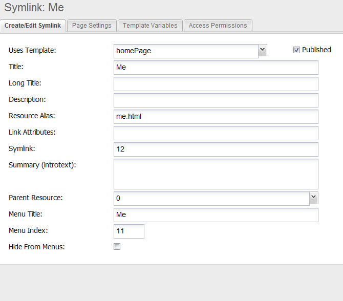

## Understanding a Symlink

A Symlink forwards a request to another Resource and returns that Resource's output at the Symlink's own URL. It does not copy the content and does not send an HTTP redirect. Each Symlink has its own URL and can sit anywhere in the tree.

Use it to keep an old URL working, to show one Resource in several places, or to shorten a deep URL.

A MODX Symlink is not a filesystem symlink. It only forwards requests inside MODX.

## Creating a Symlink

1. Create a Resource and choose the **Symlink** type, or use **Create Symlink** in the Resource tree.
2. Enter a title and alias.
3. Set the Symlink content to the ID of the target Resource.
4. Save, then clear the site cache and the document cache if the target does not appear.

The target must be a Resource ID. A URL or alias does not work; use a [Weblink](building-sites/resources/weblink) for external addresses.

## Field merging

When [`symlink_merge_fields`](building-sites/settings/symlink_merge_fields) is enabled (the default), non-empty fields on the Symlink override the target's fields during the forward. This lets a Symlink use its own Template, menu title, or other values while showing the target's content.

Some fields never merge:

| Field | Why |
| --- | --- |
| `content` | Always the target Resource ID. |
| `pub_date`, `unpub_date` | Publishing dates belong to the target. |
| `richtext` | The target's editor setting stays in effect. |
| `_content`, `_processed` | Internal runtime values. |

The default [`forward_merge_excludes`](building-sites/settings/forward_merge_excludes) list also protects `type`, `published`, and `class_key`. Add comma-separated field names to that setting to protect more fields.

When `symlink_merge_fields` is off, MODX uses the target's fields and ignores the Symlink's overrides, except for the URL and the target ID.

## SEO

The Symlink URL returns 200 and shows the target content. Search engines can index both URLs as duplicate content. Add a canonical tag to the Symlink Template when both URLs should not compete. When the old URL should permanently move, use a [Weblink](building-sites/resources/weblink) with a 301.

## Example

The Symlink serves the content of the college degrees Resource at `me.html`.

## See Also

1. [Content Types](building-sites/resources/content-types)
2. [Named Anchor](building-sites/integrating-templates/named-anchor)
3. [Static Resource](building-sites/resources/static-resource)
4. [Symlink](building-sites/resources/symlink)
5. [Weblink](building-sites/resources/weblink)
