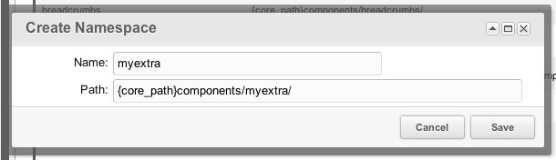
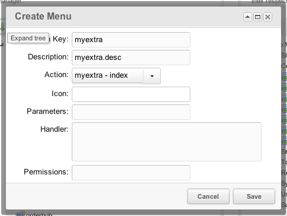

## What is a CMP?

A CMP (Custom Manager Page) is a custom page that loads in the MODX manager. It may also be called a Component or 3PC (3rd Party Component). CMPs are usually reached from the Extras menu, but you can place them anywhere.

This page covers the minimum setup. To build a full extra with a component, follow the [Developing an Extra for MODX Revolution tutorial](extending-modx/tutorials/developing-an-extra) — it walks through every step and the terminology on an example package called doodles.

## Namespaces

CMPs need a Namespace so MODX knows where to load the files from.

To create a Namespace:

1. Go to Admin -> Namespaces and click Create New.
2. Give it a lowercase name.
3. Set the core path, for example `/path/to/core/components/awesomestuff/`.
4. Set the assets path, for example `/path/to/assets/components/awesomestuff/`. It is stored with the namespace and passed to the manager JS config, so set it now.

It is best practice to place files in a directory with the same name as your namespace, under `core/components` and `assets/components`.



(NOTE: This image is outdated)

Paths can use placeholders, resolved when MODX loads files from your namespace:

- {core\_path} - the **MODX\_CORE\_PATH** variable: the absolute path to the core directory of your MODX installation, for example _/home/username/public\_html/modx\_location/core/_
- {base\_path} - the **MODX\_BASE\_PATH** variable: the absolute path to the root of the MODX installation, typically something like _/home/username/public\_html/modx\_location/_
- {assets\_path} - the **MODX\_ASSETS\_PATH** variable: the absolute path to the assets directory of your MODX installation.

## Using modMenu

To point the user to your CMP, add a menu item (modMenu). A menu item holds the text to display and an action that matches a controller.

Go to Admin > Menus and create a new menu item. Select the parent menu item, typically "Extras", and fill in the fields:

- Lexicon Key: a lexicon key, or the title to show. For distributed packages, put text in lexicons so it can be translated; the key must be in the default topic of your namespace.
- Description: the text under the menu item. Can also be a lexicon key.
- Action: the name of the controller. Enter "index" for now; the controller comes next.
- Icon: used only for top-level menu items on a narrow viewport.
- Parameters: not needed here. To pass extra URL parameters, specify "&foo=bar".
- Namespace: your namespace. Required so the action routes to the right path.
- Handler: instead of loading an action, a menu item can run a snippet of JavaScript on click. Leave empty for now.
- Permissions: only allow access if the user has these permissions.



(Note: image is outdated)

Save and refresh the page. The menu item appears, but it does not work yet — the controllers are missing.

## Adding a base Controller

To make the page work, add its controllers. The menu item's action is "index", so create the index controller first — it is the entry point for the other controllers.

Create `core/components/namespace/index.class.php` with the following contents:

``` php
<?php
/**
 * The abstract Manager Controller.
 * In this class, we define stuff we want on all of our controllers.
 */
abstract class NamespaceManagerController extends modExtraManagerController {
    /**
     * Initializes the main manager controller. You may want to load certain classes,
     * assets that are shared across all controllers or configuration.
     *
     * All your other controllers in this namespace should extend this one.
     *
     * In this case we don't do anything useful, but as you build up more complex
     * extras, it helps to enforce this structure to make it easier to maintain.
     */
    public function initialize() {
        $this->addHtml('<script type="text/javascript">
        Ext.onReady(function() {
            // We could run some javascript here that runs on all of our controllers
            // for example something that loads your config
        });
        </script>');
    }
    /**
     * Defines the lexicon topics to load in our controller.
     * @return array
     */
    public function getLanguageTopics() {
        return array('namespace:default');
    }
    /**
     * We can use this to check if the user has permission to see this controller
     * @return bool
     */
    public function checkPermissions() {
        return true;
    }
}
/**
 * The Index Manager Controller handles the action "index" — the default
 * action the manager loads when a menu item does not specify another one.
 *
 * Name this class by prefixing your namespace: "NamespaceIndexManagerController".
 * The namespace prefix is required; PHP class names are case-insensitive, so
 * the capitalisation of "Index" itself does not matter.
 */
class NamespaceIndexManagerController extends NamespaceManagerController {
    public function process(array $scriptProperties = array()) {
        /* Optionally load another controller here; in 3.x the manager
         * simply routes the empty &a= parameter to the "index" action,
         * so a menu item can also point straight at its final action. */
        return parent::process($scriptProperties);
    }
}
```

The index controller runs when the menu item's action is "index" (the default when no `&a=` parameter is passed). To load a different controller, pass its action in the `a` URL parameter — set the menu item's "Action" field (e.g. `home`) or add `&a=home` to its "Parameters".

## Adding the Home controller

The Home controller is processed when the menu item is opened.

Create `core/components/namespace/controllers/home.class.php`:

``` php
<?php
/**
 * The name of the controller is based on the action (home) and the
 * namespace. Point the menu item's Action field (or an &a= parameter)
 * at "home" to load this controller.
 */
class NamespaceHomeManagerController extends NamespaceManagerController {
    /**
     * Any specific processing we want to do here. Return a string of html.
     * @param array $scriptProperties
     */
    public function process(array $scriptProperties = array()) {
        return '<h2 class="modx-page-header">It\'s alive!</h2><p>This is your first custom manager page. You are awesome!</p>';
    }
    /**
     * The pagetitle to put in the <title> attribute.
     * @return null|string
     */
    public function getPageTitle() {
        return 'My first CMP!';
    }
    /**
     * Register needed assets. addCss/addJavascript entries are emitted with
     * a ?mv=<version> cache-busting suffix automatically; addLastJavascript
     * is emitted as-is (no suffix).
     */
    public function loadCustomCssJs() {
        $this->addCss('url/to/some/css_file.css');
        $this->addJavascript('url/to/some/javascript.js');
        $this->addLastJavascript('url/to/some/javascript_load_last.js');
        $this->addHtml('<script type="text/javascript">
        Ext.onReady(function() {
            // We could run some javascript here
        });
        </script>');
    }
}<br>
```

The `process` function returns the HTML for the page. Load the menu item now; the manager page shows the HTML.


A blank page usually means a wrong class name or path. PHP error logs name the exact problem. Also check:

- Is your namespace core path correct?
- Is your index controller called "NamespaceIndexManagerController"? The class name must start with your namespace (with an uppercase character), then the action, then "ManagerController" — e.g. for namespace `myns` and action `index` the router looks for `MynsindexManagerController` (case-insensitive).
- Is your home controller called "NamespaceHomeManagerController"? Same rule: namespace + action + ManagerController.

### Controllers in MODX 3

The class names in this guide (e.g. `modExtraManagerController`) are global names. In 3.x they are deprecated aliases of the real classes (`\MODX\Revolution\modExtraManagerController` and friends), loaded while the `load_deprecated_global_class_aliases` system setting (on by default) is enabled. New code can use the namespaced class names or, since 3.0, a PSR-4 controller class `\MODX\Revolution\Controllers\<Action>` — that is the first place the manager looks before falling back to the `controllers/` files described here.

When routing an action, the manager tries in order: the PSR-4 controller class, the full class name `<Namespace><action>ManagerController`, the file `controllers/<action>.class.php`, and finally `controllers/<action>/index.class.php`, searching each in the theme, `default` and root of your namespace's `controllers/` directory.

Other overridable hooks on the controller base class: `failure()`, `addLexiconTopic()`, `loadWorkingContext()`, `getHelpUrl()`, and the lifecycle event helpers `firePreRenderEvents()` / `firePostRenderEvents()`. `process()` may return an HTML string or an array of template placeholders. Around every page the manager fires `OnBeforeManagerPageInit`, `OnManagerPageInit`, `OnManagerPageBeforeRender` and `OnManagerPageAfterRender` — useful for CMPs that hook into the manager bootstrap.

### Using a Template file

A CMP can render a Smarty template instead of an HTML string. Add a `getTemplateFile` method that returns the template path relative to your namespace's templates directory (e.g. `return 'home.tpl';`); the manager resolves it against `[namespace]/templates/`, `[namespace]/templates/default/` and `[namespace]/templates/{manager_theme}/`, in that order. In `process`, call `$this->setPlaceholder($key, $value)` to fill template placeholders.

If you called `$this->setPlaceholder('foo', 'Bar')`, the template can output:

``` html
<h2 class="modx-page-header">{$foo}</h2>
```

This renders a standard Manager page header saying "Bar".

## Going beyond plain HTML

This tutorial built a plain HTML CMP. For a rich interface, use [MODExt](extending-modx/custom-manager-pages/modext "MODExt"), the ExtJS integration in Revolution.

The [Developing an Extra in MODX Revolution](extending-modx/tutorials/developing-an-extra) tutorial covers every step of building a full component.

Components can also be built from Snippets and Chunks — see the [parsed manager controller](extending-modx/custom-manager-pages/parsed).

## See Also

1. [Actions and Menus](extending-modx/menus/actions)
   1. [Action List](extending-modx/menus/action-list)
2. [Custom Manager Pages in 2.3](extending-modx/custom-manager-pages/tutorial)
3. [MODExt](extending-modx/custom-manager-pages/modext)
   1. [MODExt MODx Object](extending-modx/custom-manager-pages/modext/modext-modx-object)
   2. [MODExt Tutorials](extending-modx/custom-manager-pages/modext/modext-tutorials)
      1. [Ext JS Tutorial - Message Boxes](extending-modx/custom-manager-pages/modext/modext-tutorials/1.-ext-js-tutorial-message-boxes)
      2. [Ext JS Tutorial - Ajax Include](extending-modx/custom-manager-pages/modext/modext-tutorials/2.-ext-js-tutorial-ajax-include)
      3. [Ext JS Tutorial - Animation](extending-modx/custom-manager-pages/modext/modext-tutorials/3.-ext-js-tutorial-animation)
      4. [Ext JS Tutorial - Manipulating Nodes](extending-modx/custom-manager-pages/modext/modext-tutorials/4.-ext-js-tutorial-manipulating-nodes)
      5. [Ext JS Tutorial - Panels](extending-modx/custom-manager-pages/modext/modext-tutorials/5.-ext-js-tutorial-panels)
      6. [Ext JS Tutoral - Advanced Grid](extending-modx/custom-manager-pages/modext/modext-tutorials/7.-ext-js-tutoral-advanced-grid)
      7. [Ext JS Tutorial - Inside a CMP](extending-modx/custom-manager-pages/modext/modext-tutorials/8.-ext-js-tutorial-inside-a-cmp)
   3. [MODx.combo.ComboBox](extending-modx/custom-manager-pages/modext/modx.combo.combobox)
   4. [MODx.Console](extending-modx/custom-manager-pages/modext/modx.console)
   5. [MODx.FormPanel](extending-modx/custom-manager-pages/modext/modx.formpanel)
   6. [MODx.grid.Grid](extending-modx/custom-manager-pages/modext/modx.grid.grid)
   7. [MODx.grid.LocalGrid](extending-modx/custom-manager-pages/modext/modx.grid.localgrid)
   8. [MODx.msg](extending-modx/custom-manager-pages/modext/modx.msg)
   9. [MODx.tree.Tree](extending-modx/custom-manager-pages/modext/modx.tree.tree)
   10. [MODx.Window](extending-modx/custom-manager-pages/modext/modx.window)
