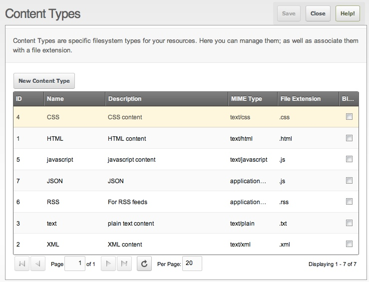

This tutorial moves from stand-alone Ext JS to MODX. The goal: a [Custom Manager Page](extending-modx/custom-manager-pages "Custom Manager Pages Tutorial") that lists content types. MODX already does this under **System -> Content Types**; the point is to re-create it.

The built-in grid we will re-create:



## Orienting Yourself

The earlier tutorials put everything in front of you: include the Ext JS Javascript and CSS, then manipulate the Javascript. Inside the manager, files sit in various folders and PHP class files, and user permissions apply. Here is the layout.

### The Manager

The MODX manager is a self-contained application. The files we need:

- `manager/assets/modext` : home to the various Ext JS configurations, panels, widgets, et al
- `manager/controllers/` : home to the PHP that loads up the Ext JS stuff. The JS points to a connector.
- `core/src/Revolution/Processors/` : class-based processors that handle the fetching of the data (in MODX 2.x these lived in `core/model/modx/processors/`)
- `core/src/Revolution/modManagerRequest.php` : responsible for handling all the requests in the manager
- `core/src/Revolution/Processors/baseProcessor.php` : the base class for class-based processors (in MODX 2.x this was `core/model/modx/modprocessor.class.php`).
- `connectors/` : a legacy entry point kept for old Extras; new code talks to processors through the main connector routed by action name.

Manager controllers add a layer of complexity and are poorly documented, so this demonstration skips them and uses a simpler approach.

## Ajax Controller

Ajax controllers must be reachable via HTTP, so put them under `assets/`, typically in `assets/components/<your_pkg>/`.


``` php
<?php
/**
 * Controller for Ajax requests.
 */
// Adjust the path appropriately
$docroot = dirname(dirname(dirname(dirname(__FILE__))));
include $docroot . '/config.core.php';
if (!defined('MODX_API_MODE')) {
    define('MODX_API_MODE', false);
}
include_once MODX_CORE_PATH . 'model/modx/modx.class.php';

$modx = new modX();
$modx->initialize('mgr');

if (!$modx->hasPermission('view_document')) {
    header('HTTP/1.0 401 Unauthorized');
    print 'Operation not allowed.';
    exit;
}
// These are the standard values that are posted to the Ajax URL by Ext JS
$start = (int) $modx->getOption('start',$_POST,0);
$limit = (int) $modx->getOption('limit',$_POST,20);
$sort = $modx->getOption('sort',$_POST);
$dir = $modx->getOption('dir',$_POST,'ASC');

// error_log(print_r($_POST,true));  // <--- uncomment this for debugging

$c = $modx->newQuery('modResource');
$count = $modx->getCount('modResource',$c);
$c->sortby($sort,$dir);
$c->limit($limit,$start);

//$c->prepare(); error_log($c->toSQL()); // <-- uncomment for debugging

$pages = $modx->getCollection('modResource',$c);

$list = array();
foreach ($pages as $p) {
    $array = $p->toArray();
    $list[] = $array;
}

// The format of the output is not well documented, but it requires a node for "total" and a root node matching the store's root config ("results" here)
print '{"total":"'.$count.'","results":'.$modx->toJSON($list).',"success":true,"msg":"Got our rows..."}';

//error_log(print_r($list,true));  // <-- another debugging point

@session_write_close();
exit();
```

After instantiating MODX and checking permissions, the rest is the same as in a Snippet.

### Advantages of Simple Controllers

1. Debug output by visiting the page directly, e.g. [http://yoursite.com/assets/components/your\_pkg/my\_ajax\_controller.php](http://yoursite.com/assets/components/your_pkg/my_ajax_controller.php) — you should see JSON data or PHP errors.
2. Permission checking is simple: `$modx->hasPermission('permission_key_here')`.
3. No extra documentation or complexity.

The disadvantages: this is not the "official" approach, so you cannot use the manager's routing, and overriding the controller via a MODX manager theme is impossible (the path is hard-coded). Given how much simpler it is, the trade-off is worth it.

## Your CMP

Paste the following into your `core/components/<your_pkg_name>/` directory and reference it as an action when you create your CMP.

``` php
<?php
/**
 * Generic MODX CMP
 */
$url = MODX_ASSETS_URL.'components/your_pkg_name/'; // <-- update this
//------------------------------------------------------------------------------
//!Grid
//------------------------------------------------------------------------------
$modx->regClientStartupHTMLBlock("<script>
function myactions(val) {
    return '<a href=\"index.php?a=30&id='+val+'\">Edit</a>';
}


Ext.onReady(function(){

    // create the Data Store
    var store = new Ext.data.JsonStore({
        root: 'results',
        totalProperty: 'total',
        idProperty: 'id',
        remoteSort: true,

        fields: [
            'id',
            'createdon',
            'pagetitle',
            'action'
        ],

        // HttpProxy posts to the same domain this page is served from
        proxy: new Ext.data.HttpProxy({
            url: '{$url}getpages.php'  // <------- set this to point to your Ajax Controller
        })
    });
    store.setDefaultSort('id', 'ASC');


    var grid = new Ext.grid.GridPanel({
        id: 'articlesGrid',
        width:700,
        height:500,
        store: store,
        trackMouseOver:true,  // will highlight rows on hover
        disableSelection:true, // will allow you to select row(s)
        loadMask: true,  // will generate a spinner icon

        // grid columns
        columns:[{
            header: 'Date',
            dataIndex: 'createdon',
            width: 150,
            sortable: true
        },{
            header: 'Page Title',
            dataIndex: 'pagetitle',
            width: 350,
            sortable: true
        },{
            header: '',
            dataIndex: 'id',
            width: 100,
            sortable: false,
            renderer : myactions,
        }],

        // paging bar on the bottom
        bbar: new Ext.PagingToolbar({
            pageSize: 25,
            store: store,
            displayInfo: true,
            displayMsg: 'Displaying Records {0} - {1} of {2}',
            emptyMsg: 'No Records to display'
        })
    });

    // render it
    grid.render('articles-grid');

    // trigger the data store load
    // NOTE: the parameter names here correspond to keys in _POST
    store.load({params:{start:0, limit:25}});
});
</script>");

// Be sure to print an HTML div that is ref'd by the grid.render() method
return '
<h2>Example</h2>
<div id="articles-grid"></div>';
```


The Javascript is printed directly into the document head: watch quoting styles, and syntax highlighting may not work — but PHP variables can be embedded in the Javascript without juggling half a dozen files.

Generating Javascript from PHP is usually frowned upon, but required at some integration points. The cleaner approach prints configuration as Javascript objects and references those variables; a later tutorial demonstrates it. For now, focus on the code above.
