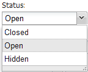
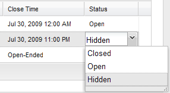

## MODx.combo.ComboBox

**Extends:**[Ext.form.ComboBox](http://extjs.cachefly.net/ext-3.3.0/docs/?class=Ext.form.ComboBox)
**Key Features:** Remote and local data stores; grid renderer.



The MODExt ComboBox has all the functionality of a regular Ext ComboBox. It can be populated remotely by an array of JSON objects from a connector (default), or locally (a plain JavaScript array or an Ext ArrayStore, with the "mode" config option set to "local").

A unique feature is the built-in renderer for grids: use a ComboBox as a grid editor and it displays the correct displayValue in the grid cell:



## Unique Parameters

The unique parameters are pass-through parameters to the combo's data store:

| Name       | Description                                                          | Default                        |
| ---------- | -------------------------------------------------------------------- | ------------------------------ |
| url        | The URL to the connector.                                            |                                |
| baseParams | Any other parameters to always send to the connector.                | { action: 'GetList' }          |
| fields     | The fields, in array format, you expect from the connector response. | \['id', 'name'\]               |

The class also inherits all [Ext.form.ComboBox](http://extjs.cachefly.net/ext-3.3.0/docs/?class=Ext.form.ComboBox) properties.

Notes:

- The constructor accepts a second argument, `getStore` (default true). Pass false to skip automatic store creation (e.g. when supplying your own store).
- The combo fires a `loaded` event after its store has finished loading.

## Using the Grid Renderer

In a grid's column model definition, specify `renderer: true` in the editor definition:

``` javascript
{
  header: _('usergroup')
  ,dataIndex: 'usergroup'
  ,width: 140
  ,editor: { xtype: 'modx-combo-usergroup' ,renderer: true}
}
```

### Units Combo Box

``` javascript
Doodles.combo.Units = function(config) {
    config = config || {};
    Ext.applyIf(config,{
        store: new Ext.data.ArrayStore({
            id: 0
            ,fields: ['unit','display']
            ,data: [
                ['MB','Megabyte']
                ,['GB','Gigabyte']
                ,['TB','Terabyte']
                ,['PB','Petabyte']
                ,['EB','Exabyte']
                ,['ZB','Zettabyte']
                ,['YB','Yottabyte']
            ]
        })
        ,mode: 'local'
        ,displayField: 'display'
        ,valueField: 'unit'
    });
    Doodles.combo.Units.superclass.constructor.call(this,config);
};
Ext.extend(Doodles.combo.Units,MODx.combo.ComboBox);
Ext.reg('doodle-combo-units',Doodles.combo.Units);
```

`store` supplies the `fields` and `data`; set `mode` to `'local'` for this approach.

### Combo Call From Grid

``` javascript
{
    header: _('unit')
    ,dataIndex: 'unit'
    ,sortable: false
    ,width: 50
    ,editor: { xtype: 'doodle-combo-units', renderer: true }
}
```

### Combo Call From Window

``` javascript
{
    xtype: 'doodle-combo-units'
    ,fieldLabel: _('unit')
    ,name: 'unit'
    ,hiddenName: 'unit'
    ,anchor: '100%'
}
```

`hiddenName` must be set when calling from a create or update window to save the value; it is not needed in the grid view.
