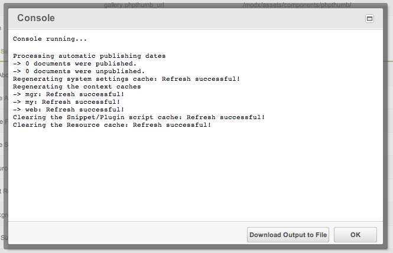

## What is the MODx.Console?

The MODx.Console is an Ext widget that shows terminal-like output from processors that return detailed information. You can find it in [Package Management](extending-modx/transport-packages "Package Management"), in cache clearing, and in other areas of MODX:



## How it Works

The Console polls a Registry entry described by two parameters:

- **register** - The registry to pull from
- **topic** - The topic in the registry to read

It keeps polling until the Console JS object's "complete" event fires, or a COMPLETED message arrives. Then polling stops and the "OK" button is enabled. The user can close the console or download the output to a file. Clicking "OK" fires the "shutdown" event.

Two more config options are worth knowing:

- **format** - How to render each log line; defaults to `html_log`.
- The console also has a `setRegister(register, topic)` method, so you can point an already-created console at a different register/topic without rebuilding it.


## Usage

Instantiate a console object:

``` javascript
var topic = '/mytopic/';
var register = 'mgr';
var console = MODx.load({
   xtype: 'modx-console'
   ,register: register
   ,topic: topic
   ,show_filename: 0
   ,listeners: {
     'shutdown': {fn:function() {
         /* do code here when you close the console */
     },scope:this}
   }
});
console.show(Ext.getBody());
```

Include the beginning and ending slashes in the topic.

Then send a request to your processor:

``` javascript
MODx.Ajax.request({
    url: URL_TO_MY_CONNECTOR
    ,params: {
        action: MY_ACTION
        ,register: register
        ,topic: topic
    }
    ,listeners: {
        'success':{fn:function() {
            console.fireEvent('complete');
        },scope:this}
    }
});
```

Specify the connector URL and the processor action. In the processor, write to the Console with $modx->log:

``` php
$modx->log(modX::LOG_LEVEL_INFO,'An information message in normal colors.');
$modx->log(modX::LOG_LEVEL_ERROR,'An error in red!');
$modx->log(modX::LOG_LEVEL_WARN,'A warning in blue!');
```

When the processor is done, fire a log message with "COMPLETED" as the body:

``` php
$modx->log(modX::LOG_LEVEL_INFO,'COMPLETED');
```

This stops the polling and enables the "OK" button.

MODX Revolution 2.1.0-rc2 and later do not need the COMPLETED message in the registry — firing the 'complete' event on the JS Console object is enough. All prior versions require the COMPLETED message.

After the user clicks "OK", MODx.Console fires its "shutdown" event; run any cleanup code there.

Modx.Ajax.request expects a 'success' key in the JSON response, so the processor must return 'success'. Otherwise the success listener never fires.

To return text, html, or anything non-json, use the native Ext.Ajax.request.