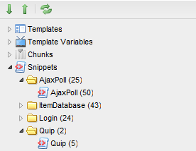

## MODx.tree.Tree

**Extends:** Ext.tree.TreePanel
**Key Features:** Remotely-loaded toolbars; drag-and-drop to form fields functionality; connector functionality for removing and dragging/sorting.



Trees display multiple levels of objects with a parent-child relationship, such as users or resources.

## Unique Parameters

MODx.tree.Tree adds parameters not found in Ext.tree.TreePanel objects:

| Name                  | Description                                                                                                                                                             | Default    |
| --------------------- | ----------------------------------------------------------------------------------------------------------------------------------------------------------------------- | ---------- |
| url                   | The URL to point the tree loader at. Optional if you pass in the data parameter.                                                                                        |            |
| action                 | The processor action the loader requests when fetching nodes.                                                                                                           | getNodes   |
| baseParams            | Parameters to send with every node load request.                                                                                                                        | {}         |
| rootName              | The text of the root node, if rootVisible is set to true.                                                                                                               |            |
| rootId                | The ID of the root node.                                                                                                                                                | root       |
| rootIconCls           | CSS class for the root node icon.                                                                                                                                        |            |
| rootQtip              | Tooltip for the root node.                                                                                                                                              |            |
| data                  | Optional; if url is not set, data must be loaded in through here.                                                                                                       | \[\]       |
| remoteToolbar         | If true, will load the tree's toolbar via data loaded remotely.                                                                                                         | false      |
| remoteToolbarUrl\*    | The connector URL to load the toolbar from. Defaults to the tree's URL.                                                                                                 |            |
| remoteToolbarAction\* | The processor action to load the toolbar from.                                                                                                                          | getToolbar |
| useDefaultToolbar     | If remoteToolbar is false, this will load the default toolbar, which contains expand all, contract all, and refresh. Items passed to tbar property will be added after. | false      |
| menuConfig            | The config object to pass to the context menu loaded for this tree.                                                                                                     |            |
| expandFirst           | If true, will expand the first level nodes on render.                                                                                                                   | false in the base class; core trees (e.g. the resource tree) set true |
| removeAction\*        | The processor action to take when removing a node.                                                                                                                      | remove     |
| removeTitle\*         | The title for the remove dialog when removing a node.                                                                                                                   | Warning!   |
| primaryKey            | The primary key for the node. Usually is id.                                                                                                                            | id         |
| sortAction            | The processor action to take when sorting nodes via drag/drop.                                                                                                          | sort       |
| toolbarItemCls\*      | The CSS class to add to remoteToolbar loaded items.                                                                                                                     | x-btn-icon |

- = MODX Revolution 2.1+ Only

## Custom Events

| Name      | Description                                                                                               |
| --------- | --------------------------------------------------------------------------------------------------------- |
| beforeSort | Fired before the tree sends the sorted nodes to the sort processor. Passes the sorted nodes, encoded.     |
| afterSort  | Fired after tree node sorting. Passes: event (the drop event) and result (the response from the sort processor). |
| refresh    | Fired after the tree has been reloaded/refreshed.                                                         |

## Other Unique Features

### Sorting

Sorting is enabled by default. To disable it, set enableDD to false in your config. After a drag/drop, the tree sends the encoded nodes to a sort processor on the same connector as the tree URL.

### Remote Toolbar Loading

Set the remoteToolbar config parameter to load the tree's toolbar from a processor; the action comes from remoteToolbarAction, which defaults to "getToolbar".

### Drag/Drop to MODx.FormPanel Fields

Nodes can be dragged into MODx.FormPanel fields, assuming that the following is passed into the config var (`modx-treedrop-dd` is the drop group used by the resource tree and MODx.TreeDrop; other trees use their own groups, e.g. `modx-treedrop-elements-dd` for the element tree):

``` javascript
,enableDD: true
,ddGroup: 'modx-treedrop-dd'
```

and that the node has an attribute of 'type', which is one of the following values: modResource,snippet,chunk,tv,file.

## See Also

1. [MODExt MODx Object](extending-modx/custom-manager-pages/modext/modext-modx-object)
2. [MODExt Tutorials](extending-modx/custom-manager-pages/modext/modext-tutorials)
   1. [Ext JS Tutorial - Message Boxes](extending-modx/custom-manager-pages/modext/modext-tutorials/1.-ext-js-tutorial-message-boxes)
   2. [Ext JS Tutorial - Ajax Include](extending-modx/custom-manager-pages/modext/modext-tutorials/2.-ext-js-tutorial-ajax-include)
   3. [Ext JS Tutorial - Animation](extending-modx/custom-manager-pages/modext/modext-tutorials/3.-ext-js-tutorial-animation)
   4. [Ext JS Tutorial - Manipulating Nodes](extending-modx/custom-manager-pages/modext/modext-tutorials/4.-ext-js-tutorial-manipulating-nodes)
   5. [Ext JS Tutorial - Panels](extending-modx/custom-manager-pages/modext/modext-tutorials/5.-ext-js-tutorial-panels)
   6. [Ext JS Tutoral - Advanced Grid](extending-modx/custom-manager-pages/modext/modext-tutorials/7.-ext-js-tutoral-advanced-grid)
   7. [Ext JS Tutorial - Inside a CMP](extending-modx/custom-manager-pages/modext/modext-tutorials/8.-ext-js-tutorial-inside-a-cmp)
3. [MODx.combo.ComboBox](extending-modx/custom-manager-pages/modext/modx.combo.combobox)
4. [MODx.Console](extending-modx/custom-manager-pages/modext/modx.console)
5. [MODx.FormPanel](extending-modx/custom-manager-pages/modext/modx.formpanel)
6. [MODx.grid.Grid](extending-modx/custom-manager-pages/modext/modx.grid.grid)
7. [MODx.grid.LocalGrid](extending-modx/custom-manager-pages/modext/modx.grid.localgrid)
8. [MODx.msg](extending-modx/custom-manager-pages/modext/modx.msg)
9. [MODx.tree.Tree](extending-modx/custom-manager-pages/modext/modx.tree.tree)
10. [MODx.Window](extending-modx/custom-manager-pages/modext/modx.window)
