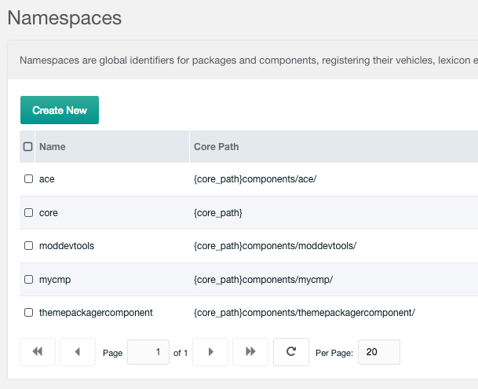
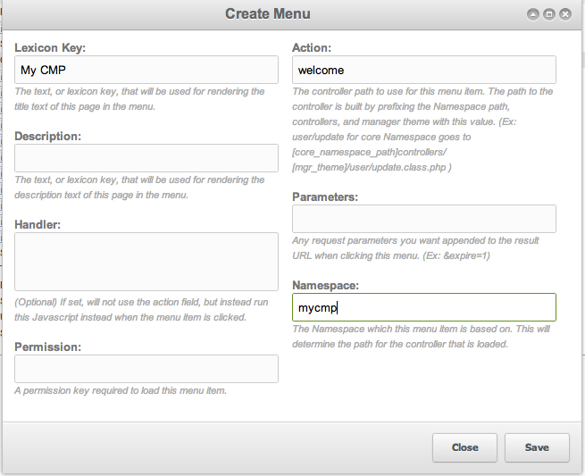
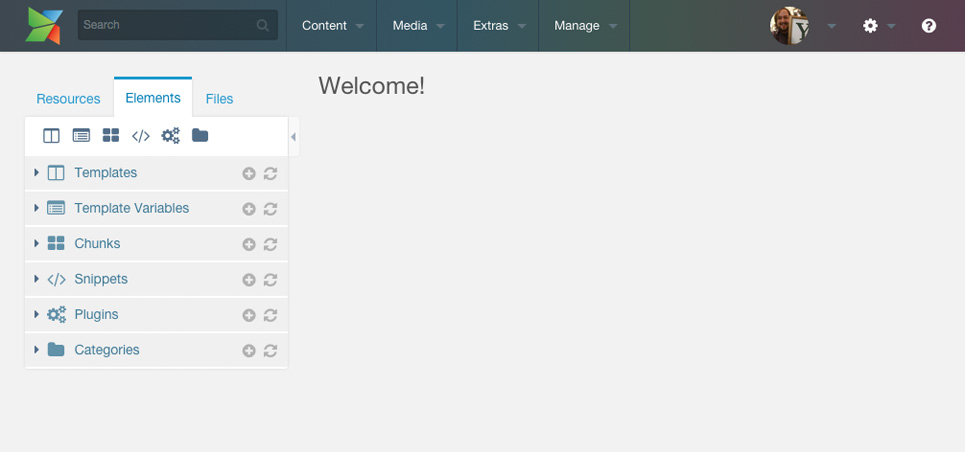

Creating MODX custom manager pages (CMPs) needs three things: a Namespace path, a menu item, and PHP files.

## Setting the Namespace Path

Create a Namespace (Admin > Namespaces) called "mycmp". Set its path to "{core\_path}components/mycmp/" and its Assets Path to "{assets\_path}components/mycmp/".



**To avoid problems, keep the namespace and the action lowercase, with alphanumeric characters only (no spaces, hyphens, or underscores). The namespace should be a lowercase version of the CMP name.**

## Creating the Menu

Go to Admin -> Menus and create a menu item under "Extras":



Set the Namespace to "mycmp" and the Action to "welcome". The manager loads the "welcome" controller by default.

## Creating the Controller File

Create the controller at `{core\_path}components/mycmp/controllers/default/welcome.class.php`:

- `controllers/` — where MODX looks for controllers.
- `default/` — the current Manager Theme, so you can ship different controllers per theme.
- `welcome.class.php` — named after the "welcome" action from the menu. An action of "home" would mean `home.class.php`.

File contents:

``` php
<?php
class MycmpWelcomeManagerController extends modExtraManagerController {
    public function process(array $scriptProperties = array()) {}
    public function getPageTitle() {
        return 'My Test CMP';
    }
    public function getTemplateFile() {
        return 'welcome.tpl';
    }
}
```

The class name starts with the CMP name (lowercase namespace) plus the action, followed by `ManagerController`. `process()` stays empty here — there is no business logic. `getPageTitle()` sets the page title; `getTemplateFile()` points MODX at the template.

## Creating the Template File

CMP pages use Smarty templates. MODX looks in `[namespace-path]templates/`; the controller only names the file (subdirectories allowed). Create `{core\_path}components/mycmp/templates/default/welcome.tpl`:

``` html
<div class="container">
<h2>Welcome!</h2>
</div>
```

The template adds padding around an `h2`. The manager displays:



The CMP is now reachable at `/url/to/modx/manager/?a=welcome&namespace=mycmp` — simpler than the ID-based actions of 2.2 and earlier. (The manager reads the controller name from the `a` parameter; `action` is the equivalent parameter used by connectors, not the manager.)

`modExtraManagerController` has more API methods to override. In the CMP itself you can use [MODExt](extending-modx/custom-manager-pages/modext "MODExt") and related tools — beyond the scope of this tutorial.
