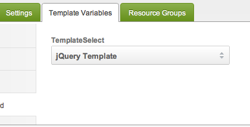

This tutorial is for MODX Revolution 3.x.

## What are Custom TV Input Types?

This example adds a TV input type named `templateselect` for [Template Variables](building-sites/elements/template-variables): the Manager shows a Template dropdown, and the frontend prints the selected Template ID in a `div`. The files live in an Extra at `core/components/ourtvs/`. Built-in type keys (`text`, `option`, `textarea`, `richtext`, …) are listed in `core/lexicon/en/tv_input_types.inc.php`.

If the custom renderer never loads, MODX draws a **plain text field** — the fallback in `modTemplateVar::getRender()`, not a broken combo. The usual cause is skipping the pathing plugin below.

## Create a Namespace

Create a Namespace named `ourtvs` with path `{core_path}components/ourtvs/`.

In 3.x, MODX also scans `{namespace_path}/tv/input/` when it **lists** input types in the TV editor, and `{namespace_path}/tv/output/` when it lists output types. Listing is not rendering: a TV on a Resource is still rendered through the plugin events in the next step.

## Creating the Pathing Plugin

You still need this plugin on 2.3 and on 3.x. The Namespace does not replace it for the Resource form.

Create a plugin named `OurTvsPlugin` and attach **only** these events:

- `OnTVInputRenderList` — Manager input renderer
- `OnTVOutputRenderList` — frontend output renderer
- `OnTVInputPropertiesList` — input properties in the Manager
- `OnTVOutputRenderPropertiesList` — output properties

Plugin code:

``` php
$corePath = $modx->getOption('core_path').'components/ourtvs/';
switch ($modx->event->name) {
    case 'OnTVInputRenderList':
        $modx->event->output($corePath.'tv/input/');
        break;
    case 'OnTVOutputRenderList':
        $modx->event->output($corePath.'tv/output/');
        break;
    case 'OnTVInputPropertiesList':
        $modx->event->output($corePath.'tv/inputoptions/');
        break;
    case 'OnTVOutputRenderPropertiesList':
        $modx->event->output($corePath.'tv/properties/');
        break;
}
```

The path returned from the plugin is used as-is — any directory name works. Two caveats:

- The namespace auto-scan for **properties** looks only in `{namespace_path}/tv/inputproperties/` and `{namespace_path}/tv/properties/`. The example uses `tv/inputoptions/`, which still works because the plugin's path wins over the scan.
- A trailing slash is required for `OnTVInputPropertiesList` and `OnTVOutputRenderPropertiesList` — the path is concatenated as-is. `OnTVInputRenderList` and `OnTVOutputRenderList` normalize the path in 3.x, so the slash does not matter there.

In 3.x the plugin events take effect as soon as you save the plugin — no Manager cache clear needed.

Skip the plugin and the type may still appear in the Input Type dropdown (3.x namespace scan), but the Resource form falls back to a text field.

## Creating the Input Controller

The input controller loads the markup. Create:

> `core/components/ourtvs/tv/input/templateselect.class.php`

The file name without `.class.php` is the type key: `templateselect`.

``` php
<?php
if (!class_exists('TemplateSelectInputRender')) {
    class TemplateSelectInputRender extends modTemplateVarInputRender {
        public function getTemplate() {
            return $this->modx->getOption('core_path').'components/ourtvs/tv/input/tpl/templateselect.tpl';
        }
        public function process($value, array $params = array()) {
        }
    }
}
return 'TemplateSelectInputRender';
```

On 3.x, `modTemplateVarInputRender` is `MODX\Revolution\modTemplateVarInputRender`. The global name still works while deprecated class aliases are on (default). You can add `use MODX\Revolution\modTemplateVarInputRender;` at the top if you prefer the namespaced class.

Built-in input renders live in `core/src/Revolution/Processors/Element/TemplateVar/Renders/mgr/input/`, their templates in `manager/templates/default/element/tv/renders/input/`. Copy `listbox-single.tpl` as the pattern — it wraps the widget in `Ext.onReady` and registers it in the resource form (`Ext.getCmp('modx-panel-resource').getForm().add(fld)`). Custom types are searched after the built-ins, so they cannot override a built-in name.

`getTemplate()` points at a Smarty file. Put it here:

> `core/components/ourtvs/tv/input/tpl/templateselect.tpl`

``` javascript
<select id="tv{$tv->id}" name="tv{$tv->id}" class="combobox"></select>
<script type="text/javascript">
// <![CDATA[
{literal}
Ext.onReady(function() {
    const fld = MODx.load({
{/literal}
        xtype: 'modx-combo-template'
        ,name: 'tv{$tv->id}'
        ,hiddenName: 'tv{$tv->id}'
        ,transform: 'tv{$tv->id}'
        ,id: 'tv{$tv->id}'
        ,width: 300
        ,value: '{$tv->value}'
{literal}
        ,listeners: { 'select': { fn:MODx.fireResourceFormChange, scope:this}}
    });
    Ext.getCmp('modx-panel-resource').getForm().add(fld);
});
{/literal}
// ]]>
</script>
```

`Ext.onReady` and `getForm().add(fld)` come from the built-in renders: without registering the field in the resource form it may render but stay out of the form's validation and change tracking.

ExtJS is optional — a plain HTML control works too, as long as its name is `tv{$tv->id}`.

Create a Template Variable, set Input Type to `templateselect`, assign it to a Template, then edit a Resource. You should get a Template dropdown:



If you still see a text box: confirm the plugin is enabled on `OnTVInputRenderList`, the class file path matches the output path, and the TV type key is `templateselect`.

## Creating the Output Controller

Create:

> `core/components/ourtvs/tv/output/templateselect.class.php`

``` php
<?php
if (!class_exists('TemplateSelectOutputRender')) {
    class TemplateSelectOutputRender extends modTemplateVarOutputRender {
        public function process($value, array $params = array()) {
            return '<div class="template">'.$value.'</div>';
        }
    }
}
return 'TemplateSelectOutputRender';
```

On the frontend this prints the selected Template ID inside a `div` — but only when the TV uses your output type. The render is looked up in the TV's **Output Type** field (`display`); when that field is empty, MODX outputs plain `text` and the `div` never appears. So: open the TV, set **Output Type** to `templateselect`, save, then check the frontend.

## Other TV Events

The four events above cover rendering. The TV editor and processors also fire `OnTVFormPrerender`, `OnTVFormRender`, `OnTVFormSave`, `OnTVFormDelete`, `OnTemplateVarBeforeSave`, `OnTemplateVarSave`, `OnTemplateVarBeforeRemove`, and `OnTemplateVarRemove` — use them when you need to hook into the TV lifecycle rather than its rendering.

## See Also

- [Creating a Template Variable](building-sites/elements/template-variables/step-by-step)
- [Template Variable Input Types](building-sites/elements/template-variables/input-types)
- [Template Variable Output Types](building-sites/elements/template-variables/output-types) (including [date](building-sites/elements/template-variables/output-types/date), [delimiter](building-sites/elements/template-variables/output-types/delimiter), [HTML tag](building-sites/elements/template-variables/output-types/html), [image](building-sites/elements/template-variables/output-types/image), [URL](building-sites/elements/template-variables/output-types/url))
- [Bindings](building-sites/elements/template-variables/bindings) (including [CHUNK](building-sites/elements/template-variables/bindings/chunk-binding), [DIRECTORY](building-sites/elements/template-variables/bindings/directory-binding), [FILE](building-sites/elements/template-variables/bindings/file-binding), [INHERIT](building-sites/elements/template-variables/bindings/inherit-binding), [RESOURCE](building-sites/elements/template-variables/bindings/resource-binding), [SELECT](building-sites/elements/template-variables/bindings/select-binding))
- [Creating a multi-select box for related pages in your template](building-sites/tutorials/multiselect-related-pages)
- [Accessing Template Variable Values via the API](extending-modx/snippets/accessing-tvs)
