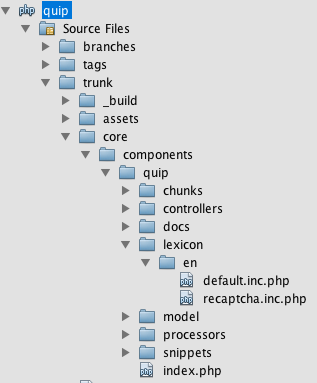
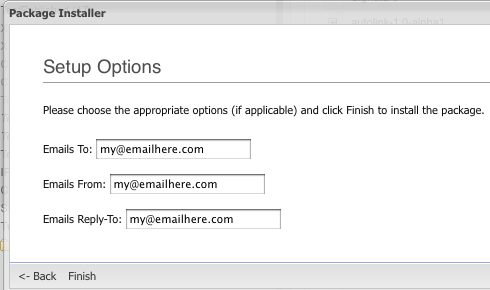

A build script is the PHP file that packs a component into a `.transport.zip` package — the archive you install through Package Management.

This tutorial builds a package for the sample component Quip: menus, chunks, a Snippet, lexicons, setup options, a license, a readme, and system settings.

## Directory Structure

The tutorial uses this layout. Your structure can differ; the split between _assets/components/quip/_ and _core/components/quip/_ is what makes packaging easy:


## Starting the Build Script

Create `build.transport.php` in the _build_ directory and start it with phpdoc comments and a timer:

```php
<?php
/**
 * Quip build script
 *
 * @package quip
 * @subpackage build
 */
$mtime = microtime();
$mtime = explode(" ", $mtime);
$mtime = $mtime[1] + $mtime[0];
$tstart = $mtime;
set_time_limit(0); /* makes sure our script doesnt timeout */
```

Collect the paths in a `$sources` array so later steps can reach them. The `source_core` and `source_assets` paths end without a forward slash — required:

```php
$root = dirname(dirname(__FILE__)).'/';
$sources= array (
    'root' => $root,
    'build' => $root .'_build/',
    'resolvers' => $root . '_build/resolvers/',
    'data' => $root . '_build/data/',
    'source_core' => $root.'core/components/quip',
    'lexicon' => $root . 'core/components/quip/lexicon/',
    'source_assets' => $root.'assets/components/quip',
    'docs' => $root.'core/components/quip/docs/',
);
unset($root); /* save memory */
```

Require the build config, which you create next to the script:

```php
require_once dirname(__FILE__) . '/build.config.php';
```

The config points the script at your MODX installation — where to load the modX class from and where to write the finished package:

```php
<?php
/**
 * Define the MODX path constants necessary for core installation
 *
 * @package quip
 * @subpackage build
 */
define('MODX_CORE_PATH', '/absolute/path/to/modx/core/');
define('MODX_CONFIG_KEY','config');
```

Set `MODX_CORE_PATH` to the absolute path of your MODX core. Keep `MODX_CONFIG_KEY` unless you run a multi-domain install.

Instantiate modX, initialize the `mgr` context, and log as HTML; from the command line the log target switches to plain `ECHO`:

```php
require_once MODX_CORE_PATH . 'model/modx/modx.class.php';

$modx= new modX();
$modx->initialize('mgr');
$modx->setLogLevel(modX::LOG_LEVEL_INFO);
$modx->setLogTarget(XPDO_CLI_MODE ? 'ECHO' : 'HTML');
```

MODX 3 loads the build classes through the Composer autoloader set up in `modx.class.php`, so there is no `$modx->loadClass()` step. Create the builder with its namespaced class (add `use MODX\Revolution\Transport\modPackageBuilder;` at the top for a short name):

```php
$builder = new \MODX\Revolution\Transport\modPackageBuilder($modx);
$builder->createPackage('quip','0.1','alpha7');
$builder->registerNamespace('quip',false,true,'{core_path}components/quip/');
```

`createPackage($name, $version, $release)` — here the signature is `quip-0.1-alpha7`.

Other builder methods you may need:

-   `setWorkspace($workspace_id)` - Switches the workspace the package is built into; the built file lands in that workspace's `packages/` directory. Returns the `modWorkspace` or false for a bad id.
-   `setAutoSelects(array $classes)` - Sets which classes `pack()` auto-collects into vehicles by namespace (used internally when `registerNamespace()` is called with `$autoincludes`).
-   `getSignature()` - Returns the signature of the package currently being built.
-   `buildSchema($model, $schema)` - Runs the xPDO model generator over a schema XML file, writing classes into the `$model` directory.
-   `registerNamespace()` takes a fifth optional parameter, `$assetsPath`, after `$path` — it sets the namespace's assets path for components that keep files outside `core/`.

Register a [Namespace](extending-modx/namespaces "Namespaces") for the package: not every package needs one, but every 3rd-Party Component does. The Namespace ties the package's objects together, so uninstall removes exactly what install added. It also groups the package's [Lexicon Entries](extending-modx/internationalization "Internationalization"): the builder assigns them to the Namespace, and you manage just those entries.

## Packaging in Objects

Objects travel as Vehicles: a vehicle carries data or files into the zip. A package holds many vehicles; an object vehicle is built on a single parent object. `$builder->createVehicle()` returns a `modTransportVehicle` — the object you later pass to `resolve()` and `putVehicle()`; it also offers `validate()`, `compile()` and `fetch()`.

The first example packages a simple object with attributes:

```php
$snippet = $modx->newObject('modSnippet');
$snippet->set('id',1);
$snippet->set('name','Test');
$vehicle = $builder->createVehicle($snippet,array(
    xPDOTransport::UNIQUE_KEY => 'name',
    xPDOTransport::UPDATE_OBJECT => true,
    xPDOTransport::PRESERVE_KEYS => false,
));
```

The snippet gets an arbitrary ID, which is not kept. With `UNIQUE_KEY` set, xPDO finds the row by that key and ignores the ID. Without `UNIQUE_KEY`, the ID identifies the object and is required. The vehicle attributes:

-   `xPDOTransport::UNIQUE_KEY` _(string/array)_ - the column that identifies the object on install, update and uninstall. MODX matches the packaged object against it — usually `name`, sometimes a set of fields.
-   `xPDOTransport::UPDATE_OBJECT` _(boolean)_ - update a row that matches `UNIQUE_KEY` on install or upgrade; when false, leave the row alone. This flag also gates uninstall: xPDO removes the object only when `UPDATE_OBJECT` is true and `UNINSTALL_OBJECT` is not false. Set it to false when an upgrade must not overwrite user changes — the object then survives uninstall as well.
-   `xPDOTransport::UNINSTALL_OBJECT` _(boolean)_ - when false, the object stays in the database after uninstall; omitted means true. Removal still requires `UPDATE_OBJECT` to be true.
-   `xPDOTransport::PRESERVE_KEYS` _(boolean)_ - applies only to inserts: true writes the packaged primary key, false lets the database assign one. Use true for natural keys (a Context `key`), false for autoincrement IDs. An existing row keeps its key regardless of this flag and of `UPDATE_OBJECT`.
-   `xPDOTransport::ABORT_INSTALL_ON_VEHICLE_FAIL` _(boolean)_ - when true and this vehicle fails to install, MODX aborts the rest of the package install.
-   `xPDOTransport::PREEXISTING_MODE` _(integer)_ - how objects (and file-resolver targets) that already exist on the site are handled; the modes below.

**Preexisting modes** (values for `PREEXISTING_MODE`):

-   `xPDOTransport::PRESERVE_PREEXISTING` _(0, default)_ - on install or upgrade, snapshot preexisting object data (and matching files from file resolvers) so they can be restored later. On uninstall, objects that existed before install are not removed — they stay in that snapshot.
-   `xPDOTransport::REMOVE_PREEXISTING` _(1)_ - no restore snapshot. On uninstall, remove the object even if it existed before the package was installed (still requires `UPDATE_OBJECT` and `UNINSTALL_OBJECT`).
-   `xPDOTransport::RESTORE_PREEXISTING` _(2)_ - on uninstall, restore objects and files from the snapshot taken at install. Object restore also requires `UPDATE_OBJECT` to be true.

`PREEXISTING_MODE` sits on the vehicle or is passed at install/uninstall time. Package Management passes it when uninstalling; core setup installs the core package with `REMOVE_PREEXISTING`.

The modMenu follows the same pattern:

```php
$menu= $modx->newObject('modMenu');
$menu->fromArray(array(
    'text' => 'quip',
    'namespace' => 'quip',
    'action' => 'index',
    'parent' => 'components',
    'description' => 'quip_desc',
    'icon' => 'images/icons/plugin.gif',
    'menuindex' => '0',
    'params' => '',
    'handler' => '',
),'',true,true);
$vehicle= $builder->createVehicle($menu,array (
    xPDOTransport::PRESERVE_KEYS => true,
    xPDOTransport::UPDATE_OBJECT => true,
    xPDOTransport::UNIQUE_KEY => 'text',
));
```

## Related objects

Two more attributes cover related objects:

-   `xPDOTransport::RELATED_OBJECTS` _(boolean)_ - set true to search for related objects of this object; required for the next attribute to work.
-   `xPDOTransport::RELATED_OBJECT_ATTRIBUTES` _(array)_ - the related objects to take: an associative array keyed by the alias of the relation, with the same attribute format as the parent object. Aliases come from the schema at _core/model/schema/modx.mysql.schema.xml_.

Associate the related objects with the `addOne()` or `addMany()` functions before calling `$builder->createVehicle()`; nesting can go as deep as you need.

Package the menu for the backend:

```php
/* load action/menu */
$menu = include $sources['data'].'transport.menu.php';

$vehicle= $builder->createVehicle($menu,array (
    xPDOTransport::PRESERVE_KEYS => true,
    xPDOTransport::UPDATE_OBJECT => true,
    xPDOTransport::UNIQUE_KEY => 'text',
));
$builder->putVehicle($vehicle);
unset($vehicle,$menu); /* to keep memory low */
```

The action data lives in a separate file — optional, but it keeps the build script short and the menus easy to manage.

The system settings loop the same way:

```php
/* load system settings */
$settings = include $sources['data'].'transport.settings.php';

$attributes= array(
    xPDOTransport::UNIQUE_KEY => 'key',
    xPDOTransport::PRESERVE_KEYS => true,
    xPDOTransport::UPDATE_OBJECT => false,
);
foreach ($settings as $setting) {
    $vehicle = $builder->createVehicle($setting,$attributes);
    $builder->putVehicle($vehicle);
}
unset($settings,$setting,$attributes);
```

Next, a Category named 'Quip' with the Snippet and Chunks in it, step by step:

```php
/* create category */
$category= $modx->newObject('modCategory');
$category->set('id',1);
$category->set('category','Quip');
```

Now the Snippet:

```php
/* create the snippet */
$snippet= $modx->newObject('modSnippet');
$snippet->set('id',0);
$snippet->set('name', 'Quip');
$snippet->set('description', 'A simple commenting component.');
$snippet->set('snippet',file_get_contents($sources['source_core'].'/snippet.quip.php'));
```

`file_get_contents()` reads the Snippet source from your development copy, so later builds pick up changes in that file automatically.

The properties go in next:

```php
$properties = include $sources['data'].'properties.inc.php';
$snippet->setProperties($properties);
$category->addMany($snippet);
```

`addMany()` rather than `addOne()`: the choice follows the cardinality of the relationship, not the number of objects. A Category holds many Snippets, so the relation is one-to-many and `addMany()` fits — it accepts a single object or an array. See [relationships](extending-modx/xpdo/custom-models/defining-a-schema/relationships "Defining Relationships"), [addOne](extending-modx/xpdo/class-reference/xpdoobject/related-object-accessors/addone "addOne") and [addMany](extending-modx/xpdo/class-reference/xpdoobject/related-object-accessors/addmany "addMany").

The property definitions:

```php
<?php
/**
 * Default snippet properties
 *
 * @package quip
 * @subpackage build
 */
$properties = array(
    array(
        'name' => 'closed',
        'desc' => 'If set to true, the thread will not accept new comments.',
        'type' => 'combo-boolean',
        'options' => '',
        'value' => false,
    ),
    array(
        'name' => 'dateFormat',
        'desc' => 'The format of the dates displayed for a comment.',
        'type' => 'textfield',
        'options' => '',
        'value' => '%b %d, %Y at %I:%M %p',
    ),
    /* ...removed others for brevity... */
);
return $properties;
```

Now the chunks:

```php
/* add chunks */
$chunks = include $sources['data'].'transport.chunks.php';
if (is_array($chunks)) {
    $category->addMany($chunks);
} else { $modx->log(modX::LOG_LEVEL_FATAL,'Adding chunks failed.'); }
```

The array of chunks goes in with `addMany()`; the check catches a typo in the data file. Now package the category with its related Snippets and Chunks:

```php
/* create category vehicle */
$attr = array(
    xPDOTransport::UNIQUE_KEY => 'category',
    xPDOTransport::PRESERVE_KEYS => false,
    xPDOTransport::UPDATE_OBJECT => true,
    xPDOTransport::RELATED_OBJECTS => true,
    xPDOTransport::RELATED_OBJECT_ATTRIBUTES => array (
        'Snippets' => array(
            xPDOTransport::PRESERVE_KEYS => false,
            xPDOTransport::UPDATE_OBJECT => true,
            xPDOTransport::UNIQUE_KEY => 'name',
        ),
        'Chunks' => array (
            xPDOTransport::PRESERVE_KEYS => false,
            xPDOTransport::UPDATE_OBJECT => true,
            xPDOTransport::UNIQUE_KEY => 'name',
        ),
    )
);
$vehicle = $builder->createVehicle($category,$attr);
```

## Validators and Resolvers

Validators run before the vehicle they are attached to installs; returning false stops the installation. Resolvers run after it has installed: a file resolver copies files into a target location, a PHP resolver executes a script.

These vehicle attributes toggle resolver and file-vehicle behavior; pass them in the same array as `UPDATE_OBJECT` and friends, or as install options:

-   `xPDOTransport::RESOLVE_FILES` _(boolean)_ - If false, file resolvers on the vehicle are skipped. Omit or set true to run them.
-   `xPDOTransport::RESOLVE_FILES_REMOVE` _(boolean)_ - On uninstall, file resolvers remove their target files or directories unless this is set to false. Default is to remove.
-   `xPDOTransport::RESOLVE_PHP` _(boolean)_ - If false, PHP resolvers on the vehicle are skipped. Omit or set true to run them.
-   `xPDOTransport::INSTALL_FILES` _(boolean)_ - For `xPDOFileVehicle` only. If false, the vehicle skips copying its files on install.
-   `xPDOTransport::UNINSTALL_FILES` _(boolean)_ - For `xPDOFileVehicle` only. If false, the vehicle leaves its files on uninstall. Default is to remove them.

File resolvers also honor `PREEXISTING_MODE`. With `PRESERVE_PREEXISTING`, files already at the target path are archived before overwrite. With `RESTORE_PREEXISTING`, that archive is unpacked on uninstall.

Attach two file resolvers and one PHP resolver:

```php
$vehicle->resolve('file',array(
    'source' => $sources['source_core'],
    'target' => "return MODX_CORE_PATH . 'components/';",
));
$vehicle->resolve('file',array(
    'source' => $sources['source_assets'],
    'target' => "return MODX_ASSETS_PATH . 'components/';",
));
$vehicle->resolve('php',array(
    'source' => $sources['resolvers'] . 'setupoptions.resolver.php',
));
$builder->putVehicle($vehicle);
```

File resolvers take two options:

-   **source** - The directory (or script for a PHP resolver) to copy from. For a file resolver it must be a valid directory; the examples below write it without a trailing slash. For a PHP script resolver, a valid and accessible file.
-   **target** - Only applicable to file resolvers, this tells MODX where to install the source files. It is an eval()'ed statement, so must be used as in the example. The standard MODX defines are available to you; use those to grab base paths to target.

Each copy lands in `target/` plus the name of the source directory. The files from `$sources['source_core']` go to _core/components/quip/_, those from `$sources['source_assets']` to _assets/components/quip/_.

Keep files that must not be reachable over the web under _core_ — PHP, tpl files, docs. _core_ can sit outside the webroot; _assets_ then holds only what the browser needs.

The PHP resolver `setupoptions.resolver.php` is covered under Setup Options below.

## Lexicons

Lexicons sit in _core/components/quip/lexicon_:



The subdirectory `en` is the IANA language code; `default.inc.php` is the `default` lexicon topic. Extra topics get their own `topicname.inc.php`.

MODX finds lexicons at `{namespace_path}lexicon/` — the Namespace path you registered earlier — and parses them itself, so no lexicon code goes into the package. Lexicons are cached from the files first, then overrides from the database merge in. Users can edit them in Lexicon Management without breaking their upgrade path for your Component.

## Package Attributes: License, Readme and Setup Options

Package attributes reach every resolver or validator; pass any array to `modPackageBuilder::setPackageAttributes()`. Four keys get special treatment:

-   **license** (string) - the license agreement. When it is not empty, install asks the user to accept it before the package can be installed.
-   **readme** (string) - the readme shown before install, so requirements are seen first.
-   **changelog** (string) - optional release notes shown with the package attributes.
-   **setup-options** (string) - an HTML form (without the form tags) whose values go to the resolvers or validators. It collects user input before install and processes it during install.

**Markdown in package attributes (MODX 3+):** When the installer shows `license`, `readme`, or `changelog`, MODX renders those strings as Markdown (Parsedown, safe mode) before display — [#13853](https://github.com/modxcms/revolution/pull/13853). Plain text and HTML-ish content are fine: Markdown headings, lists, and links work without shipping a separate HTML file for those three keys.

Set them in the build script:

```php
/* now pack in the license file, readme and setup options */
$builder->setPackageAttributes(array(
    'license' => file_get_contents($sources['docs'] . 'license.txt'),
    'readme' => file_get_contents($sources['docs'] . 'readme.txt'),
    'setup-options' => array(
        'source' => $sources['build'] . 'setup.options.php'
    ),
));
```

`file_get_contents()` embeds the license and readme while the original files stay in the _core/components/quip/docs_ directory after install, should the user want to view them later.

`setup-options` takes the file location as the `source` parameter, the same idea as a PHP resolver. A string from `file_get_contents()` would freeze the form; the file keeps it current across upgrades.

The setup.options.php file:

```php
<?php
/**
 * Build the setup options form.
 *
 * @package quip
 * @subpackage build
 */
/* set some default values */
$values = array(
    'emailsTo' => 'my@emailhere.com',
    'emailsFrom' => 'my@emailhere.com',
    'emailsReplyTo' => 'my@emailhere.com',
);
switch ($options[xPDOTransport::PACKAGE_ACTION]) {
    case xPDOTransport::ACTION_INSTALL:
    case xPDOTransport::ACTION_UPGRADE:
        $setting = $modx->getObject('modSystemSetting',array('key' => 'quip.emailsTo'));
        if ($setting != null) { $values['emailsTo'] = $setting->get('value'); }
        unset($setting);

        $setting = $modx->getObject('modSystemSetting',array('key' => 'quip.emailsFrom'));
        if ($setting != null) { $values['emailsFrom'] = $setting->get('value'); }
        unset($setting);

        $setting = $modx->getObject('modSystemSetting',array('key' => 'quip.emailsReplyTo'));
        if ($setting != null) { $values['emailsReplyTo'] = $setting->get('value'); }
        unset($setting);
    break;
    case xPDOTransport::ACTION_UNINSTALL: break;
}

$output = '<label for="quip-emailsTo">Emails To:</label>
<input type="text" name="emailsTo" id="quip-emailsTo" width="300" value="'.$values['emailsTo'].'" />
<br /><br />

<label for="quip-emailsFrom">Emails From:</label>
<input type="text" name="emailsFrom" id="quip-emailsFrom" width="300" value="'.$values['emailsFrom'].'" />
<br /><br />

<label for="quip-emailsReplyTo">Emails Reply-To:</label>
<input type="text" name="emailsReplyTo" id="quip-emailsReplyTo" width="300" value="'.$values['emailsReplyTo'].'" />';

return $output;
```

The constants are available to all setup options forms and resolvers:

-   `xPDOTransport::PACKAGE_ACTION` - the action performed on the package, one of three values:
    -   `xPDOTransport::ACTION_INSTALL` - the package is being installed.
    -   `xPDOTransport::ACTION_UPGRADE` - the package is being upgraded.
    -   `xPDOTransport::ACTION_UNINSTALL` - the package is being uninstalled. Setup options ignore it: nothing is set up on uninstall.

The form shown before install:



It sets or updates the `emailsTo`, `emailsFrom` and `emailsReplyTo` system settings before install. The script reads the current values first, so an upgrade keeps the user's changes.

The resolver applies the submitted values:

```php
<?php
/**
 * Resolves setup-options settings by setting email options.
 *
 * @package quip
 * @subpackage build
 */
$success= false;
switch ($options[xPDOTransport::PACKAGE_ACTION]) {
    case xPDOTransport::ACTION_INSTALL:
    case xPDOTransport::ACTION_UPGRADE:
        /* emailsTo */
        $setting = $object->xpdo->getObject('modSystemSetting',array('key' => 'quip.emailsTo'));
        if ($setting != null) {
            $setting->set('value',$options['emailsTo']);
            $setting->save();
        } else {
            $object->xpdo->log(xPDO::LOG_LEVEL_ERROR,'[Quip] emailsTo setting could not be found, so the setting could not be changed.');
        }

        /* emailsFrom */
        $setting = $object->xpdo->getObject('modSystemSetting',array('key' => 'quip.emailsFrom'));
        if ($setting != null) {
            $setting->set('value',$options['emailsFrom']);
            $setting->save();
        } else {
            $object->xpdo->log(xPDO::LOG_LEVEL_ERROR,'[Quip] emailsFrom setting could not be found, so the setting could not be changed.');
        }

        /* emailsReplyTo */
        $setting = $object->xpdo->getObject('modSystemSetting',array('key' => 'quip.emailsReplyTo'));
        if ($setting != null) {
            $setting->set('value',$options['emailsReplyTo']);
            $setting->save();
        } else {
            $object->xpdo->log(xPDO::LOG_LEVEL_ERROR,'[Quip] emailsReplyTo setting could not be found, so the setting could not be changed.');
        }

        $success= true;
        break;
    case xPDOTransport::ACTION_UNINSTALL:
        $success= true;
        break;
}
return $success;
```

`$modx` does not exist inside a resolver: it runs within the transport object. Use `$object->xpdo`, where `$object` is the object the resolver is attached to — here the modCategory.

Now pack the package into a zip file:

```php
$builder->pack();
```

`pack()` compresses the package with ZipArchive by default; if the extension is missing, it falls back to PclZip. The `xPDOTransport::ARCHIVE_WITH` option (read at pack time) makes the choice explicit:

-   `xPDOTransport::ARCHIVE_WITH_DEFAULT` _(0)_ - the default: use ZipArchive when the extension is present, otherwise PclZip.
-   `xPDOTransport::ARCHIVE_WITH_PCLZIP` _(1)_ - Use PclZip, even when ZipArchive is available.
-   `xPDOTransport::ARCHIVE_WITH_ZIPARCHIVE` _(2)_ - Use ZipArchive when the extension is present.

Then the timing wrapper:

```php
$mtime= microtime();
$mtime= explode(" ", $mtime);
$mtime= $mtime[1] + $mtime[0];
$tend= $mtime;
$totalTime= ($tend - $tstart);
$totalTime= sprintf("%2.4f s", $totalTime);

$modx->log(modX::LOG_LEVEL_INFO,"\nPackage Built.\nExecution time: {$totalTime}\n");

session_write_close();
exit();
```

Run the script; the finished `.transport.zip` appears in your _core/packages_ directory.

## Related Pages

-   [Transport Packages](extending-modx/transport-packages "Transport Packages")
-   [Transport Providers](building-sites/extras/providers "Providers")
