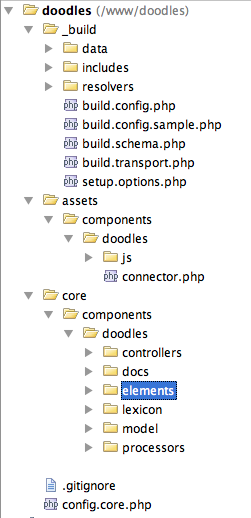
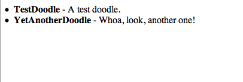

## Overview

This tutorial builds the Doodles Extra step by step: a custom table, a Snippet that reads it through an xPDO model and renders the rows with a Chunk, a manager page to edit the data, and a build script that packages everything into a Transport Package. It targets MODX 3.x on PHP 8.1 or newer.

Part 1, this page, creates the component skeleton and the Snippet. [Part 2](extending-modx/tutorials/developing-an-extra/part-2 "Developing an Extra, part 2") builds the manager page with a grid, a create form and inline editing, and [part 3](extending-modx/tutorials/developing-an-extra/part-3 "Developing an Extra, part 3") packages the Extra.

The finished Doodles Extra is on GitHub: <https://github.com/splittingred/doodles>

## Setting Up Our Directories

This tutorial develops the Extra outside the MODX installation and tracks it with [Git](http://github.com/), so that:

-   edits come straight from the repository, with no copying of files into the manager;
-   several developers work on the same files without touching the MODX core;
-   the code stays in one place and can be moved or reused as a whole.

Create the Extra next to the MODX installation: **/www/doodles/**, with MODX itself in **/www/modx/**. `git init` and a `.gitignore` inside `/www/doodles/` are all that is needed to start tracking it.

You **may** also want two System Settings: `session_cookie_path` with a value of `/` (no quotations), so MODX uses the same session on the site and in the manager, and a `session_name` such as `modxlocaldevsession`, so several local installations do not fight over one session. Clear `core/cache/` and log in again after changing either.

The directory will look like this:



An installed Extra is split in two: `core/components/doodles/` and `assets/components/doodles/`. Web-facing files — JavaScript, CSS, images, connectors — go into `assets/`, which has to be reachable over HTTP. All PHP files go into `core/`, which can and should sit outside the webroot; a connector is the exception and stays in `assets/`. The development copy mirrors that split, so the Transport Package installs every file where it already is.

The `_build/` directory is scaffolding for the build script and never goes into the package zip.

One file in `assets/` needs a word before part 2: `assets/components/doodles/connector.php`. It gives the Custom Manager Page (CMP) its custom processors.

The rest of `core/components/doodles/`:

| Path | Contents |
| --- | --- |
| `bootstrap.php` | Runs on every MODX initialization and registers the class files and the service. See [Registering the Service](#registering-the-service). |
| `controllers/` | Controllers for the CMP. |
| `docs/` | Changelog, readme and license. |
| `elements/` | Snippets, Chunks, Plugins. |
| `lexicon/` | Language files. |
| `model/` | The XML schema. The classes generated from it go to `src/`. |
| `processors/` | Custom processors for the CMP. |
| `src/` | PHP classes and the xPDO model generated from the schema. |

## The Namespace Record

MODX finds an Extra's files through a [Namespace](extending-modx/namespaces "Namespaces") record, and the build script in part 3 creates that same record when the Transport Package installs. Create it once, in the manager, under **Admin → Namespaces**:

| Field | Value |
| --- | --- |
| Name | `doodles` |
| Core Path | `{base_path}doodles/core/components/doodles/` |
| Assets Path | `{base_path}doodles/assets/components/doodles/` |

MODX substitutes `{base_path}` with the root of the installation, so the record keeps working after the site is moved. During development the paths point at the local `/www/doodles/` directory; once the Transport Package is installed they point at `{core_path}components/doodles/`. No System Settings of your own are involved.

## Creating the Doodles Snippet

Create the file for the first Snippet:

`/www/doodles/core/components/doodles/elements/snippets/snippet.doodles.php`

You will need a `snippets/` directory under `elements/` if you have not made it yet.

### Making the Doodles Base Class

The Snippet needs a class to hold the paths and the methods it uses. Create `/www/doodles/core/components/doodles/src/Doodles.php`:

```php
<?php
namespace Doodles;

use MODX\Revolution\modX;

class Doodles
{
    /** @var modX */
    public $modx;
    public array $config = [];

    public function __construct(modX $modx, array $config = [])
    {
        $this->modx = $modx;
        $basePath = $config['basePath'] ?? $modx->getOption('core_path') . 'components/doodles/';
        $assetsUrl = $config['assetsUrl'] ?? $modx->getOption('assets_url') . 'components/doodles/';
        $this->config = array_merge([
            'basePath' => $basePath,
            'corePath' => $basePath,
            'modelPath' => $basePath . 'src/',
            'processorsPath' => $basePath . 'processors/',
            'templatesPath' => $basePath . 'templates/',
            'chunksPath' => $basePath . 'elements/chunks/',
            'jsUrl' => $assetsUrl . 'js/',
            'cssUrl' => $assetsUrl . 'css/',
            'assetsUrl' => $assetsUrl,
            'connectorUrl' => $assetsUrl . 'connector.php',
        ], $config);
    }
}
```

The class lives in the `Doodles` namespace in a file of the same name, which is what the Composer autoloader expects.

The paths come from the Namespace record, so the class works in the development copy and in an installed Extra without a change.

### Registering the Service

MODX loads a file named `bootstrap.php` from every Namespace when it initializes, before anything else is ready. Create `/www/doodles/core/components/doodles/bootstrap.php`:

```php
<?php
/**
 * @var \MODX\Revolution\modX $modx
 * @var array $namespace
 */

$modx->addPackage('Doodles\Model', $namespace['path'] . 'src/', null, 'Doodles\\');

$modx->services->add('doodles', function () use ($modx, $namespace) {
    return new \Doodles\Doodles($modx, [
        'basePath' => $namespace['path'],
        'assetsUrl' => $namespace['assets_path'],
    ]);
});
```

`addPackage()` loads the generated xPDO model and registers the `Doodles\` namespace with the autoloader. `services->add()` puts the class into the MODX [dependency injection container](extending-modx/di-container "Dependency Injection Container") under the id `doodles`, so any Snippet, Plugin or processor can ask for it.

`$namespace['path']` is the Core Path of the Namespace record with `{core_path}` and `{base_path}` already substituted, and `$namespace['assets_path']` is its Assets Path.

`$modx->getService()` also still loads a service and is what older Extras use, but it is deprecated and scheduled for removal.

> [!WARNING]
> `bootstrap.php` runs before the Context is loaded. `$modx->getContext()` returns `null` in there, and Context settings are not in the configuration yet — keep the file to class loading and service registration.

Any Snippet can then fetch the service:

```php
<?php
/** @var \MODX\Revolution\modX $modx */
/** @var array $scriptProperties */

if (!$modx->services->has('doodles')) {
    return '';
}
$dood = $modx->services->get('doodles');
```

`$modx` and `$scriptProperties` are already in scope inside a Snippet — no `global` declarations needed. `$scriptProperties` holds every property passed to the Snippet call.

Add the default properties after those lines:

```php
$dood = $modx->services->get('doodles');
/* setup default properties */
$tpl = $modx->getOption('tpl', $scriptProperties, 'rowTpl');
$sort = $modx->getOption('sort', $scriptProperties, 'name');
$dir = $modx->getOption('dir', $scriptProperties, 'ASC');
$output = '';
return $output;
```

To read records with xPDO, the Snippet needs a model, so build that first.

### Making the Model

An xPDO Schema describes your tables; the generator turns it into PHP classes that read and write the rows, and `addPackage()` makes them available to your code. [Custom Models](extending-modx/xpdo/custom-models "Custom Models") covers the general case — here is the version for our table.

Create `/www/doodles/core/components/doodles/model/schema/doodles.mysql.schema.xml`:

```xml
<?xml version="1.0" encoding="UTF-8"?>
<model package="Doodles\Model" baseClass="xPDO\Om\xPDOObject" platform="mysql" defaultEngine="InnoDB" version="3.0">
    <object class="Doodle" table="doodles" extends="xPDO\Om\xPDOSimpleObject">
        <field key="name" dbtype="varchar" precision="255" phptype="string" null="false" default=""/>
        <field key="description" dbtype="text" phptype="string" null="false" default=""/>
        <field key="createdon" dbtype="datetime" phptype="datetime" null="true"/>
        <field key="createdby" dbtype="int" precision="10" attributes="unsigned" phptype="integer" null="false" default="0" />
        <field key="editedon" dbtype="datetime" phptype="datetime" null="true"/>
        <field key="editedby" dbtype="int" precision="10" attributes="unsigned" phptype="integer" null="false" default="0" />
        <aggregate alias="CreatedBy" class="MODX\Revolution\modUser" local="createdby" foreign="id" cardinality="one" owner="foreign"/>
        <aggregate alias="EditedBy" class="MODX\Revolution\modUser" local="editedby" foreign="id" cardinality="one" owner="foreign"/>
    </object>
</model>
```

If this is your first xPDO schema, [More Examples of xPDO XML Schema Files](extending-modx/xpdo/custom-models/defining-a-schema/more-examples "More Examples of xPDO XML Schema Files") explains the rest. Start with the model line:

```xml
<model package="Doodles\Model" baseClass="xPDO\Om\xPDOObject" platform="mysql" defaultEngine="InnoDB" version="3.0">
```

| Attribute | Meaning |
| --- | --- |
| `package="Doodles\Model"` | PHP namespace the generated classes get, and the package name our `addPackage()` call uses. |
| `baseClass` | The class every object below extends. |
| `platform="mysql"` | The database platform. |
| `version="3.0"` | Not decoration: only from `3.0` on does the generator write the `metadata.mysql.php` file with the class map, and only a model with that map is registered with the PSR-4 autoloader. |

Then the object line:

```xml
<object class="Doodle" table="doodles" extends="xPDO\Om\xPDOSimpleObject">
```

An "object" in an xPDO schema is a database table. This line names the table `doodles`; xPDO prefixes it with your table prefix, so it lands in the database as `modx_doodles`. `xPDOSimpleObject` is `xPDOObject` plus an auto-incrementing `id` column, and a Doodle needs an `id`.

The six `<field>` lines are the remaining columns of the table:

```xml
<field key="name" dbtype="varchar" precision="255" phptype="string" null="false" default=""/>
<field key="description" dbtype="text" phptype="string" null="false" default=""/>
<field key="createdon" dbtype="datetime" phptype="datetime" null="true"/>
<field key="createdby" dbtype="int" precision="10" attributes="unsigned" phptype="integer" null="false" default="0" />
<field key="editedon" dbtype="datetime" phptype="datetime" null="true"/>
<field key="editedby" dbtype="int" precision="10" attributes="unsigned" phptype="integer" null="false" default="0" />
```

The last two lines bring in related objects: `createdby` maps to a `modUser`, and `editedby` to another one.

```xml
<aggregate alias="CreatedBy" class="MODX\Revolution\modUser" local="createdby" foreign="id" cardinality="one" owner="foreign"/>
<aggregate alias="EditedBy" class="MODX\Revolution\modUser" local="editedby" foreign="id" cardinality="one" owner="foreign"/>
```

Related classes are given with their full namespace — a short name here does not resolve.

### The Schema Parsing Script

This script parses the schema into PHP classes. Create `/www/doodles/_build/build.schema.php`:

```php
<?php
require_once dirname(__FILE__) . '/build.config.php';
require_once MODX_CORE_PATH . 'vendor/autoload.php';

$modx = new \MODX\Revolution\modX();
$modx->initialize('mgr');
$modx->setLogLevel(\MODX\Revolution\modX::LOG_LEVEL_INFO);
$modx->setLogTarget(XPDO_CLI_MODE ? 'ECHO' : 'HTML');

/* the Namespace record is where MODX will look for the files */
$namespace = $modx->getObject(\MODX\Revolution\modNamespace::class, 'doodles');

$sources = [
    'model' => $namespace->getCorePath() . 'src/',
    'schema_file' => $namespace->getCorePath() . 'model/schema/doodles.mysql.schema.xml',
];

$manager = $modx->getManager();
$generator = $manager->getGenerator();
if (!is_dir($sources['model'])) { $modx->log(modX::LOG_LEVEL_ERROR, 'Model directory not found!'); die(); }
if (!file_exists($sources['schema_file'])) { $modx->log(modX::LOG_LEVEL_ERROR, 'Schema file not found!'); die(); }

$generator->parseSchema($sources['schema_file'], $sources['model'], [
    'regenerate' => 1,
    'namespacePrefix' => 'Doodles\\',
]);
$modx->addPackage('Doodles\Model', $sources['model'], null, 'Doodles\\');
$manager->createObjectContainer(\Doodles\Model\Doodle::class);
$modx->log(modX::LOG_LEVEL_INFO, 'Done!');
```

`namespacePrefix` puts the generated classes under the `Doodles\` prefix: the domain class lands in `src/Model/Doodle.php`, its platform map in `src/Model/mysql/Doodle.php`, and the class map in `src/Model/metadata.mysql.php` — the file `addPackage()` reads.

The script expects `/www/doodles/_build/build.config.php` with the paths of your installation:

```php
<?php
define('MODX_BASE_PATH', '/www/modx/');
define('MODX_CORE_PATH', MODX_BASE_PATH . 'core/');
define('MODX_MANAGER_PATH', MODX_BASE_PATH . 'manager/');
define('MODX_CONNECTORS_PATH', MODX_BASE_PATH . 'connectors/');
define('MODX_ASSETS_PATH', MODX_BASE_PATH . 'assets/');
define('MODX_BASE_URL','/modx/');
/* define('MODX_CORE_URL', MODX_BASE_URL . 'core/'); */ /* There isn't a core URL!! */
define('MODX_MANAGER_URL', MODX_BASE_URL . 'manager/');
define('MODX_CONNECTORS_URL', MODX_BASE_URL . 'connectors/');
define('MODX_ASSETS_URL', MODX_BASE_URL . 'assets/');
```

Change the paths to wherever your MODX installation is, then run the script from the command line:

```bash
php /www/doodles/_build/build.schema.php
```

It generates the class files and maps in `core/components/doodles/src/Model/`:

```
src/Model/Doodle.php
src/Model/mysql/Doodle.php
src/Model/metadata.mysql.php
```

> [!CAUTION]
> Do not open `build.schema.php` in a browser. It creates tables and rewrites files with no authentication in front of it — run it from the command line only.

`bootstrap.php` calls `addPackage()` on every request, so anything you write from here on can use `\Doodles\Model\Doodle`. The Snippet so far only fetches the service and sets defaults:

```php
$dood = $modx->services->get('doodles');
/* setup default properties */
$tpl = $modx->getOption('tpl', $scriptProperties, 'rowTpl');
$sort = $modx->getOption('sort', $scriptProperties, 'name');
$dir = $modx->getOption('dir', $scriptProperties, 'ASC');
$output = '';
return $output;
```

### The Static Snippet

MODX needs the Snippet in the manager, but pasting the code there means copying it back and forth on every edit. A static Snippet reads the file from disk on every call instead.

Create a new Snippet and check the **Is Static** checkbox. Two fields appear. Set **Media Source for Static File** to **None**: the Doodles Extra lives outside the MODX web space, and the path given to it is absolute. In the static file field put:

```
/www/doodles/core/components/doodles/elements/snippets/snippet.doodles.php
```

Edit the Snippet in your IDE from now on. Properties passed to the Snippet call arrive in the file as `$scriptProperties` as usual. The path is absolute, so it has to be changed once the Extra is installed from its Transport Package — part 3 covers that.

### Building the Query

**Note:** Creating the table belongs to the build process of the package, not to a Snippet, so it stayed in `_build/build.schema.php`.

Add this to the Snippet before the return statement:

```php
$doodles = $modx->getCollection(\Doodles\Model\Doodle::class);
$output = count($doodles);
```

**Know Your Objects!**
This call retrieves a collection of "Doodle" objects. Most of the time [xPDO.getCollection](extending-modx/xpdo/class-reference/xpdo/xpdo.getcollection "xPDO.getCollection") returns the built-in MODX objects (pages are `MODX\Revolution\modResource`, templates are `MODX\Revolution\modTemplate`), so keep `core/model/schema/modx.mysql.schema.xml` open to look up the object names.

Save the Snippet and run it from a Resource, for example <http://localhost/modx/doodles.html>. With an empty table it returns:

> 0

Add a few rows to the `modx_doodles` table with any database tool, for example phpMyAdmin, filling in the `name` and `description` values. With two rows the Snippet returns:

> 2

Add a sort to the query:

```php
$c = $modx->newQuery('Doodle');
$c->sortby($sort,$dir);
$doodles = $modx->getCollection('Doodle',$c);
```

That sorts by the field named in `$sort` in the direction named in `$dir`, both of which come from the Snippet properties. Now the rows need output.

### The Doodles class getChunk Method

Add two helper methods to the `Doodles` class so that Chunks can live in files. Open `/www/doodles/core/components/doodles/src/Doodles.php` and add:

```php
    public function getChunk($name, $properties = [])
    {
        $chunk = $this->_getTplChunk($name);
        if (!$chunk) {
            $chunk = $this->modx->getObject(\MODX\Revolution\modChunk::class, ['name' => $name]);
        }
        if (!$chunk) {
            return false;
        }
        /* the rendered row differs per call, so it must not be cached */
        $chunk->setCacheable(false);
        return $chunk->process($properties);
    }

    private function _getTplChunk($name, $postfix = '.chunk.tpl')
    {
        $f = $this->config['chunksPath'] . strtolower($name) . $postfix;
        if (!file_exists($f)) {
            return false;
        }
        $chunk = $this->modx->newObject(\MODX\Revolution\modChunk::class);
        $chunk->set('name', $name);
        $chunk->setContent(file_get_contents($f));
        return $chunk;
    }
```

`setCacheable(false)` is what keeps MODX from storing the rendered row in the element cache: the same Chunk produces different output for every row, so what was rendered for one Doodle must not be served for the next.

Both methods look for `elements/chunks/<name>.chunk.tpl` first, with the name lowercased, and fall back to a Chunk of that name in MODX. So:

```php
$o = $dood->getChunk('hello',['name' => 'Joe']);
```

returns the contents of `/www/doodles/core/components/doodles/elements/chunks/hello.chunk.tpl` with `[[+name]]` replaced by `Joe`. Keeping Chunks in files also means the package does not have to install them into the user's MODX, where an upgrade could overwrite them.

Create `/www/doodles/core/components/doodles/elements/chunks/rowtpl.chunk.tpl`:

```html
<li><strong>[[+name]]</strong> - [[+description]]</li>
```

Add this below the query and above the return line in the Snippet:

```php
foreach ($doodles as $doodle) {
    $doodleArray = $doodle->toArray();
    $output .= $dood->getChunk($tpl,$doodleArray);
}
```

The loop turns each Doodle into a PHP array with `toArray()`, hands it to `getChunk()` as the Chunk properties, and appends the result to `$output` — one `<li>` per row:



The Chunk is a file too, so a `&tpl` property in the Snippet call can point at any other Chunk.

The Snippet now loads the base class through the service container, reads the custom table through the generated model, and renders the rows with a Chunk:

```php
<?php
/** @var \MODX\Revolution\modX $modx */
/** @var array $scriptProperties */

if (!$modx->services->has('doodles')) {
    return '';
}
$dood = $modx->services->get('doodles');
/* setup default properties */
$tpl = $modx->getOption('tpl', $scriptProperties, 'rowTpl');
$sort = $modx->getOption('sort', $scriptProperties, 'name');
$dir = $modx->getOption('dir', $scriptProperties, 'ASC');
/* build query */
$c = $modx->newQuery(\Doodles\Model\Doodle::class);
$c->sortby($sort, $dir);
$doodles = $modx->getCollection(\Doodles\Model\Doodle::class, $c);
/* iterate */
$output = '';
foreach ($doodles as $doodle) {
    $output .= $dood->getChunk($tpl, $doodle->toArray());
}
return $output;
```

## Summary

Part 1 produced a custom database model, a Snippet that reads it, and the directory structure of a working Extra. Editing the data in the manager is [part 2](extending-modx/tutorials/developing-an-extra/part-2 "Developing an Extra, part 2"), which builds the Custom Manager Page (CMP).
