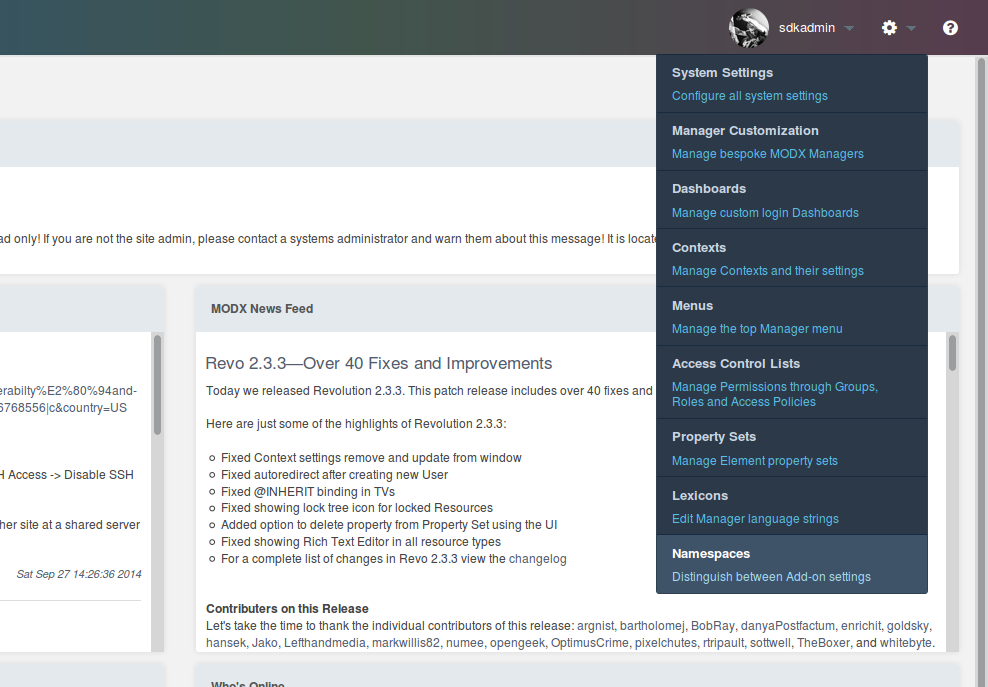
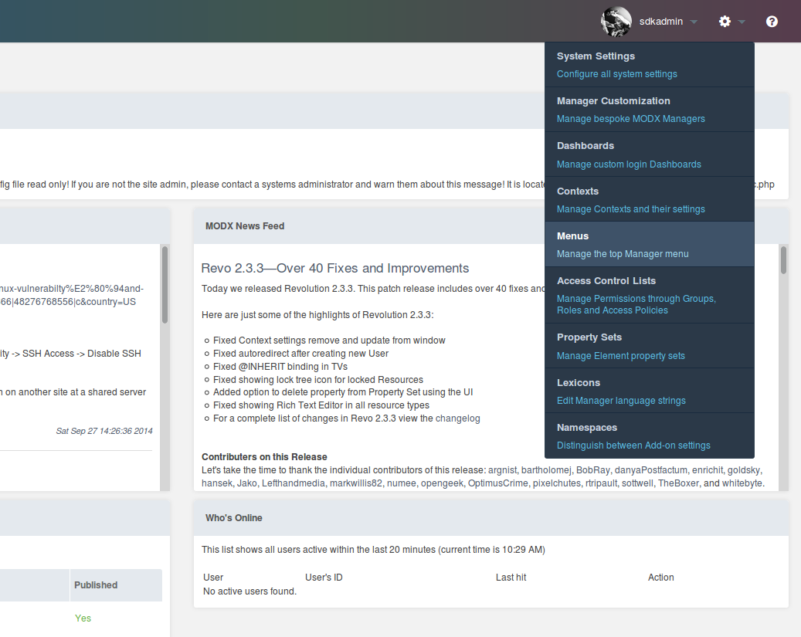
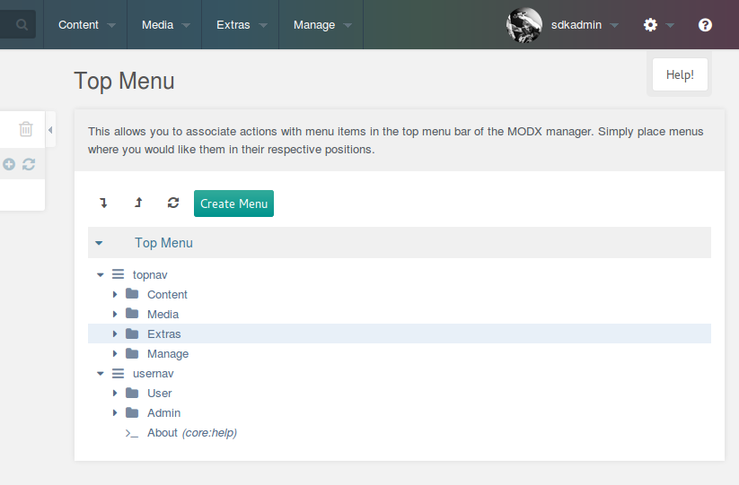
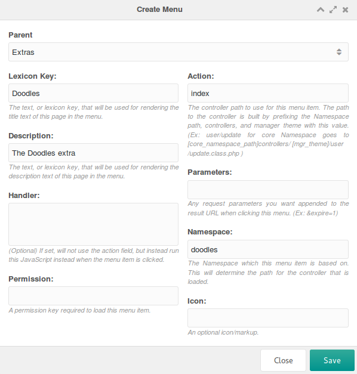
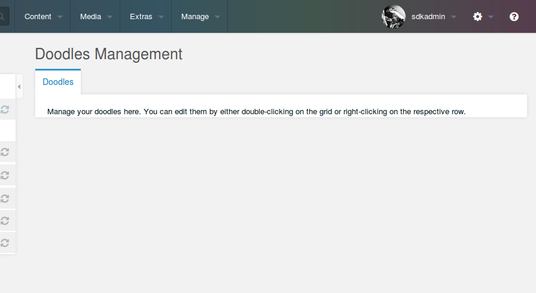
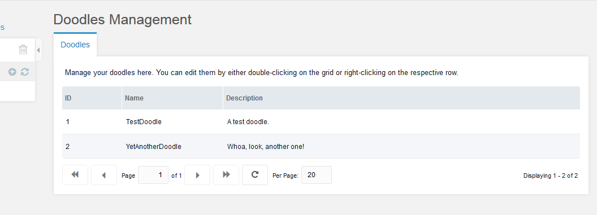
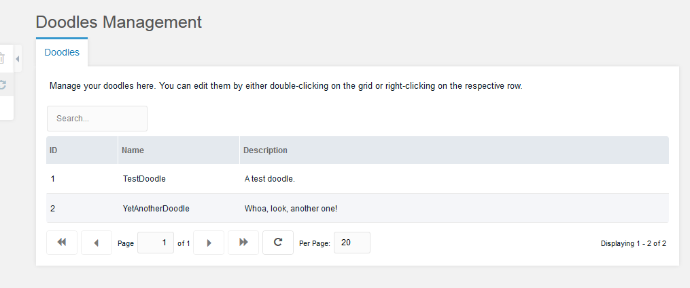
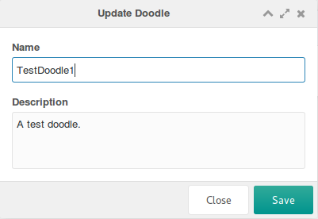
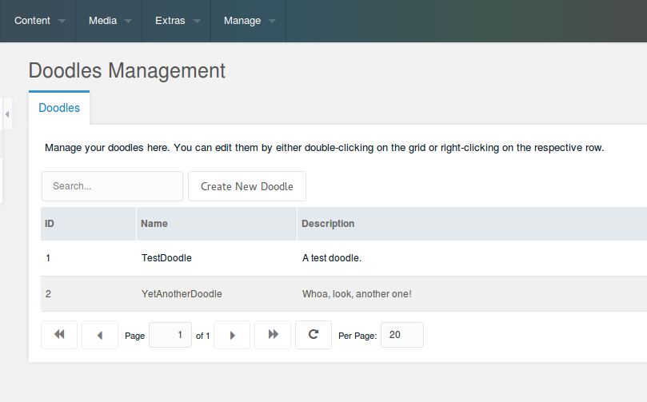
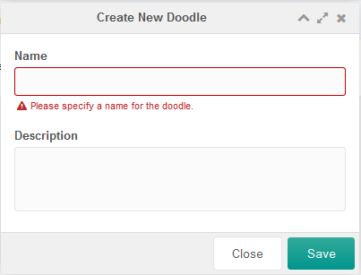

This tutorial is part of a Series:

-   [Part I: Getting Started and Creating the Doodles Snippet](extending-modx/tutorials/developing-an-extra "Developing an Extra")
-   Part II: Creating our Custom Manager Page
-   [Part III: Packaging Our Extra](extending-modx/tutorials/developing-an-extra/part-3 "Developing an Extra, part 3")

This part covers the Custom Manager Page (CMP) for the Doodles Extra from [part 1](extending-modx/tutorials/developing-an-extra "Developing an Extra"): the controller, the connector and its processors, the Namespace and Menu item, and the ExtJS grid.

## First Setup Steps

Part 1 left a working Snippet and a directory structure. The manager page needs three more things before it can be written: the Namespace, the Menu item, and a Lexicon topic.

### Namespaces

A [Namespace](extending-modx/namespaces "Namespaces") tells MODX where the files of an Extra live, so an Extra can run without touching the MODX core. Part 1 already created the `doodles` Namespace — check it under **Admin → Namespaces**:



| Field | Value |
| --- | --- |
| Name | `doodles` |
| Core Path | Full absolute path to `core/components/doodles/`, or `{core_path}components/doodles/` when the files are inside the MODX root. |
| Assets Path | Full absolute path to `assets/components/doodles/`, or `{assets_path}components/doodles/`. |

`{base_path}` works in both path fields and resolves to the root of the installation. Part 1 used it to point at the development copy.

MODX reads the Core Path for the controllers, the Lexicon files and `bootstrap.php`. The Assets Path is yours to use: MODX does not read it by itself, so the controller passes the asset URLs to the page as part of its own config.

### Menus

A CMP is opened by a menu item, and the menu item *is* the route: the Namespace plus the name of the controller file. There is no separate Action object to create.

The controller `controllers/index.class.php` resolves to the action `index`, so the URL of the CMP is <http://your-web-root/manager/?a=index&namespace=doodles>. A Namespace and an empty action fall back to `index` as well (`core/src/Revolution/modManagerResponse.php:67-70`).

Create the menu item under **Admin → Menus**. Click **Create** above the menu tree:





Fill the Create Menu window in like this:

| Field | Value | What it does |
| --- | --- | --- |
| Parent | Extras | Where in the menu tree the item is listed. |
| Lexicon Key | Doodles | Key translated into the item caption. Use a plain name now and a Lexicon key later. |
| Description | The Doodles Extra | Free text or a Lexicon key. |
| Handler | — | Runs JavaScript instead of loading a page. Useful for items like "Clear Cache"; unused here. |
| Permissions | — | See below. |
| Action | index | The controller file MODX loads on click. |
| Parameters | — | GET parameters appended to the URL. Unused here. |
| Namespace | doodles | The Namespace of the controller. |
| Icon | — | Written into the menu as raw HTML, so a tag such as `<i class="icon icon-home"></i>`, not a file name. |

An empty **Permissions** list is not "no check": the same list is verified on every click of the route, and an empty one lets every user who can reach the manager open the page. Fill it in when the CMP should be restricted.



Save, and the item appears in the tree under **Extras**.

### Lexicons

[Lexicons](extending-modx/internationalization "Internationalization") hold the translations of an Extra. Strings, also called entries, are grouped into topics, and an Extra is free to load only the topics a page needs instead of all of them.

Keys are conventionally prefixed with the Namespace and a dot — `doodles.desc` — so that two Extras cannot collide.

Files live at:

> {namespace_path}/lexicon/{language}/{topic}.inc.php

Create `/www/doodles/core/components/doodles/lexicon/en/default.inc.php`:

```php
<?php
$_lang['doodle'] = 'Doodle';
$_lang['doodles'] = 'Doodles';
$_lang['doodles.desc'] = 'Manage your doodles here.';
$_lang['doodles.description'] = 'Description';
$_lang['doodles.doodle_err_ae'] = 'A doodle with that name already exists.';
$_lang['doodles.doodle_err_nf'] = 'Doodle not found.';
$_lang['doodles.doodle_err_ns'] = 'Doodle not specified.';
$_lang['doodles.doodle_err_ns_name'] = 'Please specify a name for the doodle.';
$_lang['doodles.doodle_err_remove'] = 'An error occurred while trying to remove the doodle.';
$_lang['doodles.doodle_err_save'] = 'An error occurred while trying to save the doodle.';
$_lang['doodles.doodle_create'] = 'Create New Doodle';
$_lang['doodles.doodle_remove'] = 'Remove Doodle';
$_lang['doodles.doodle_remove_confirm'] = 'Are you sure you want to remove this doodle?';
$_lang['doodles.doodle_update'] = 'Update Doodle';
$_lang['doodles.downloads'] = 'Downloads';
$_lang['doodles.location'] = 'Location';
$_lang['doodles.management'] = 'Doodles Management';
$_lang['doodles.management_desc'] = 'Manage your doodles here. You can edit them by either double-clicking on the grid or right-clicking on the respective row.';
$_lang['doodles.name'] = 'Name';
$_lang['doodles.search...'] = 'Search...';
$_lang['doodles.top_downloaded'] = 'Top Downloaded Doodles';
```

A topic file is nothing but a `$_lang` array. `doodles` and `doodles.desc` are the two strings the menu item uses.

A Snippet loads a topic with `$modx->lexicon->load('doodles:default')`. A CMP loads it from the controller instead, by returning the topic names from `getLanguageTopics()`; the core adds `action` and `trash` to whatever you return, so those two are always loaded.

## Setting up the Controller with MODExt

CMPs are built with [ExtJS](http://sencha.com/), and the MODX additions to a few of its tools are called MODExt. The manager still runs ExtJS 3 (`manager/assets/ext3/`) and MODX's own pages are built on it, so a component that extends one of the MODX classes keeps working across upgrades.

This part is not a course in ExtJS. It shows the MODExt tools needed for a grid with CRUD actions.

### The Base Controller

MODX looks for a controller in this order (`core/src/Revolution/modManagerResponse.php:244-295`):

1. an autoloadable class named `\MODX\Revolution\Controllers\<action>`;
2. a class named `ucfirst(namespace) . $action . 'ManagerController'`;
3. a file `controllers/<action>.class.php` in the Namespace;
4. a file `controllers/<action>/index.class.php` in the Namespace.

The third step is used here: the file name is what the action resolves to, and the class name inside it does not matter for routing, because PHP class names are case-insensitive.

Create `/www/doodles/core/components/doodles/controllers/index.class.php`:

```php
<?php
use MODX\Revolution\modExtraManagerController;

class DoodlesIndexManagerController extends modExtraManagerController {
    /** @var \Doodles\Doodles $doodles */
    public $doodles;
    public function initialize() {
        $this->doodles = $this->modx->services->get('doodles');
        $this->addCss($this->doodles->config['cssUrl'] . 'mgr.css');
        $this->addJavascript($this->doodles->config['jsUrl'] . 'mgr/doodles.js');
        $this->addHtml('<script type="text/javascript">
            Ext.onReady(function() {
                Doodles.config = ' . $this->modx->toJSON($this->doodles->config) . ';
            });
            </script>');
        return parent::initialize();
    }
    public function getLanguageTopics() {
        return array('doodles:default');
    }
    public function checkPermissions() { return true; }
    public function process(array $scriptProperties = array()) {}
    public function getPageTitle() { return $this->modx->lexicon('doodles'); }
    public function loadCustomCssJs() {
        //$this->addJavascript($this->doodles->config['jsUrl'].'mgr/widgets/doodles.grid.js');
        $this->addJavascript($this->doodles->config['jsUrl'] . 'mgr/widgets/home.panel.js');
        $this->addLastJavascript($this->doodles->config['jsUrl'] . 'mgr/sections/index.js');
    }
    public function getTemplateFile() {
        return $this->doodles->config['templatesPath'] . 'home.tpl';
    }
}
```

| Method | Purpose |
| --- | --- |
| `initialize()` | Runs when the controller is loaded: fetches the Doodles service from part 1, adds the CSS and JS the page always needs, and passes the paths to the component as `Doodles.config`. |
| `getLanguageTopics()` | Names the Lexicon topics to load for the manager. |
| `checkPermissions()` | Anything other than `true` denies access to the page. |
| `process()` | Required in every manager controller, unused here. |
| `getPageTitle()` | The page title; here the translated "Doodles". |
| `loadCustomCssJs()` | Registers the panel and the section of this particular page. |
| `getTemplateFile()` | The Smarty template MODX renders; looked up in `templates/<theme>/`, `templates/default/` and `templates/` inside the Namespace core path. |

Two details are not obvious. In MODX 3 the parent class lives in the `MODX\Revolution` namespace, so `extends modExtraManagerController` only works because of the global class aliases in `core/include/deprecated.php`, which are slated for removal. And the terms are the ones MODX itself uses: a widget is a piece of interface such as a grid, a tree or a panel, kept in its own file so that different pages can reuse it; a section is the JavaScript that actually loads widgets onto a page. Including a widget does not render it.

The grid is left commented out for now and comes back in the next section.

Create the template at `/www/doodles/core/components/doodles/templates/home.tpl`:

```html
<div id="doodles-panel-home-div"></div>
```

`initialize()` also loads `mgr/doodles.js`, which defines the JavaScript component and receives the config from `$doodles->config` in `Doodles.config`:

```javascript
var Doodles = function (config) {
    config = config || {};
    Doodles.superclass.constructor.call(this, config);
};
Ext.extend(Doodles, Ext.Component, {
    page: {},
    window: {},
    grid: {},
    tree: {},
    panel: {},
    combo: {},
    config: {},
});
Ext.reg("doodles", Doodles);
Doodles = new Doodles();
```

`Ext.extend()` against `Ext.Component` is what gives the file a JavaScript namespace of its own: everything below hangs off the `Doodles` object.

## Our Doodles CMP Page

### The Section JS File

Create `/www/doodles/assets/components/doodles/js/mgr/sections/index.js`:

```javascript
Ext.onReady(function () {
    MODx.load({ xtype: "doodles-page-home" });
});
Doodles.page.Home = function (config) {
    config = config || {};
    Ext.applyIf(config, {
        components: [
            {
                xtype: "doodles-panel-home",
                renderTo: "doodles-panel-home-div"
            }
        ]
    });
    Doodles.page.Home.superclass.constructor.call(this, config);
};
Ext.extend(Doodles.page.Home, MODx.Component);
Ext.reg("doodles-page-home", Doodles.page.Home);
```

An `xtype` is a unique name for a component — an identifier for a class, in effect. `MODx.load()` instantiates the component registered under that name, here `doodles-page-home`.

`Doodles.page.Home` extends `MODx.Component`, a base class that renders a page in the manager. It receives the components to load, currently the not-yet-defined `doodles-panel-home`, and renders it into the `doodles-panel-home-div` element returned by the template.

### The Panel JS File

Create `/www/doodles/assets/components/doodles/js/mgr/widgets/home.panel.js`:

```javascript
Doodles.panel.Home = function (config) {
    config = config || {};
    Ext.apply(config, {
        border: false,
        cls: "container",
        items: [{
            html: "<p>" + _("doodles.management_desc") + "</p>",
            border: false,
            bodyCssClass: "panel-desc",
        } /*,{
            xtype: 'doodles-grid-doodles'
            ,cls: 'main-wrapper'
            ,preventRender: true
        }*/],
    });
    Doodles.panel.Home.superclass.constructor.call(this, config);
};
Ext.extend(Doodles.panel.Home, MODx.Panel);
Ext.reg("doodles-panel-home", Doodles.panel.Home);
```

The panel registers itself as `doodles-panel-home`, the xtype the section asked for, and extends `MODx.Panel` rather than `Ext.Panel` for the manager styling. The grid goes in as a second item of the same `items` array below.

The `_()` function is how the manager JavaScript translates a Lexicon key: `_('doodles.management_desc')` renders the string defined in part 1's topic file.

Load the page. The manager may need a refresh before the Doodles component shows up in the Components menu:



The panel is MODX-styled but empty. It needs a grid.

## The Doodles Grid

Uncomment the grid line in the controller:

```php
$this->addJavascript($doodles->config['jsUrl'].'mgr/widgets/doodles.grid.js');
```

Create `/www/doodles/assets/components/doodles/js/mgr/widgets/doodles.grid.js`:

```javascript
Doodles.grid.Doodles = function (config) {
    config = config || {};
    Ext.applyIf(config, {
        id: "doodles-grid-doodles",
        url: MODx.config.connector_url,
        baseParams: { action: "mgr/doodle/getList" },
        fields: ["id", "name", "description", "menu"],
        paging: true,
        remoteSort: true,
        anchor: "97%",
        autoExpandColumn: "name",
        columns: [
            {
                header: _("id"),
                dataIndex: "id",
                sortable: true,
                width: 60,
            },
            {
                header: _("doodles.name"),
                dataIndex: "name",
                sortable: true,
                width: 100,
                editor: { xtype: "textfield" },
            },
            {
                header: _("doodles.description"),
                dataIndex: "description",
                sortable: false,
                width: 350,
                editor: { xtype: "textfield" },
            },
        ],
    });
    Doodles.grid.Doodles.superclass.constructor.call(this, config);
};
Ext.extend(Doodles.grid.Doodles, MODx.grid.Grid);
Ext.reg("doodles-grid-doodles", Doodles.grid.Doodles);
```

| Option | Meaning |
| --- | --- |
| `id` | DOM ID of the grid. |
| `url` | The connector URL. MODX publishes it to the page as `MODx.config.connector_url`; use that instead of a path of your own. |
| `baseParams` | Parameters sent with every request. `action` names the processor that returns the rows. |
| `fields` | Fields the AJAX response fills the store with — the fields of a Doodle. |
| `paging` | Adds pagination; MODExt handles the toolbar. |
| `remoteSort` | Lets ExtJS sort the columns through the processor. |
| `anchor` | Stretches the grid to 97% of the panel, leaving room for padding. |
| `autoExpandColumn` | Lets the `name` column take the remaining width. |
| `columns` | The columns to show. `dataIndex` matches the field name, and an `editor` makes a column editable in place. |

Add the grid to the panel by removing the comment markers around the second item in `home.panel.js`:

```javascript
[
    {
        html: "<p>" + _("doodles.management_desc") + "</p>",
        border: false,
        bodyCssClass: "panel-desc",
    },
    {
        xtype: "doodles-grid-doodles",
        cls: "main-wrapper",
        preventRender: true,
    },
]
```

`preventRender` keeps ExtJS from rendering the grid until the rest of the panel is loaded.

The grid would show now but stay empty: it has no connector to fetch data from.

### Hooking Up via Connectors

A **Connector** is the file a request enters the model through. It checks access, then routes the request to a **Processor** — the form-layer file that runs the queries and modifies the data. Keeping the access points few and guarded is the point of the arrangement.

Create `/www/doodles/assets/components/doodles/connector.php`:

```php
<?php
require_once dirname(dirname(dirname(dirname(__FILE__)))).'/config.core.php';
require_once MODX_CORE_PATH.'config/'.MODX_CONFIG_KEY.'.inc.php';
require_once MODX_CONNECTORS_PATH.'index.php';

$namespace = $modx->getObject(\MODX\Revolution\modNamespace::class, 'doodles');
$corePath = $namespace->getCorePath();
require_once $corePath.'src/Doodles.php';

$modx->services->add('doodles', function () use ($modx, $corePath) {
    return new \Doodles\Doodles($modx, ['basePath' => $corePath]);
});
$modx->lexicon->load('doodles:default');

/* handle request */
$path = $corePath.'processors/';
$modx->request->handleRequest(array(
    'processors_path' => $path,
));
```

In a standard MODX install the first line already resolves. In this development environment create `/www/doodles/config.core.php`:

```php
<?php
define('MODX_CORE_PATH', '/www/modx/core/');
define('MODX_CONFIG_KEY', 'config');
```

Change the paths to your own installation, and add the file to `.gitignore` — it holds local paths and has no place in the repository.

The first three lines create the MODX instance and initialize it — `connectors/index.php` skips its own request handling precisely because we defined `MODX_CORE_PATH` before including it (`$included = defined('MODX_CONNECTOR_INCLUDED') || defined('MODX_CORE_PATH')`, `connectors/index.php:17`). The request is therefore ours to make, and the last lines do it: look up the Namespace, register the service the way `bootstrap.php` does, load the Doodles Lexicon topic, and let MODX route the request to the processors directory.

Opening the file directly returns an error instead of data:

```json
{
    "success": false,
    "message": "Access denied.",
    "total": 0,
    "data": [],
    "object": []
}
```

Two things cause that. Connectors reject anyone without a manager session. And every request must carry an authorization key that prevents CSRF attacks, passed either as the `modAuth` header or as the `HTTP_MODAUTH` parameter. Its value is a token from the session of the user making the request — different for every user and every context, which is what makes it a session token rather than a site-wide secret. Never paste or share that value.

None of this has to be handled by hand: MODExt sends the token both ways for requests made from the manager.

The second reason is that the request has no route. The `action` base parameter of the grid is `mgr/doodle/getList`, which points at:

> /www/doodles/core/components/doodles/processors/mgr/doodle/getList.class.php

> [!WARNING]
> The file name has to match the action, case included: MODX builds the path as `<processors_path><action>.class.php` without lowering the case (`core/src/Revolution/modX.php:1833`). A `getlist.class.php` next to an action of `mgr/doodle/getList` works on macOS and Windows and fails on a Linux server.

Create it:

```php
<?php
use MODX\Revolution\Processors\Model\GetListProcessor;

class DoodleGetListProcessor extends GetListProcessor {
    public $classKey = 'Doodles\\Model\\Doodle';
    public $languageTopics = ['doodles:default'];
    public $defaultSortField = 'name';
    public $defaultSortDirection = 'ASC';
    public $objectType = 'doodles.doodle';
}
return 'DoodleGetListProcessor';
```

`GetListProcessor` does the ordinary work of a list processor; the class properties say what to work on:

| Property | Meaning |
| --- | --- |
| `$classKey` | The xPDO class to read, here the Doodle objects. |
| `$languageTopics` | Lexicon topics to load for this processor. |
| `$defaultSortField` | Sort field used when the request does not name one. |
| `$defaultSortDirection` | Sort direction used when the request does not name one. |
| `$objectType` | Prefix for the standard error messages of this processor — `doodles.doodle_err_nf` and the rest of the topic. It also names the manager log entry. |

The trailing `return` names the class so that MODX can find it; the file itself may hold anything else the processor needs.

> [!TIP]
> MODX looks for a processor in this order (`core/src/Revolution/modX.php:1786-1884`): an autoloadable class if `action` is itself a class name, then `action` of the form `context/update` mapped to `MODX\Revolution\Processors\Context\Update`, and only then a file. Core processors use the second form, which is why they need no `return` line at all.

Load the page:



The grid works. It only lists Doodles so far.

### Adding Search

Add a text field to the top bar of the grid in `_widgets/doodles.grid.js`, right after the `columns:` definition:

```javascript
,tbar:[{
    xtype: 'textfield'
    ,id: 'doodles-search-filter'
    ,emptyText: _('doodles.search...')
    ,listeners: {
        'change': {fn:this.search,scope:this}
        ,'render': {fn: function(cmp) {
            new Ext.KeyMap(cmp.getEl(), {
                key: Ext.EventObject.ENTER
                ,fn: function() {
                    this.fireEvent('change',this);
                    this.blur();
                    return true;
                }
                ,scope: cmp
            });
        },scope:this}
    }
}]
```

`emptyText` is shown while the field is empty. The `change` listener runs the `search` method, and the `render` listener fires the same event on ENTER.

Define that method by replacing the `Ext.extend()` line of the grid:

```javascript
Ext.extend(Doodles.grid.Doodles, MODx.grid.Grid, {
    search: function (tf, nv, ov) {
        var s = this.getStore();
        s.baseParams.query = tf.getValue();
        this.getBottomToolbar().changePage(1);
        this.refresh();
    },
});
```

The store holds the grid data. Putting `query` into `baseParams` sends it to the processor with every request, and going back to page 1 keeps a match on the first page.

Handle the parameter in the getList processor by adding a method to the class:

```php
    public function prepareQueryBeforeCount(xPDOQuery $c) {
        $query = $this->getProperty('query');
        if (!empty($query)) {
            $c->where([
                'name:LIKE' => '%' . $query . '%',
                'OR:description:LIKE' => '%' . $query . '%',
            ]);
        }
        return $c;
    }
```

`prepareQueryBeforeCount()` receives the [xPDOQuery](extending-modx/xpdo/class-reference/xpdoquery "xPDOQuery") before `getCount()` runs and must return it. `->getProperty()` reads a request parameter.



The grid is searchable. Now the records themselves.

> [!TIP]
> MODX grids have a built-in filter mechanism — the lexicon grid configures it with `tbar.cls: 'has-nested-filters'` and a `filters` array (`manager/assets/modext/workspace/lexicon/lexicon.grid.js:16-24`). The text field above is the older, hand-written way; it still works, and it lets you see exactly what goes over the wire.

### Adding an Update Window

A MODX grid has no context menu until one is defined. Add a `getMenu` method to the grid, right below `search`:

```javascript
    ,getMenu: function() {
        return [{
            text: _('doodles.doodle_update')
            ,handler: this.updateDoodle
        },'-',{
            text: _('doodles.doodle_remove')
            ,handler: this.removeDoodle
        }];
    }
```

`MODx.grid.Grid` adds whatever items `getMenu` returns to the context menu, so the two entries above bind it to `updateDoodle` and `removeDoodle`. The second method comes later.

Add `updateDoodle` below it:

```javascript
    ,updateDoodle: function(btn,e) {
        e.preventDefault();
        if (!this.updateDoodleWindow) {
            this.updateDoodleWindow = MODx.load({
                xtype: 'doodles-window-doodle-update'
                ,record: this.menu.record
                ,listeners: {
                    'success': {fn:this.refresh,scope:this}
                }
            });
        }
        this.updateDoodleWindow.setValues(this.menu.record);
        this.updateDoodleWindow.show(e.target);
    }
```

The window is created on the first right-click and reused afterwards, which is faster and avoids DOM ID conflicts. `record` passes the clicked row to the window: `MODx.grid.Grid` keeps it in `this.menu.record`, and `MODx.Window` fills its fields from it. The `success` listener refreshes the grid whenever the form submits successfully. On later calls `setValues()` overwrites the fields with the new row, and `show(e.target)` animates the window out of the clicked element.

Define the window at the end of the file:

```javascript
Doodles.window.UpdateDoodle = function (config) {
    config = config || {};
    Ext.applyIf(config, {
        title: _("doodles.doodle_update"),
        url: MODx.config.connector_url,
        baseParams: {
            action: "mgr/doodle/update",
        },
        fields: [
            {
                xtype: "hidden",
                name: "id",
            },
            {
                xtype: "textfield",
                fieldLabel: _("doodles.name"),
                name: "name",
                anchor: "100%",
            },
            {
                xtype: "textarea",
                fieldLabel: _("doodles.description"),
                name: "description",
                anchor: "100%",
            },
        ],
    });
    Doodles.window.UpdateDoodle.superclass.constructor.call(this, config);
};
Ext.extend(Doodles.window.UpdateDoodle, MODx.Window);
Ext.reg("doodles-window-doodle-update", Doodles.window.UpdateDoodle);
```

The window has `fields` instead of `columns`, and the `id` is a hidden field because an update needs to know which record it changes.

`MODx.Window` wraps `Ext.Window` with a form that posts to `url` with `baseParams` and the field values, and adds Cancel and Save buttons labelled from `cancelBtnText` and `saveBtnText` when those are passed.



The `action` above names the processor to create:

```php
<?php
use MODX\Revolution\Processors\Model\UpdateProcessor;

class DoodleUpdateProcessor extends UpdateProcessor {
    public $classKey = 'Doodles\\Model\\Doodle';
    public $languageTopics = ['doodles:default'];
    public $objectType = 'doodles.doodle';
}
return 'DoodleUpdateProcessor';
```

`UpdateProcessor` saves the object and builds the response, so only the class properties are needed.

On MODX 3 this class also requires the `save` policy on an accessible object and answers `Access denied.` when it is missing — before any of your code runs.

### Adding a Remove Context Menu Option

Add the JS method after `updateDoodle` in the grid:

```javascript
    ,removeDoodle: function() {
        MODx.msg.confirm({
            title: _('doodles.doodle_remove')
            ,text: _('doodles.doodle_remove_confirm')
            ,url: MODx.config.connector_url
            ,params: {
                action: 'mgr/doodle/remove'
                ,id: this.menu.record.id
            }
            ,listeners: {
                'success': {fn:this.refresh,scope:this}
            }
        });
    }
```

`MODx.msg.confirm` shows a confirmation dialog and, once confirmed, calls a processor through the connector:

| Parameter | Meaning |
| --- | --- |
| `title` | Caption of the dialog. |
| `text` | The question asked; here whether the Doodle is really to be removed. |
| `url` | The connector URL. |
| `params` | REQUEST parameters: the processor path and the ID to remove. |
| `listeners` | Refreshes the grid on success, as in the update window. |

Create `/www/doodles/core/components/doodles/processors/mgr/doodle/remove.class.php`:

```php
<?php
use MODX\Revolution\Processors\Model\RemoveProcessor;

class DoodleRemoveProcessor extends RemoveProcessor {
    public $classKey = 'Doodles\\Model\\Doodle';
    public $languageTopics = ['doodles:default'];
    public $objectType = 'doodles.doodle';
}
return 'DoodleRemoveProcessor';
```

`RemoveProcessor` does the deleting.

### Creating the Create Form

R, U and D are in place. For C, add a button to the `tbar` of the grid config in `doodles.grid.js`, between the closing curly bracket of the search text field and the closing square bracket:

```javascript
,{
   text: _('doodles.doodle_create')
   ,handler: { xtype: 'doodles-window-doodle-create' ,blankValues: true }
}
```



MODExt accepts a JavaScript object as a toolbar `handler`: it loads the window, blanks its values on open, and refreshes the grid on a successful submit.

Define the window at the end of the file:

```javascript
Doodles.window.CreateDoodle = function (config) {
    config = config || {};
    Ext.applyIf(config, {
        title: _("doodles.doodle_create"),
        url: MODx.config.connector_url,
        baseParams: {
            action: "mgr/doodle/create",
        },
        fields: [
            {
                xtype: "textfield",
                fieldLabel: _("doodles.name"),
                name: "name",
                anchor: "100%",
            },
            {
                xtype: "textarea",
                fieldLabel: _("doodles.description"),
                name: "description",
                anchor: "100%",
            },
        ],
    });
    Doodles.window.CreateDoodle.superclass.constructor.call(this, config);
};
Ext.extend(Doodles.window.CreateDoodle, MODx.Window);
Ext.reg("doodles-window-doodle-create", Doodles.window.CreateDoodle);
```

The window is the update window without the `id` field and with `create` as the action.

Create `/www/doodles/core/components/doodles/processors/mgr/doodle/create.class.php`:

```php
<?php
use MODX\Revolution\Processors\Model\CreateProcessor;

class DoodleCreateProcessor extends CreateProcessor {
    public $classKey = 'Doodles\\Model\\Doodle';
    public $languageTopics = ['doodles:default'];
    public $objectType = 'doodles.doodle';
    public function beforeSave() {
        $name = $this->getProperty('name');
        if (empty($name)) {
            $this->addFieldError('name', $this->modx->lexicon('doodles.doodle_err_ns_name'));
        } elseif ($this->doesAlreadyExist(['name' => $name])) {
            $this->addFieldError('name', $this->modx->lexicon('doodles.doodle_err_ae'));
        }
        return parent::beforeSave();
    }
}
return 'DoodleCreateProcessor';
```

`beforeSave()` validates before `CreateProcessor` saves, and the check is twofold:

1. an empty name gets the `doodles.doodle_err_ns_name` message on the `name` field;
2. otherwise `doesAlreadyExist()` looks for a Doodle of that name, and a match gets `doodles.doodle_err_ae` on the same field.

Field errors arrive in the `data` element of the connector response, which is what marks the field red in the window:



### Adding Inline-Editing

MODExt grids edit in place as well. Add this to the `Doodles.grid.Doodles` config, right below `autoExpandColumn`:

```javascript
    ,save_action: 'mgr/doodle/updateFromGrid'
    ,autosave: true
```

Inline editing is on, and every save goes to the `mgr/doodle/updateFromGrid` processor. Create `/www/doodles/core/components/doodles/processors/mgr/doodle/updateFromGrid.class.php`:

```php
<?php
require_once dirname(__FILE__) . '/update.class.php';

class DoodleUpdateFromGridProcessor extends DoodleUpdateProcessor {
    public function initialize() {
        $data = $this->getProperty('data');
        if (empty($data)) return $this->modx->lexicon('invalid_data');
        $data = $this->modx->fromJSON($data);
        if (empty($data)) return $this->modx->lexicon('invalid_data');
        $this->setProperties($data);
        $this->unsetProperty('data');
        return parent::initialize();
    }
}
return 'DoodleUpdateFromGridProcessor';
```

The grid sends the changed record as one JSON string in `data`, not as separate parameters, so `initialize()` decodes it and hands the fields to the update processor it extends.

## Summary

The CMP now creates, updates, removes, searches, paginates and sorts Doodles.

[Part 3](extending-modx/tutorials/developing-an-extra/part-3 "Developing an Extra, part 3") builds a Transport Package so the Extra can be installed on any MODX site.

## Note

`$objectType` is not required in the processors above. MODX falls back to the plain value `object`, which is what a Plugin receives in `$scriptProperties['object']` — with ten components and ten `$objectType` values, that means ten different names for the same thing.

On MODX 3 the `object` key is passed either way: the processors send `$this->objectType => &$this->object` and a hardcoded `'object' => &$this->object` (`core/src/Revolution/Processors/Model/CreateProcessor.php:162-163, 191-192`). Leaving `$objectType` out removes the second name, and the manager log entries become `object_create` and `object_update`.
