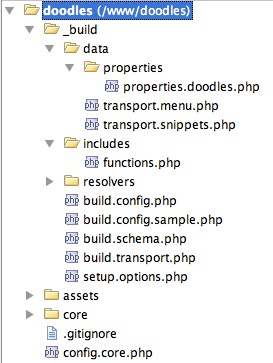
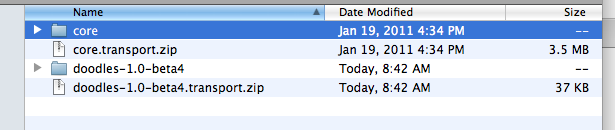

This tutorial is part of a Series:

-   [Part I: Getting Started and Creating the Doodles Snippet](extending-modx/tutorials/developing-an-extra "Developing an Extra")
-   [Part II: Creating our Custom Manager Page](extending-modx/tutorials/developing-an-extra/part-2 "Developing an Extra, part 2")
-   Part III: Packaging Our Extra

## Overview

This part packages the Extra from [part 1](extending-modx/tutorials/developing-an-extra "Developing an Extra") and [part 2](extending-modx/tutorials/developing-an-extra/part-2 "Developing an Extra, part 2") into a [Transport Package](extending-modx/transport-packages "Transport Packages"), so that it can be installed on any MODX site.

Read [Transport Packages](extending-modx/transport-packages "Transport Packages") and [Creating a Build Script](extending-modx/transport-packages/build-script "Creating a Build Script") first if either is unfamiliar. For an Extra without a CMP, [PackMan](/extras/packman "PackMan") packages one without a script; this Extra has a CMP, so the script is written by hand.

By the end the package will contain:

-   the Snippet and its default properties;
-   the files from `core/components` and `assets/components`;
-   the Menu and Namespace of the CMP;
-   a Resolver that creates the custom table in the installing user's database.

## Setting Up Our Build Directory

The `_build` directory will look like this when the work is done. Part 1 created `build.config.php` and `build.schema.php`; the rest is new.



-   **data** — the scripts that package the MODX objects.
-   **resolvers** — the [resolvers](extending-modx/transport-packages) run at install time.
-   **build.transport.php** — the main build script, which creates the Transport Package.
-   **setup.options.php** — the form shown during installation; touched only briefly here.

### The Build Script

Create `/www/doodles/_build/build.transport.php`:

```php
<?php
set_time_limit(0);

/* define package names */
define('PKG_NAME','Doodles');
define('PKG_NAME_LOWER','doodles');
define('PKG_VERSION','1.0');
define('PKG_RELEASE','beta4');

/* define build paths */
$root = dirname(dirname(__FILE__)).'/';
$sources = array(
    'root' => $root,
    'build' => $root . '_build/',
    'data' => $root . '_build/data/',
    'resolvers' => $root . '_build/resolvers/',
    'lexicon' => $root . 'core/components/'.PKG_NAME_LOWER.'/lexicon/',
    'docs' => $root.'core/components/'.PKG_NAME_LOWER.'/docs/',
    'elements' => $root.'core/components/'.PKG_NAME_LOWER.'/elements/',
    'source_assets' => $root.'assets/components/'.PKG_NAME_LOWER,
    'source_core' => $root.'core/components/'.PKG_NAME_LOWER,
);
unset($root);

/* override with your own defines here (see build.config.sample.php) */
require_once $sources['build'] . 'build.config.php';
require_once MODX_CORE_PATH . 'vendor/autoload.php';

$modx = new \MODX\Revolution\modX();
$modx->initialize('mgr');
$modx->setLogLevel(modX::LOG_LEVEL_INFO);
$modx->setLogTarget('ECHO');

$builder = new \MODX\Revolution\Transport\modPackageBuilder($modx);
$builder->createPackage(PKG_NAME_LOWER, PKG_VERSION, PKG_RELEASE);
$builder->registerNamespace(PKG_NAME_LOWER, false, true, '{core_path}components/' . PKG_NAME_LOWER . '/');

/* zip up package */
$modx->log(modX::LOG_LEVEL_INFO,'Packing up transport package zip...');
$builder->pack();
exit();
```

This much packages the Namespace and produces a `doodles-1.0-beta4.transport.zip`. The `$sources` array is the reference for every file the rest of the script adds. Note that `source_core` and `source_assets` carry **no trailing slash**, which matters when they are used as resolver sources.

`modPackageBuilder` is autoloaded from `core/src/` by Composer, so nothing is loaded by hand. The old `$modx->loadClass('transport.modPackageBuilder', …)` wrote a deprecation entry on every build and is gone.

Two methods matter:

```php
$builder->createPackage(PKG_NAME_LOWER, PKG_VERSION, PKG_RELEASE);
$builder->registerNamespace(PKG_NAME_LOWER, false, true, '{core_path}components/' . PKG_NAME_LOWER . '/');
```

`createPackage(key, version, release)` names the package. The key is lowercased for you; the version and release come from the defines above.

| `registerNamespace()` parameter | Value | Meaning |
| --- | --- | --- |
| `namespace_name` | `doodles` | Name of the Namespace. |
| `autoincludes` | `false` | Whether to package an array of Namespace-associated classes. Not wanted. |
| `packageNamespace` | `true` | Whether to add the Namespace to the package. Wanted. |
| `namespacePath` | `{core_path}components/doodles/` | Path the Namespace ends up at. |
| `assetsPath` | not passed | Assets Path of the Namespace. |

`{core_path}` is a placeholder that MODX substitutes at install time, so the package does not hard-code an installation layout and stays portable. If the Namespace does not exist on the target site, MODX creates it with that path.

`pack()` builds the zip from everything added so far, and `exit()` makes sure nothing else runs after it. Run the script from the command line:

```bash
php /www/doodles/_build/build.transport.php
```

The zip appears in the `core/packages/` directory of the installation:



Installing it does nothing yet, because no objects and no files are in it.

## Adding in the Data

The Snippet goes into a category of its own so that it stays separated from other Snippets on the user's site. Add this below the `registerNamespace` call in `build.transport.php`:

```php
$category = $modx->newObject(MODX\Revolution\modCategory::class);
$category->set('id',1);
$category->set('category',PKG_NAME);

/* add snippets */
 //$modx->log(modX::LOG_LEVEL_INFO,'Packaging in snippets...');
 //$snippets = include $sources['data'].'transport.snippets.php';
 //if (empty($snippets)) $modx->log(modX::LOG_LEVEL_ERROR,'Could not package in snippets.');
 //$category->addMany($snippets);

/* create category vehicle */
$attr = array(
    xPDOTransport::UNIQUE_KEY => 'category',
    xPDOTransport::PRESERVE_KEYS => false,
    xPDOTransport::UPDATE_OBJECT => true,
    xPDOTransport::RELATED_OBJECTS => true,
    xPDOTransport::RELATED_OBJECT_ATTRIBUTES => array (
        'Snippets' => array(
            xPDOTransport::PRESERVE_KEYS => false,
            xPDOTransport::UPDATE_OBJECT => true,
            xPDOTransport::UNIQUE_KEY => 'name',
        ),
    ),
);
$vehicle = $builder->createVehicle($category,$attr);
$builder->putVehicle($vehicle);
```

The category object is never saved — only carried into the package, inside a **Vehicle**. A Vehicle is the wrapper that tells MODX how to install an object and what to do with it on removal.

[Creating a 3rd Party Component Build Script](extending-modx/transport-packages/build-script "Creating a 3rd Party Component Build Script") covers the same attributes in depth; here they are:

| Attribute | Meaning |
| --- | --- |
| `UNIQUE_KEY => 'category'` | The field that identifies this Category. The ID on the target site is almost never the ID here, and the unique key is how MODX finds the installed category again to update or remove it. |
| `PRESERVE_KEYS => false` | Whether to keep the primary key of the object on install. It only does anything on SQL Server, where preserving an explicit ID needs `IDENTITY_INSERT`; on MySQL a row that already exists keeps its key whatever this says. The Category does not need its ID, so this is `false`. |
| `UPDATE_OBJECT => true` | Update the Category if it is already installed. Without it an upgrade would skip the object, and the Category is exactly the object that changes between releases. |
| `RELATED_OBJECTS => true` | Package related objects — the Snippet — along with the Category, so the Snippet is assigned to the Category being installed. |
| `RELATED_OBJECT_ATTRIBUTES` | Per-alias settings for those related objects. The single key `Snippets` applies the next set to the Snippets. |

`RELATED_OBJECT_ATTRIBUTES` applies this to each Snippet:

```php
'Snippets' => array(
   xPDOTransport::PRESERVE_KEYS => false,
   xPDOTransport::UPDATE_OBJECT => true,
   xPDOTransport::UNIQUE_KEY => 'name',
),
```

The Snippet is not installed under a fixed ID, an existing one is updated, and it is matched on the name `Doodles` — which is also how an uninstall finds and removes it.

`createVehicle()` wraps the Category with those attributes, and `putVehicle()` adds it to the package. The Snippet still has to be attached.

### Adding the Snippet

Create `/www/doodles/_build/data/` and put `transport.snippets.php` in it:

```php
<?php
function getSnippetContent($filename) {
    $o = file_get_contents($filename);
    $o = trim(str_replace(array('<?php','?>'),'',$o));
    return $o;
}
$snippets = array();

$snippets[1]= $modx->newObject(MODX\Revolution\modSnippet::class);
$snippets[1]->fromArray(array(
    'id' => 1,
    'name' => 'Doodles',
    'description' => 'Displays a list of Doodles.',
    'snippet' => getSnippetContent($sources['elements'].'snippets/snippet.doodles.php'),
),'',true,true);
$properties = include $sources['data'].'properties/properties.doodles.php';
$snippets[1]->setProperties($properties);
unset($properties);

return $snippets;
```

The helper reads the Snippet file built in part 1 and strips the `<?php` tags from it. The `$snippets` array collects everything to be packaged, one entry per Snippet, and each Snippet is created but never saved. The array is returned for the build script to attach.

Uncomment the block that was skipped in `build.transport.php`:

```php
/* add snippets */
$modx->log(modX::LOG_LEVEL_INFO,'Packaging in snippets...');
$snippets = include $sources['data'].'transport.snippets.php';
if (empty($snippets)) $modx->log(modX::LOG_LEVEL_ERROR,'Could not package in snippets.');
$category->addMany($snippets);
```

The Snippet is now in the Category Vehicle. The properties it was given are next.

### Adding in Snippet Properties

Create `/www/doodles/_build/data/properties/properties.doodles.php`:

```php
<?php
$properties = array(
    array(
        'name' => 'tpl',
        'desc' => 'prop_doodles.tpl_desc',
        'type' => 'textfield',
        'options' => '',
        'value' => 'rowTpl',
        'lexicon' => 'doodles:properties',
    ),
    array(
        'name' => 'sort',
        'desc' => 'prop_doodles.sort_desc',
        'type' => 'textfield',
        'options' => '',
        'value' => 'name',
        'lexicon' => 'doodles:properties',
    ),
    array(
        'name' => 'dir',
        'desc' => 'prop_doodles.dir_desc',
        'type' => 'list',
        'options' => array(
            array('text' => 'prop_doodles.ascending','value' => 'ASC'),
            array('text' => 'prop_doodles.descending','value' => 'DESC'),
        ),
        'value' => 'DESC',
        'lexicon' => 'doodles:properties',
    ),
);
return $properties;
```

One array per default property of the Snippet:

| Key | Meaning |
| --- | --- |
| `name` | Property key. It reaches the caller as `[[Doodles? &tpl=`rowTpl`]]`, and `value` is the default. |
| `desc` | Description text, or a Lexicon key when `lexicon` is set — here it is one, so the properties are translatable. |
| `type` | The field type: `textfield`, `textarea`, `combo-boolean`, `datefield`, `list`, `numberfield`, `file` or `color`. |
| `options` | Only used by `list` and `color`: an array of `text` / `value` pairs. `text` may itself be a Lexicon key. |
| `value` | Default value. |
| `lexicon` | Lexicon topic holding the description strings. |
| `area` | Optional. Groups the property in a separate area of the properties tab; empty by default. |

The `doodles:properties` topic referenced above does not exist yet. Create `/www/doodles/core/components/doodles/lexicon/en/properties.inc.php`:

```php
<?php
$_lang['prop_doodles.ascending'] = 'Ascending';
$_lang['prop_doodles.descending'] = 'Descending';
$_lang['prop_doodles.dir_desc'] = 'The direction to sort by.';
$_lang['prop_doodles.sort_desc'] = 'The field to sort by.';
$_lang['prop_doodles.tpl_desc'] = 'The chunk for displaying each row.';
```

The keys match the `desc` values in the properties file, which is what translates the properties tab.

Run the build script now and the Category, the Snippet and its properties are in the package. The files themselves are not — that is what resolvers are for.

### Adding the File Resolvers

Add `/www/doodles/core/components/doodles/` and `/www/doodles/assets/components/doodles/` to the Category Vehicle with File Resolvers. A resolver is a script that runs after the package is installed and copies files into the user's installation.

Insert this in `build.transport.php` between `$vehicle = $builder->createVehicle($category,$attr);` and `$builder->putVehicle($vehicle);`:

```php
$modx->log(modX::LOG_LEVEL_INFO,'Adding file resolvers to category...');
$vehicle->resolve('file',array(
    'source' => $sources['source_assets'],
    'target' => "return MODX_ASSETS_PATH . 'components/';",
));
$vehicle->resolve('file',array(
    'source' => $sources['source_core'],
    'target' => "return MODX_CORE_PATH . 'components/';",
));
```

::: warning
Order matters here. `putVehicle()` copies the vehicle into the package, and a resolver added after that call is never copied — the build "succeeds" and the files simply do not arrive on install.
:::

The first argument of `resolve()` is the resolver type; `'file'` is the built-in file resolver. It takes two options:

| Option | Meaning |
| --- | --- |
| `source` | Where the files are now: `$sources['source_assets']` and `$sources['source_core']`, without a trailing slash. |
| `target` | An evaluated statement returning where to install them — the assets path and the core path of the user's installation. |

The package now carries the `core/` and `assets/` directories and installs them into the right places.

### Adding the Menu

The CMP needs its Menu item packaged too. Add this below the `putVehicle` line of the Category:

```php
$modx->log(modX::LOG_LEVEL_INFO,'Packaging in menu...');
$menu = include $sources['data'].'transport.menu.php';
if (empty($menu)) $modx->log(modX::LOG_LEVEL_ERROR,'Could not package in menu.');
$vehicle= $builder->createVehicle($menu,array (
    xPDOTransport::PRESERVE_KEYS => true,
    xPDOTransport::UPDATE_OBJECT => true,
    xPDOTransport::UNIQUE_KEY => 'text',
));
$builder->putVehicle($vehicle);
unset($vehicle,$menu);
```

`UNIQUE_KEY` is `text` here: the menu key is what lets an upgrade find and update the item already installed.

Create `/www/doodles/_build/data/transport.menu.php`:

```php
<?php
$menu= $modx->newObject(MODX\Revolution\modMenu::class);
$menu->fromArray(array(
    'text' => 'doodles',
    'parent' => 'components',
    'description' => 'doodles.desc',
    'icon' => '<i class="icon-cube icon"></i>',
    'menuindex' => 0,
    'params' => '',
    'handler' => '',
    'action' => 'index',
    'namespace' => 'doodles',
),'',true,true);

return $menu;
```

The array keys are the columns of the menu table. `action` and `namespace` are what tell MODX which controller to load on click — there is no separate Action object in MODX 3. The **icon** is written into the menu as raw HTML, so it takes a tag such as `<i class="icon-cube icon"></i>`; a file name ends up printed as broken text.

The table also has a **permissions** column, left empty here. It takes a comma-separated list of permission names, and MODX checks it in two places: the Manager skips the menu entry for users who lack the permission, and a direct hit on the route raises an access error. An empty list is not "restricted" — the item simply stays visible to everyone who can reach the Manager, which is the right default for an Extra that ships its own settings.

::: warning
A name in that column has to exist before it can be granted. Creating it is a separate step in the Manager: **Access → Permissions**, where the permission is added to a policy template, and that policy is then granted to a User Group. Fill the column in on a site where no such permission exists yet and the menu entry disappears for everyone — including the administrator who just installed the package.
:::

## Adding a Resolver

An installed Extra still has no `modx_doodles` table, because a resolver has not created it yet. A PHP Resolver runs after the Vehicle it is attached to has been installed; attach this one to the Menu Vehicle, right below its `createVehicle` call and before `putVehicle`:

```php
$modx->log(modX::LOG_LEVEL_INFO,'Adding in PHP resolvers...');
$vehicle->resolve('php',array(
    'source' => $sources['resolvers'] . 'resolve.tables.php',
));
```

Only a `source` is passed, pointing at the script. Create `/www/doodles/_build/resolvers/resolve.tables.php`:

```php
<?php
if ($object->xpdo) {
    switch ($options[xPDOTransport::PACKAGE_ACTION]) {
        case xPDOTransport::ACTION_INSTALL:
            $modx =& $object->xpdo;
            $namespace = $modx->getObject(MODX\Revolution\modNamespace::class, 'doodles');
            $modelPath = $namespace->getCorePath() . 'src/';

            $modx->addPackage('Doodles\Model', $modelPath, null, 'Doodles\\');

            $manager = $modx->getManager();
            $manager->createObjectContainer('Doodles\\Model\\Doodle');

            break;
        case xPDOTransport::ACTION_UPGRADE:
            break;
    }
}
return true;
```

`$object` is the Menu, because the resolver hangs off the Menu Vehicle, and `$object->xpdo` is MODX itself. The `switch` reads `xPDOTransport::PACKAGE_ACTION` from `$options` and runs the body only on a new install, `ACTION_INSTALL`.

The path comes from the installed Namespace record, not from a System Setting of our own that nobody would have created. `addPackage()` loads the model generated in part 1, and `createObjectContainer()` runs the SQL that creates the table. Returning `true` tells MODX the resolver succeeded.

Build and install, and the table appears.

## Adding the Changelog, Readme, License and Setup Options

Packages can show a license, a readme and a changelog in the installer dialog. Three files in `docs/` supply the text.

Create `/www/doodles/core/components/doodles/docs/changelog.txt`:

```text
Changelog file for Doodles component.

Doodles 1.0
====================================
- Updating text, ready to build
- Added default properties to Doodles snippet in build
- Fixes to doodles class
- Fixed bugs with build, updated readme
- Initial commit
```

Create `/www/doodles/core/components/doodles/docs/license.txt` with your license text.

Create `/www/doodles/core/components/doodles/docs/readme.txt`:

```text
--------------------
Extra: Doodles
--------------------
Version: 1.0

A simple demo extra for creating robust 3rd-Party Components in MODX Revolution.
```

Add this at the end of `build.transport.php`, right before `$builder->pack()`:

```php
$modx->log(modX::LOG_LEVEL_INFO,'Adding package attributes and setup options...');
$builder->setPackageAttributes(array(
    'license' => file_get_contents($sources['docs'] . 'license.txt'),
    'readme' => file_get_contents($sources['docs'] . 'readme.txt'),
    'changelog' => file_get_contents($sources['docs'] . 'changelog.txt'),
    'setup-options' => array(
        'source' => $sources['build'].'setup.options.php',
    ),
));
```

`license`, `readme` and `changelog` take the text of the corresponding file. `setup-options` takes a `source` path to a PHP file, the way a resolver does. Create `/www/doodles/_build/setup.options.php`:

```php
<?php
$output = '';
switch ($options[xPDOTransport::PACKAGE_ACTION]) {
    case xPDOTransport::ACTION_INSTALL:
        $output = '<h2>Doodles Installer</h2>
<p>Thanks for installing Doodles! Please review the setup options below before proceeding.</p><br />';
        break;
    case xPDOTransport::ACTION_UPGRADE:
        break;
}
return $output;
```

The setup options file works like a resolver and returns the HTML of the installation form. So far it only greets the user.

::: tip
The uninstall action never reaches this file: `Processors/Workspace/Packages/GetAttribute.php:89-97` passes only `ACTION_INSTALL` and `ACTION_UPGRADE`, and setup options are not shown at all on uninstall.
:::

Any form element in that HTML arrives in the `$options` array of the resolvers under its `name`, so a resolver can read what the user filled in — a field named `test` is `$options['test']`. That is how an Extra can ask questions before it installs. Going further than the greeting shown here is beyond the scope of this tutorial; [Quip](/extras/quip "Quip") is a published Extra that does it, and its [source code](https://github.com/splittingred/Quip) shows how.

## Summary

Run `build.transport.php` and a `doodles-1.0-beta4.transport.zip` appears in the `core/packages/` directory. Upload it to another installation to install the Extra there — a different one from the copy you developed in — or share the file.

Across the three parts of this tutorial:

-   set up a directory structure for the Extra outside the MODX repository, under Git;
-   added a custom xPDO model and a templatable Snippet that lists the records;
-   built a Custom Manager Page with a CRUD grid, search and inline editing;
-   wrote a build script that packages the files and the MODX objects;
-   made the package create the custom table on install;
-   made the package show the license, readme, changelog and a status message.

The finished Extra is on GitHub: <https://github.com/splittingred/doodles>
