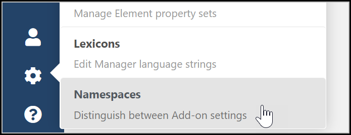
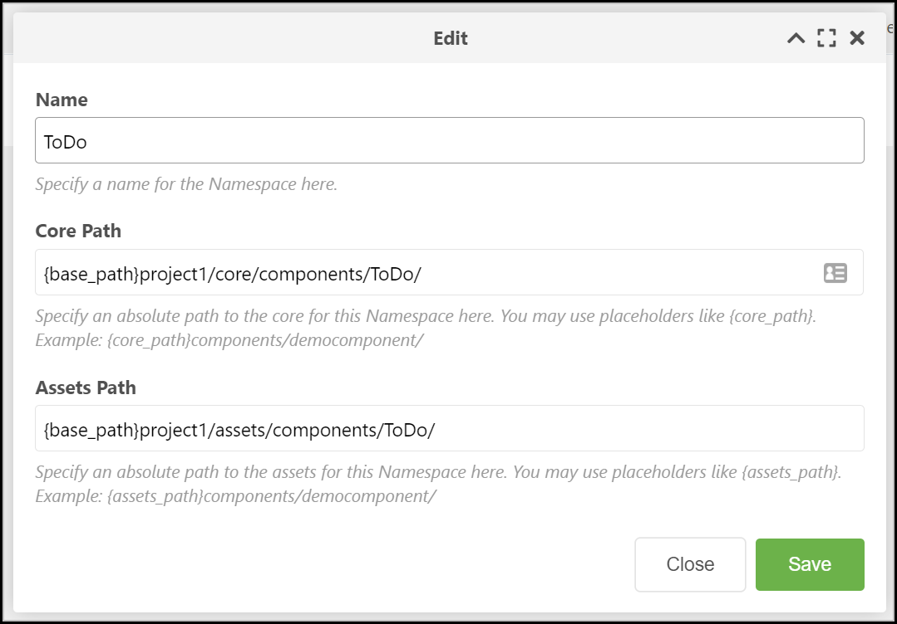
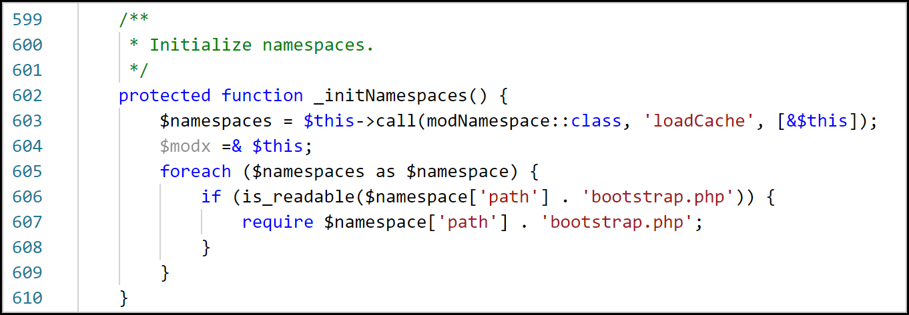
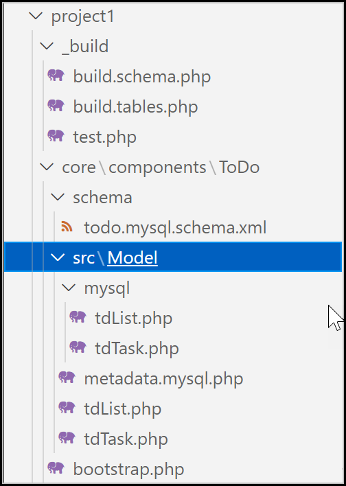
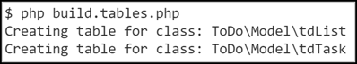
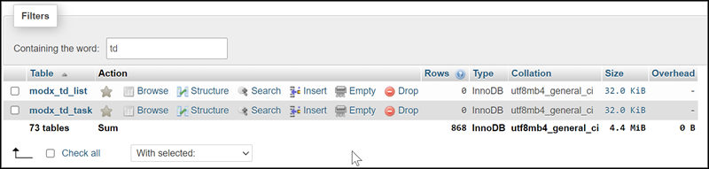
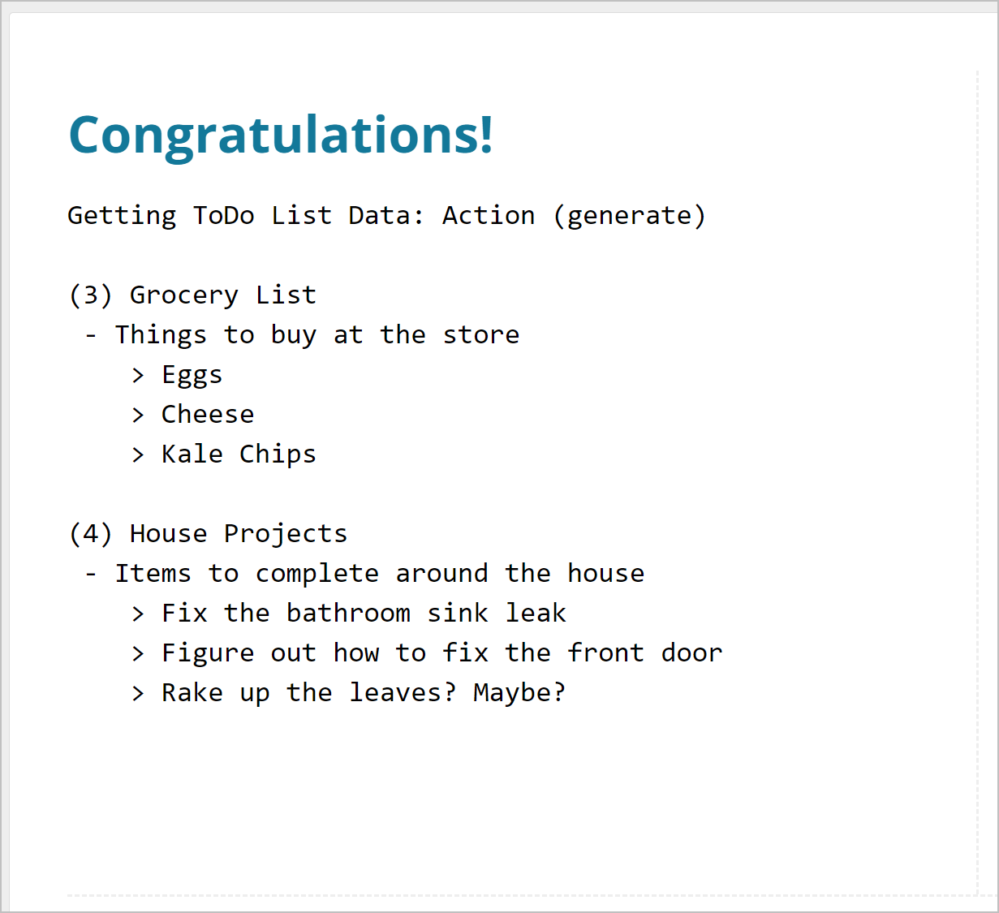

This tutorial builds a small To-Do list: two tables described in an XML Schema, a model generated from that schema, and a Snippet that writes records and reads them back.

## What's Changed in MODX 3?

MODX 3 adds PHP Namespaces to the XML Schema and the class files, a `bootstrap.php` file for startup work, and a new MySQL map layout in the generated model. Everything below is written for MODX 3 and starts from the minimum: one table, one model, one record written and read back.

> [!WARNING]
> This methodology does not work on MODX 2.x. For 2.x, use the [2.x guide](https://docs.modx.com/revolution/2.x/case-studies-and-tutorials/using-custom-database-tables-in-your-3rd-party-components "Using Custom Database Tables"). For an upgrade checklist (Composer, `metadata.mysql.php`, `instanceof`, `addPackage`), see [xPDO 3](getting-started/upgrading-to-3.0/xpdo).

**Note**: converted from the earlier "StoreFinder" example.

## Terminology {#terminology}

Three names recur below. They are set in different places and each has its own case rule:

| Name | Set where | Case |
| --- | --- | --- |
| PHP Namespace | The `package` attribute of the schema. MODX writes the declaration at the top of every class file it generates in `src/Model/`. | PascalCase |
| Component Namespace | The Namespace record you create in the Manager. MODX resolves the Core Path and the Assets Path from it, and Menu entries use it to route the request to the right Manager page. | lowercase |
| File and directory names | Your own source tree. | lowercase, except under `src/`, which mirrors the class names |

A file path and the Namespace it carries line up, name for name:

| File | PHP Namespace |
| --- | --- |
| `{core_path}/components/mycomponent/src/Model/MyClass.php` | `MyComponent\Model\MyClass` |

## Directory Structure

MODX 3 adds Composer, PHP Namespaces and a `src/` source directory — the layout Composer and the PSR-4 autoloader expect.

`/core/components/` is where Extras are installed. You can leave that level out if you never publish the component — and pay for the refactoring later if you do. This tutorial keeps the level, so the result can be packaged as an Extra. The project sits in a `project1` folder in the web root:

```
project1/
  _build/
  core/
    components/
      todo/
        src/
          Model/
        schema/
        bootstrap.php
```

Create these directories except `src/Model/` — the build script below generates it. A Custom Manager Page would add an `assets/` directory; this tutorial covers the data side only.

`bootstrap.php` loads on every request. It calls `addPackage` to register the Model classes, reaches the MODX autoloader, registers further PSR-4 Namespaces against their `src/` directories, and adds a Service to the DI container.

> More details on [Namespaces and Bootstrapping Services](extending-modx/namespaces#bootstrapping-services "Namespaces | Bootstrapping Services")

## Data and Tables

The example is a To-Do list: one parent **To-Do List** table and one child **To-Do Tasks** table, in a one-to-many relationship from the List to the Tasks.

| Table | Fields |
| --- | --- |
| `modx_td_list` | `name`, `short_description` |
| `modx_td_task` | `list` — foreign key to the parent list, `task_description`, `due_date` |

The schema file describes these tables in XML. xPDO parses it into PHP-format "maps": array representations of the schema and its relationships.

## Define the Schema XML

The schema structure has not changed much for MODX 3. Two things did: the `package` attribute now carries the PHP Namespace, and the classes you extend are namespaced. For an xPDO object, prefix the class with `xPDO\Om\`; for a MODX object like `modElement`, use `MODX\Revolution\`.

### MODX and xPDO File Locations

Both trees mirror the class-to-directory structure, so you can find any class by path:

| Class | File |
| --- | --- |
| `MODX\Revolution\modElement` | `core/src/Revolution/modElement.php` |
| `xPDO\Om\xPDOSimpleObject` | `core/vendor/xpdo/xpdo/src/xPDO/Om/xPDOSimpleObject.php` |

### Schema File Contents

The schema below defines the two tables and links them with a composite on the parent and an aggregate on the child. Together they set the owner and the type of the relationship: deleting a List that has Tasks deletes both.

> For more details on when to use `xPDOObject` vs. `xPDOSimpleObject`, see Bob Ray's blog post: [Comparing xPDOObject and xPDOSimpleObject](https://modx.com/blog/comparing-xpdoobject-and-xpdosimpleobject?utm_source=MODX+News&utm_campaign=df07d658fe-weekly_recap_21_12_10_&utm_medium=email&utm_term=0_27b5d94031-df07d658fe-34671909&goal=0_27b5d94031-df07d658fe-34671909&mc_cid=df07d658fe&mc_eid=21ae2973a7 "Comparing xPDOObject and xPDOSimpleObject"). This tutorial uses `xPDOSimpleObject`, which generates the auto-incrementing `id` primary key.

Create `project1/core/components/todo/schema/todo.mysql.schema.xml` and paste this XML into it.

```xml
<?xml version="1.0" encoding="UTF-8"?>
<model package="ToDo\Model" baseClass="xPDO\Om\xPDOObject" platform="mysql"  defaultEngine="InnoDB" version="3.0">
	
	<object class="tdList" table="td_list" extends="xPDO\Om\xPDOSimpleObject">
		<field key="name" dbtype="varchar" precision="128" phptype="string" default="" />
		<field key="short_description" dbtype="varchar" precision="255" phptype="string" default="" />

		<index alias="name" name="name" primary="false" unique="false" type="BTREE">
			<column key="name" length="" collation="A" null="false" />
		</index>

		<composite alias="Task" class="ToDo\Model\tdTask" local="id" foreign="list" cardinality="many" owner="local" />
	</object>

	<object class="tdTask" table="td_task" extends="xPDO\Om\xPDOSimpleObject">
		<field key="list" dbtype="int" precision="10" phptype="integer" null="false" default="" />
		<field key="task_description" dbtype="varchar" precision="255" phptype="string" default="" />
		<field key="due_date" dbtype="datetime" phptype="datetime" null="true" default="NULL" />

		<index alias="task_description" name="task_description" primary="false" unique="false" type="BTREE">
			<column key="task_description" length="" collation="A" null="false" />
		</index>

		<aggregate alias="List" class="ToDo\Model\tdList" local="list" foreign="id" cardinality="one" owner="foreign" />
	</object>

</model>
```

> [!WARNING]
> In MODX 3, the `class` attribute of any aggregate or composite must be the full namespaced class.

The `model` tag and its attributes:

| Attribute | Meaning |
| --- | --- |
| `package` | PHP Namespace of the xPDO package. In MODX 3 this value is written as the `namespace` declaration of your class files. |
| `baseClass` | The base class all your classes extend. Leave it at the default unless you build a custom `xPDOObject` extension. |
| `platform` | MySQL (`mysql`). |
| `defaultEngine` | The database table engine, InnoDB or MyISAM. MODX itself uses InnoDB. |
| `version` | Leave it at `3.0`. This is not cosmetic: from `3.0` on the generator writes `Model/metadata.mysql.php` with a class map, and only a model with that map reaches the PSR-4 autoloader. With `version="1.0"` the classes generate, but `addPackage()` never picks them up. |
| `phpdoc-package` | Not read by MODX, only used in doc blocks. Expects your PHP Namespace; MODX fills it in for you, and you will see it as `@package MyComponent\Model`. |
| `phpdoc-subpackage` | Deprecated per [phpDocumentor](https://docs.phpdoc.org/guide/references/phpdoc/tags/subpackage.html). The Namespace already covers both package and subpackage. |

> For more details on MODX schemas, see [Defining a Schema | Database and Tables](extending-modx/xpdo/custom-models/defining-a-schema/database-and-tables#defining-tables), which covers the Class, Table and Extends attributes.
> 
> For more details on how the paths are defined and used, see [Namespaces | Usage](extending-modx/namespaces#usage).

## Create a Component Namespace Entry in the Manager

The Component Namespace record holds the same data as in MODX 2 — see [Terminology](#terminology). MODX 3 gives the record one more use, described in the next section.

Open the Namespaces in the Manager and create a new entry.



Fill in the fields and save the record. The "Name" and both paths must be lowercase, and both paths must end with a trailing slash.

> **Name**: todo<br/>
> **Core Path**: {base_path}project1/core/components/todo/<br/>
> **Assets Path**: {base_path}project1/assets/components/todo/

MODX replaces `{base_path}` with the install path of the current site: the web root, or a subdirectory if MODX was installed into one.



## How MODX Uses the Component Namespace

As of MODX 3, the Core Path in your Namespace entry is where MODX looks for `bootstrap.php`. Whatever that file does runs at startup: load your class files, hook into the autoloader, register a service.

### When Bootstrap.php Runs

`index.php` calls the initialize function with the context key `web`, unless `config.context.php` in the install root returns another one. That function, in `modX.php`, calls `_initNamespaces()` first and `_initContext()` after it. `_initNamespaces()` loads the Namespace data from the cache, loops over the entries, and requires every `bootstrap.php` it finds.

> [!WARNING]
> `bootstrap.php` is required before `_initContext()`, so the Context does not exist inside it: `$modx->getContext()` returns `null`, and Context settings are not in the configuration yet. Stick to `$modx` itself and to the namespace data in the bootstrap file — anything else has to wait until later in the request.



## Writing Our Build Schema Script

Create `build.schema.php` in the `_build/` directory with the following code. `MODX_API_MODE` is still supported by the current `index.php`: setting the constant to true stops `$modx->handleRequest()` from running.

```php
<?php

// Set API Mode to true
define('MODX_API_MODE', true);

// Include the main index.php file to load MODX in API Mode
@include(dirname(__FILE__, 3) . '/index.php');

/**
 * @var \MODX\Revolution\modX $modx
 * 
 */

// Get the manager and generator
$manager = $modx->getManager();
$generator = $manager->getGenerator();

// Define the paths needed
//{base_path}/project1/
$projectRootDir = MODX_BASE_PATH . 'project1/';

//{base_path}/project1/core/components/todo/
$corePath = $projectRootDir . 'core/components/todo/';

//{base_path}/project1/core/components/todo/schema/todo.mysql.schema.xml
$schemaFile = $corePath . "schema/todo.mysql.schema.xml";

if (is_file($schemaFile)) {
	echo("Parsing schema: $schemaFile".PHP_EOL);
	// Parse the schema to generate the class files
	$generator->parseSchema(
		$schemaFile, 
		$corePath . 'src/',
		[
			"compile" => 0,
			"update" => 0,
			"regenerate" => 1,
			"namespacePrefix" => "ToDo\\"
		]
	);
}
else {
	echo("Schema file path invalid: $schemaFile".PHP_EOL);
}
```

The paths in the script are hard coded; adjust them if your project folder does not sit in the web root. Run the script from the command line in `_build`: `php build.schema.php`. A new `src/Model/` directory appears, along with a few files:



## Configure Our Bootstrap.php File

The model classes exist now, but there is no table to save records to. Before building the tables, create `bootstrap.php` so that MODX loads the classes on every request.

MODX 3 still calls `addPackage`, with a slightly different signature: it also registers the Model Namespace with the PSR-4 autoloader. With no services to register yet, the whole file is one call. Create it in `components/todo/`:

```php
<?php

/**
 * @var \MODX\Revolution\modX $modx
 * @var array $namespace
 */

// Load the classes
$modx->addPackage('ToDo\Model', $namespace['path'] . 'src/', null, 'ToDo\\');
```

> [!WARNING]
> Run `build.schema.php` before you rely on this file. `addPackage()` reads `src/Model/metadata.mysql.php`, and when that file is missing it gives up without a PHP error — the only trace is a `Could not load package metadata` warning in the MODX log, and then every class of your component is "not found" further down.

> [!CAUTION]
> `bootstrap.php` runs before the Manager finishes loading. A PHP typo, a wrong class name, or any `echo` in this file breaks the Manager and it stops loading. Remove the `echo` and it works again.

## Writing Our Build Tables Script

This script shares the paths and the API mode bootstrap of the schema script. You could merge both into one file that builds the schema and then the tables; running them separately makes a broken schema obvious before you touch the database.

> Beyond the scope of this tutorial, you can also use the new xPDO CLI to write your files and build. This can also be included into your composer.json settings.

Create `build.tables.php` in `_build/` with the following code.

```php
<?php

// Set API Mode
define('MODX_API_MODE', true);

// Include the index to load MODX in API Mode
@include(dirname(__FILE__, 3) . '/index.php');

/**
 * @var \MODX\Revolution\modX $modx
 * 
 */

// Classes to loop through
$classes = [
	'ToDo\Model\tdList',
	'ToDo\Model\tdTask'
];

// Get the manager
$manager = $modx->getManager();

// Loop through our classes
foreach ($classes as $class) {
	// Check if the class exists
	if (class_exists($class)  ) {
		// Create the table
		echo("Creating table for class: $class".PHP_EOL);
		$manager->createObjectContainer($class);
	}
	else {
		echo("Unable to load model class: $class".PHP_EOL);
	}
}
```

Run it from the command line: `php build.tables.php`. The tables are built when you see output like this:



Check phpMyAdmin or the MySQL editor of your choice for a table name containing "td". There should be two new tables.



## Using Our New Model

The model is ready. One Snippet writes the records and reads them back; to test it, put this in a Resource content field — the `!` tells MODX to run the Snippet uncached:

```html
<pre>[[!ToDo]]</pre>
```

Output is wrapped in `pre` tags to keep the example free of a template and of any iteration.

Create a Snippet named `ToDo` to match, and paste in the script below. The first half writes the Lists and Tasks from the data array when the request carries `&action=generate`; the second half reads everything back into a string.

> [!WARNING]
> Loading the page more than once with `&action=generate` adds another set of records every time. Each set gets its own new ids.

Writing and reading: [Creating Objects](extending-modx/xpdo/creating-objects "Creating Objects"), [Retrieving Objects](extending-modx/xpdo/retrieving-objects "Retrieving Objects"), [Add Many](extending-modx/xpdo/class-reference/xpdoobject/related-object-accessors/addmany "Add Many").

```php
<?php
// Output
$output = "";

// Namespace
$namespace = "ToDo\\Model\\";

// Handle task generation
$action = $_GET['action'] ?: "Get Lists";
$output .= "Getting ToDo List Data: Action ($action)";

if ($action === 'generate') {
    // Define our todo list data as an array
    $data = [
        [   
            "name" => "Grocery List",
            "short_description" => "Things to buy at the store",
            "tasks" => [
                ["task_description" => "Eggs", "due_date" => "2026-10-17"],
                ["task_description" => "Cheese", "due_date" => "2026-10-17"],
                ["task_description" => "Kale Chips"]
            ]
        ],
        [
            "name" => "House Projects",
            "short_description" => "Items to complete around the house",
            "tasks" => [
                ["task_description" => "Fix the bathroom sink leak", "due_date" => "2026-10-20"],
                ["task_description" => "Figure out how to fix the front door"],
                ["task_description" => "Rake up the leaves? Maybe?"]
            ]
        ]
    ];
    
    // Now let's loop through and create our lists and tasks
    foreach ($data as $createList) {
        // Get a list object and set the values
        $newList = $modx->newObject($namespace.'tdList');
        $newList->set('name', $createList['name']);
        $newList->set('short_description', $createList['short_description']);
        
        // Now before we save the list, let's create an array of task objects
        $newTaskArr = [];
        foreach ($createList['tasks'] as $createTask) {
            // Get a task object and set the values
            $newTask = $modx->newObject($namespace.'tdTask');
            $newTask->set('task_description', $createTask['task_description']);
            if (!empty($createTask['due_date'])) {
                $newTask->set('due_date', $createTask['due_date']);
            }
            
            // Add the task object to the array
            $newTaskArr[] = $newTask;
        }
        
        // Use the addMany function to associate all the tasks to the parent list
        $newList->addMany($newTaskArr);
        
        // And finally call the save function to persist the data to our tables
        $newList->save();
    }
}

// Query for any lists
$lists = $modx->getCollection($namespace.'tdList', []);
$listCount = 0;

// If our query returned results
if ($lists) {
    // Loop through them
    foreach ($lists as $list) {
        // Add the list to the output
        $output .= PHP_EOL.PHP_EOL.'(' . $list->get('id') . ') '.$list->get('name');
        
        // Add the description if we have one
        if ($list->get('short_description'))
            $output .= PHP_EOL.' - '.$list->get('short_description');
            
        // Now get any tasks
        $tasks = $modx->getCollection($namespace.'tdTask', ['list' => $list->get('id')]);
        $taskCount = 0;
        
        // If we have tasks
        if ($tasks) {
            // Loop through the tasks
            foreach ($tasks as $task) {
                // Add the task to the output
                $output .= PHP_EOL."    > " . $task->get('task_description');
                if ($task->get('due_date')) {
                    $output .= ' (' . $task->get('due_date') . ')';
                }
            }
        }
    }
}

// Return output
return $output;
```

Visit the Resource. The page shows every List with its Tasks:



## See Also

* [Generating the xPDO Model Code](extending-modx/xpdo/custom-models/generating-the-model "Generating the Model Code")
* [More Examples of xPDO XML Schema Files](extending-modx/xpdo/custom-models/defining-a-schema/more-examples "More Examples of xPDO XML Schema Files")
* [Reverse Engineer xPDO Classes from Existing Database Table](extending-modx/xpdo/custom-models/generating-the-model/reverse-engineer "Reverse Engineer xPDO Classes from Existing Database Table")
