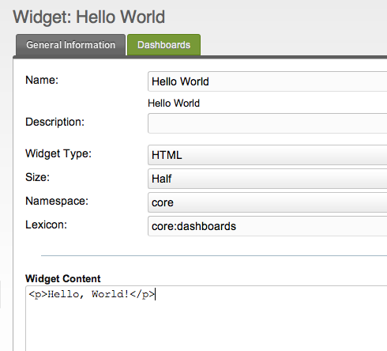
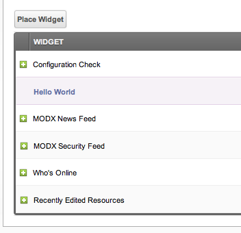
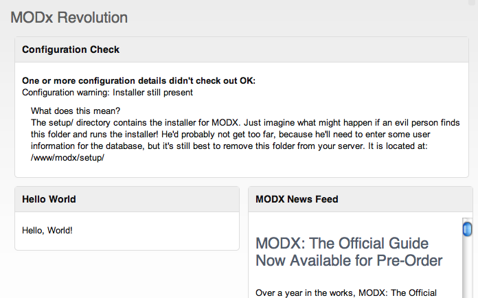

В этой статье описано, как создать собственный виджет панели управления, включая краткий обзор типов виджетов и принципов их работы.

## Создание базового виджета

Откройте страницу панелей управления (**Admin → Панели управления** в верхнем меню) и перейдите на вкладку **Widgets**. Нажмите **Создать**. Откроется экран создания виджета. На нём эти поля:

| Поле | Что в нём |
| --- | --- |
| **Name** | Имя виджета. Оно должно быть уникальным. |
| **Description** | Краткое описание виджета для внутреннего использования. |
| **Widget Type** | Тип виджета. Для первого виджета выберите «HTML». |
| **Size** | Один из семи размеров: Quarter, One Third, Half, Two Third, Three Quarters, Full Size и Double Size. |
| **Permission** | Право менеджера, которое нужно пользователю, чтобы виджет появился. Пусто — виджет виден всем. |
| **Namespace** | Пространство имён, с которым связан виджет. Оставьте «core», если вы не пишете дополнение. |
| **Lexicon** | Лексикон, который грузится вместе с виджетом. По умолчанию «core:dashboards». |
| **Properties** | Произвольные свойства виджета, которые хранятся в JSON. Виджет-файл или виджет-сниппет получает их как `$scriptProperties`. |

Имя виджета должно быть уникальным. Когда вы вводите имя, под полем появляется текст, повторяющий ваш ввод: это автоматический перевод имён виджетов, он ищет ключ в лексиконе виджета. Введите ключ существующей записи, например `w_configcheck`, и увидите переведённое имя.

В содержимое виджета вставьте:

``` php
<p>Hello, world!</p>
```

Виджет должен выглядеть так:



Сохраните виджет.

### Назначение виджета панели по умолчанию

Вернитесь на главную страницу панелей управления, откройте вкладку **Dashboards** и найдите панель по умолчанию. Щёлкните по ней правой кнопкой мыши и выберите **Редактировать**. Откроется страница редактирования.

Нажмите **Place Widget** над таблицей виджетов. Выберите **Hello World** в выпадающем списке и сохраните. Виджет добавлен на панель. Перетащите его на позицию №2 между виджетами **Configuration Check** и **MODX News Feed**:



Сохраните панель.

> **Примечание:** Добавление виджета через менеджер панелей (как описано выше) помещает его в **шаблон** панели. Если панель [настраиваемая](building-sites/client-proofing/dashboards "Dashboards"), виджет автоматически появится у всех существующих пользователей этой панели, а также у новых.
>
> Добавление виджета прямо на странице панели (через сам просмотр панели) добавляет его только для текущего пользователя. Другие пользователи его не увидят, пока виджет не добавят в шаблон.
>
> Виджет, добавленный в шаблон, приходит к существующим пользователям со стандартным размером и в конце списка, а не с тем размером, который указан в шаблоне.
>
> На крупных сайтах с большим числом пользователей добавление виджета в шаблон создаёт запись размещения для каждого пользователя, у которого уже есть личная копия этой панели. Учитывайте это, если важна производительность.

### Просмотр виджета

Нажмите на логотип MODX в левом верхнем углу. Вы увидите новый виджет на панели.



## Удаление виджета

Виджет удаляется на вкладке Widgets, и при этом он убирается со всех панелей, где он был размещён. Виджеты, которые поставляются с MODX, удалить нельзя.

## Другие типы виджетов

Доступны и другие типы виджетов. См. раздел [Типы виджетов панели управления](building-sites/client-proofing/dashboards/widget-types "Dashboard Widget Types").

## Смотрите также

1. [Панели управления](building-sites/client-proofing/dashboards)
2. [Редактирование панели управления](building-sites/client-proofing/dashboards/managing)
3. [Назначение панели управления группе пользователей](building-sites/client-proofing/dashboards/usergroups)
4. [Создание виджета панели управления](building-sites/client-proofing/dashboards/creating-a-widget)
5. [Типы виджетов панели управления](building-sites/client-proofing/dashboards/widget-types)
    1. [Тип виджета панели управления - Файл](building-sites/client-proofing/dashboards/widget-types/file)
    2. [Тип виджета панели управления - HTML](building-sites/client-proofing/dashboards/widget-types/html)
    3. [Тип виджета панели управления - Inline PHP](building-sites/client-proofing/dashboards/widget-types/inline-php)
    4. [Тип виджета панели управления - Сниппет](building-sites/client-proofing/dashboards/widget-types/snippet)
