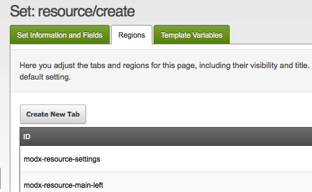

Настройка форм прячет или переименовывает вкладки формы ресурса целиком и их части.

**Если область не вкладка**
В **Админ → Настройка форм** при правке набора есть список «Областей». Он не совпадает со вкладками «Документ», «Настройки», «Переменные шаблона» и «Ресурсные группы». Идентификаторы в списке относятся ко вкладке целиком или к *части* вкладки.

## Области формы

Это различные области вкладок, видимость которых можно переключать.

| ID | Заголовок области по умолчанию | Описание |
| --- | --- | --- |
| modx-resource-settings | Документ | Основная вкладка |
| modx-resource-main-left | | |
| modx-resource-content-above | | |
| modx-resource-content-below | | |
| modx-resource-main-right | | |
| modx-resource-main-right-top | | |
| modx-resource-main-right-middle | | |
| modx-resource-main-right-bottom | | |
| modx-page-settings | Настройки | Основная вкладка |
| modx-page-settings-left | | |
| modx-page-settings-right | | |
| modx-page-settings-box-left | | |
| modx-page-settings-box-right | | |
| modx-panel-resource-tv | Переменные шаблона | Основная вкладка |
| modx-resource-access-permissions | Ресурсные группы | Основная вкладка |

Набор, привязанный к действию **Create Resource**, предлагает на две области меньше: `modx-resource-content-above` и `modx-resource-content-below`.

Список областей хранится в справочнике и заполняется при установке MODX. На базе, обновлённой с 2.x, список может быть короче.

## Добавление новых вкладок

Отредактируйте набор и откройте вкладку **Regions**. Нажмите **Создать**, задайте области идентификатор, например `my-new-tab`, и **Title**.

Каждый раз, когда вам нужно обратиться к области, например при переносе TV на новую вкладку, используйте идентификатор, который вы ей дали.

Идентификатор должен быть уникален в пределах набора. Область, созданная так, снова удаляется пунктом **Delete** её контекстного меню. Области самой формы удалить нельзя.

## Смотрите также

1. [Настройка менеджера](building-sites/client-proofing/form-customization)
2. [Профили настройки формы](building-sites/client-proofing/form-customization/profiles)
3. [Наборы настроек формы](building-sites/client-proofing/form-customization/sets)
   1. [Правила настройки формы](building-sites/client-proofing/form-customization/rules)
   2. [Настройка вкладок](building-sites/client-proofing/form-customization/tabs)
4. [Пользовательские темы системы управления](building-sites/client-proofing/custom-manager-themes)
