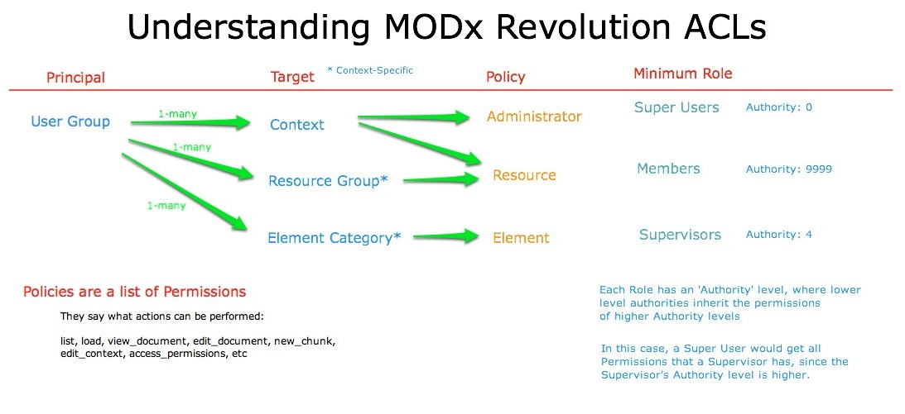

## Безопасность в MODX Revolution

Безопасность в MODX Revolution построена на списках. Права выдаются группам пользователей и привязываются к объекту с указанием минимальной роли.

Каждый пользователь в MODX — это объект [User](building-sites/client-proofing/security/users "Пользователи"), который может состоять в любом числе [групп пользователей](building-sites/client-proofing/security/user-groups "Группы пользователей"). Каждой группе пользователей назначаются атрибуты через [списки контроля доступа](building-sites/client-proofing/security/policies/acls "ACL") (ACL). У этих ACL разные названия в зависимости от того, к чему они применены, но у всех есть одно общее свойство — они содержат список [разрешений](building-sites/client-proofing/security/policies/permissions "Разрешения"). Эти разрешения открывают доступ к разным разделам и действиям MODX.

У ACL обычно есть следующее:

- **Principal** — объект, получающий права доступа. В MODX по умолчанию это группа пользователей.
- **Target** — объект, к которому они применяются, например контекст или группа ресурсов.
- **Access Policy** — список разрешений, которые даёт этот ACL.
- **Authority** — минимальный уровень authority, нужный для использования этого ACL (см. [Роли](building-sites/client-proofing/security/roles "Роли")).

Проверку ACL пользователь проходит, когда authority его роли **не больше** authority самого ACL: политики выдаются группе, а роль — это просто число, с которым сравнивается порог.

Доступ в MODX **по разрешению**: по умолчанию он открыт. Как только к объекту — контексту или группе ресурсов — применён ACL, этот объект доступен только тем, у кого есть подходящие разрешения.

### Права страницы

Странице списков контроля доступа нужно право `access_permissions`.

## Что создаётся при установке

MODX 3 создаёт при установке:

| Кто | Что |
| --- | --- |
| Анонимный пользователь | Политика **Load Only** на контексте `web`, с authority 9999. |
| Группа `Administrator` | Политика **Administrator** на контекстах `web` и `mgr`, с authority 0 — это роль Super User. |

Анонимный пользователь — не группа: это ACL с principal `0`. Группы «Anonymous» в базе нет, а в дереве групп он показан как псевдоузел «(Anonymous)».

Роль **Member** имеет authority 9999, поэтому она не проходит проверку ACL с authority 0. Роль **Super User** проходит.

## Видеоурок по безопасности

Демонстрирует применение понятий на тестовом сайте MODX:

- Ограничить RSS-ленту для директоров и выше
- Ограничить блог только для сотрудников
- Создать защищённый контекст для директоров и выше
- Ограничить некоторые категории элементов администраторами

### Пример: доступ к контексту

Хороший пример — создать контекст 'test' и назначить ему ACL. Это делается в форме контекста, на вкладке 'Access Permissions'. Там можно дать группе пользователей (например, 'HR Dept') явный доступ к этому контексту: выбрать группу, политику 'Administrator' и указать требуемый Authority (например, 9999 для 'Member'):

Это ограничит контекст 'test' пользователями, которые являются Member (или имеют [роль](building-sites/client-proofing/security/roles "Роли") с большим authority) группы 'HR Dept'.

## События

Поведение аутентификации и учётных записей меняется плагином. События раздела:

| Событие | Когда срабатывает |
| --- | --- |
| OnManagerLogin, OnWebLogin | После того, как пользователь вошёл. |
| OnManagerAuthentication, OnWebAuthentication | Пока проверяются данные пользователя. |
| OnUserNotFound | Когда вход называет несуществующего пользователя. |
| OnManagerLogout, OnWebLogout | После того, как пользователь вышел. |
| OnBeforeManagerLogout, OnBeforeWebLogout | Перед выходом пользователя. |
| OnUserBeforeSave, OnUserSave | До и после сохранения пользователя. |
| OnUserBeforeRemove, OnUserRemove | До и после удаления пользователя. |
| OnUserFormSave, OnBeforeUserFormSave | До и после сохранения пользователя из формы менеджера. |
| OnUserChangePassword | После того, как пользователь сменил пароль. |
| OnUserActivate, OnBeforeUserActivate | После и до активации пользователя. |
| OnUserDeactivate, OnBeforeUserDeactivate | После и до деактивации пользователя. |
| OnUserBeforeAddToGroup, OnUserAddToGroup | До и после добавления пользователя в группу. |
| OnUserBeforeRemoveFromGroup, OnUserRemoveFromGroup | До и после удаления пользователя из группы. |
| OnUserGroupBeforeSave, OnUserGroupSave | До и после сохранения группы. |
| OnUserGroupBeforeRemove, OnUserGroupRemove | До и после удаления группы. |
| OnResourceGroupBeforeSave, OnResourceGroupSave | До и после сохранения группы ресурсов. |
| OnBeforeResourceGroupRemove, OnResourceGroupRemove | До и после удаления группы ресурсов. |
| OnResourceAddToResourceGroup, OnResourceRemoveFromResourceGroup | Когда ресурс добавляют в группу ресурсов или убирают из неё. |

## Смотрите также

1. [Безопасность (ACLs)](building-sites/client-proofing/security)
2. [Пользователи](building-sites/client-proofing/security/users)
3. [Группы пользователей](building-sites/client-proofing/security/user-groups)
4. [Группы ресурсов](building-sites/client-proofing/security/resource-groups)
5. [Роли](building-sites/client-proofing/security/roles)
6. [Политики](building-sites/client-proofing/security/policies)
    1. [Разрешения](building-sites/client-proofing/security/policies/permissions)
        1. [Разрешения - Политика администратора](building-sites/client-proofing/security/policies/permissions/administrator-policy)
        2. [Разрешения - Ресурсная политика](building-sites/client-proofing/security/policies/permissions/resource-policy)
    2. [ACL](building-sites/client-proofing/security/policies/acls)
    3. [Шаблоны политик](building-sites/client-proofing/security/policies/policytemplates)
7. [Учебники по безопасности](building-sites/client-proofing/security/security-tutorials)
    1. [Доступ менеджера](building-sites/client-proofing/security/security-tutorials/giving-a-user-manager-access)
    2. [Страницы только для участников](building-sites/client-proofing/security/security-tutorials/making-member-only-pages)
    3. [Второй суперпользователь](building-sites/client-proofing/security/security-tutorials/creating-a-second-super-admin-user)
    4. [Ограничение элемента](building-sites/client-proofing/security/security-tutorials/restricting-an-element-from-users)
    5. [Об анонимном пользователе](building-sites/client-proofing/security/security-tutorials/more-on-the-anonymous-user-group)
8. [Диагностика безопасности](building-sites/client-proofing/security/troubleshooting-security)
    1. [Ручной сброс пароля пользователя](building-sites/client-proofing/security/troubleshooting-security/resetting-a-user-password-manually)
