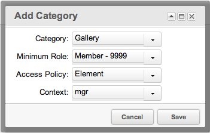
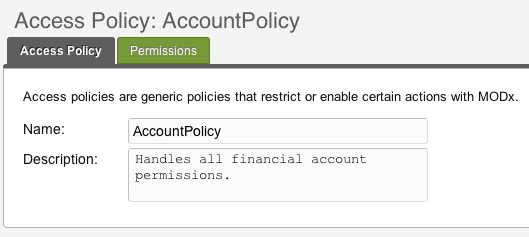

## Что такое политика доступа?

Политика доступа - это набор [Разрешений](building-sites/client-proofing/security/policies/permissions "Разрешения") содержащий одно или несколько Разрешений, определённых в панели управления. По умолчанию в MODX определены следующие политики доступа:

| Политика | Что это | Шаблон политики |
| --- | --- | --- |
| Administrator | Политика администрирования контекста со всеми разрешениями по умолчанию. | AdministratorTemplate |
| Content Editor | Политика администрирования контекста с ограниченными разрешениями, относящимися к редактированию контента, но без разрешений на публикацию (`publish_document` / `unpublish_document`). | AdministratorTemplate |
| Context | Стандартная политика контекста, которую можно применять при создании списков ACL для получения базового доступа в контексте (read/write и view\_unpublished). | ContextTemplate |
| Developer | Политика администрирования контекста со всеми разрешениями администратора, кроме административных и относящихся к безопасности. | AdministratorTemplate |
| Element | Политика элемента MODX со всеми атрибутами. | ElementTemplate |
| Hidden Namespace | Прячет пространство имён из списков. Даёт `load` и `view`, запрещает `list`. | NamespaceTemplate |
| Load Only | Минимальная политика с разрешением на загрузку объекта. | ObjectTemplate |
| Load, List and View | Разрешает загрузку, чтение и просмотр. | ObjectTemplate |
| Media Source Admin | Политика администрирования медиа источника. | MediaSourceTemplate |
| Media Source User | Политика пользователя медиа источника, с базовым просмотром и использованием - но без редактирования. | MediaSourceTemplate |
| Object | Политика объекта со всеми разрешениями. | ObjectTemplate |
| Resource | Политика ресурсов MODX со всеми атрибутами. | ResourceTemplate |

Шаблон политики определяет, какие разрешения она вообще может содержать, — это список чекбоксов, который вы получаете при создании политики. Смотрите [Шаблоны политик](building-sites/client-proofing/security/policies/policytemplates "Шаблоны политик").

Если вы настраиваете любую из вышеуказанных политик доступа по умолчанию, продублируйте и переименуйте их перед настройкой! Сценарий установки пересоздаёт штатные политики при каждом обновлении, поэтому ваши правки в них могут пропасть.

## Права страницы

Странице политик нужно право `policy_view` — увидеть список, `policy_new` и `policy_save` — создать политику, `policy_edit` — изменить, `policy_delete` — удалить. Для шаблонов нужны `policy_template_view`, `policy_template_new`, `policy_template_save`, `policy_template_edit` и `policy_template_delete`.

## Создание и редактирование

Чтобы создать Политику доступа в менеджере, перейдите к

> Настройки -> Контроль доступа -> Политики доступа

В этом разделе вы можете добавить новые политики. Чтобы изменить Политику доступа в менеджере, просто щелкните правой кнопкой мыши Политику, которую вы хотите изменить.

## Использование

Политики могут использоваться различными способами. Вот 3 примера использования по умолчанию в MODX:

### Доступ к контекстам

Политики доступа могут быть назначены с помощью [Списков контроля доступа](building-sites/client-proofing/security/policies/acls "ACLs") (ACLs), для контекста или группы пользователей с указанием минимальной [Роли](building-sites/client-proofing/security/roles "Роли"). Это означает, что все пользователи в этой группе  обладающие минимальной ролью, могут использовать разрешения в политике контекста, указанные в [ACL](building-sites/client-proofing/security/policies/acls "ACLs").

По умолчанию в MODX присутствует политика доступа ["Administrator"](building-sites/client-proofing/security/policies/permissions/administrator-policy "Политики - Политика Администратора") которая содержит все [Разрешения](building-sites/client-proofing/security/policies/permissions "Разрешения") которые можно использовать в контексте ACL. При создании пользовательской политики доступа, для пользователей с ограничениями, эту политику лучше всего продублировать.

Кнопки публикации в менеджере требуют `publish_document` в Context Access ACL на контексте **`mgr`**. Политика только на другом контексте эти кнопки не откроет. Подробнее: [ACL: публикация в менеджере](building-sites/client-proofing/security/policies/acls#publikaciya-v-menedzhere-i-neskolko-grupp).

### Доступ к группе ресурсов

Доступ к ресурсам так же может быть разграничен с использованием ролей и групп ресурсов. По умолчанию MODX имеет [Ресурсную политику](building-sites/client-proofing/security/policies/permissions/resource-policy "Разрешения - Ресурсная политика"), содержащую все основные разрешения, которые можно использовать в ACL групп ресурсов.

Примером может быть назначение политики "Resource" группе ресурсов под названием "Documents HR". Затем вы предоставили бы группе пользователей под названием «Отдел кадров» доступ к этой группе ресурсов через ACL ресурса:

Такая настройка разрешит доступ к ресурсам из группы "Documents HR" только пользователям из группы «Отдел кадров».

### Доступ к элементам категории

Просмотр элементов также может быть ограничен с использованием ACL. Например, если у вас есть группа пользователей 'Developers', и вы хотите, чтобы пользователи в этой группе были единственной группой, которая может видеть элементы в категории 'Gallery', вы должны создать ACL в разделе «Доступ к категории элементов» (вкладка при редактировании группы пользователей):

Это позволит только пользователям, состоящим в группе "Developers" просматривать элементы в категории "Gallery".

## Примеры

Пример пользовательской политики:

и его разрешений:

Все пользователи которым назначена эта политика будут иметь разрешения `view_accounts` и `save_accounts`.

## Смотрите также

1. [Безопасность (ACLs)](building-sites/client-proofing/security)
2. [Пользователи](building-sites/client-proofing/security/users)
3. [Группы пользователей](building-sites/client-proofing/security/user-groups)
4. [Группы ресурсов](building-sites/client-proofing/security/resource-groups)
5. [Роли](building-sites/client-proofing/security/roles)
6. [Политики](building-sites/client-proofing/security/policies)
    1. [Разрешения](building-sites/client-proofing/security/policies/permissions)
        1. [Политика администратора](building-sites/client-proofing/security/policies/permissions/administrator-policy)
        2. [Ресурсная политика](building-sites/client-proofing/security/policies/permissions/resource-policy)
    2. [ACL](building-sites/client-proofing/security/policies/acls)
    3. [Шаблоны политик](building-sites/client-proofing/security/policies/policytemplates)
7. [Учебники по безопасности](building-sites/client-proofing/security/security-tutorials)
    1. [Доступ менеджера](building-sites/client-proofing/security/security-tutorials/giving-a-user-manager-access)
    2. [Страницы только для участников](building-sites/client-proofing/security/security-tutorials/making-member-only-pages)
    3. [Второй суперпользователь](building-sites/client-proofing/security/security-tutorials/creating-a-second-super-admin-user)
    4. [Ограничение элемента](building-sites/client-proofing/security/security-tutorials/restricting-an-element-from-users)
    5. [Об анонимном пользователе](building-sites/client-proofing/security/security-tutorials/more-on-the-anonymous-user-group)
8. [Диагностика безопасности](building-sites/client-proofing/security/troubleshooting-security)
    1. [Ручной сброс пароля пользователя](building-sites/client-proofing/security/troubleshooting-security/resetting-a-user-password-manually)
