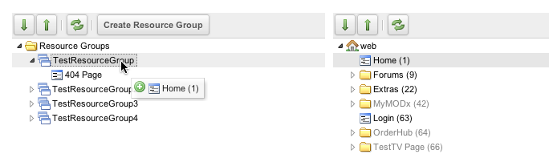
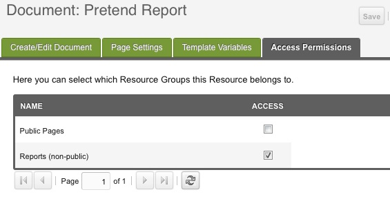

## Что такое группа ресурсов?

Группа ресурсов (Resource Group) это набор ресурсов, например страницы «только для участников». Вместе с группами пользователей группы ресурсов ограничивают доступ к страницам и ресурсам. Одна страница MODX может входить в несколько групп ресурсов.

## Использование

Страницы в группе ресурсов можно управлять двумя способами:

### Вариант 1

Откройте иконка замка в меню пользователя → **Resource Groups**. Слева увидите список групп ресурсов, справа дерево ресурсов.

Перетащите ресурсы из правого дерева прямо в группы ресурсов в левом:

### Вариант 2

Откройте ресурс, вкладку **Resource Groups** (**Группы ресурсов**) и чекбокс **Access** (**Доступ**) в нужной строке. Отмечен: ресурс в группе. Снят: не в группе. Сохраните ресурс.

Само членство страницу не прячет. Нужны ещё группа пользователей и ACL на группу ресурсов. Тот же чекбокс описан на странице [Ресурсы](building-sites/resources).

## Смотрите также

1. [Безопасность (ACLs)](building-sites/client-proofing/security)
2. [Пользователи](building-sites/client-proofing/security/users)
3. [Группы пользователей](building-sites/client-proofing/security/user-groups)
4. [Группы ресурсов](building-sites/client-proofing/security/resource-groups)
5. [Роли](building-sites/client-proofing/security/roles)
6. [Политики](building-sites/client-proofing/security/policies)
    1. [Разрешения](building-sites/client-proofing/security/policies/permissions)
        1. [Политика администратора](building-sites/client-proofing/security/policies/permissions/administrator-policy)
        2. [Ресурсная политика](building-sites/client-proofing/security/policies/permissions/resource-policy)
    2. [ACL](building-sites/client-proofing/security/policies/acls)
    3. [Шаблоны политик](building-sites/client-proofing/security/policies/policytemplates)
7. [Учебники по безопасности](building-sites/client-proofing/security/security-tutorials)
    1. [Доступ менеджера](building-sites/client-proofing/security/security-tutorials/giving-a-user-manager-access)
    2. [Страницы только для участников](building-sites/client-proofing/security/security-tutorials/making-member-only-pages)
    3. [Второй суперпользователь](building-sites/client-proofing/security/security-tutorials/creating-a-second-super-admin-user)
    4. [Ограничение элемента](building-sites/client-proofing/security/security-tutorials/restricting-an-element-from-users)
    5. [Об анонимном пользователе](building-sites/client-proofing/security/security-tutorials/more-on-the-anonymous-user-group)
8. [Диагностика безопасности](building-sites/client-proofing/security/troubleshooting-security)
    1. [Ручной сброс пароля пользователя](building-sites/client-proofing/security/troubleshooting-security/resetting-a-user-password-manually)
