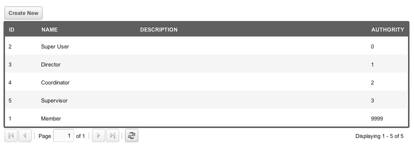
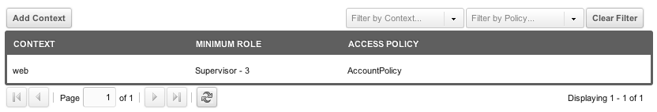

## Что такое роль?

Роль это должность или статус в конкретной ситуации. В MODX ею задают положение пользователя внутри группы пользователей, например "Editor" или "Front-end Read Only".

Роли в MODX используют целое число Authority. **Меньшее число означает более сильные полномочия.** Пользователь проходит проверку ACL, когда authority его роли **не больше** authority самого ACL, поэтому пользователь с ролью authority 10 проходит все ACL, которые проходит пользователь с ролью authority 11.

Говоря об Authority, формулируйте аккуратно: обратная зависимость часто путает формулировки.

Authority удобно мыслить как порядковые номера: первый, второй, третий и так далее. **Authority=1** это первые полномочия и они сильнее **Authority=2** (вторых).

**Номера Authority уникальны**
База не даст создать две роли с одинаковым authority: у столбца уникальный индекс.

## Роли MODX

В MODX 3 поставляется две роли:

| Роль | Authority |
| --- | --- |
| Member | 9999 |
| Super User | 0 |

Роль **Super User** проходит проверку любого ACL, потому что authority у ACL не бывает ниже 0. Роль **Member** проходит только те ACL, у которых authority равен 9999 или больше.

## Права страницы

Странице ролей нужны права: `view_role` — увидеть список, `new_role` и `save_role` — создать роль, `edit_role` — изменить, `delete_role` — удалить.

## Использование

Частый пример: роли по структуре должностей. Допустим, вы создаёте такие роли и уровни Authority:

- Administrator - 0
- Director - 1
- Coordinator - 2
- Supervisor - 3
- Employee - 9999

Затем создайте группу пользователей "HR Department". Внутри группы назначьте пользователям эти роли (на одну роль может приходиться несколько пользователей).

Допустим, у John роль Coordinator, у Mark роль Supervisor. Группе пользователей "HR Deparment" вы даёте Access Policy (набор Permissions) с именем "AccountPolicy" и такими Access Permissions:

- view\_accounts
- save\_accounts

Эту политику вы назначили контексту "web" для группы "HR Department". Значение Minimum Role поставили в "Supervisor":

Значит, у Mark есть эти Permissions: он в группе и его роль не слабее "Supervisor" (именно эту роль он и занимает).

Но **также** эти Permissions есть у John: у него роль "Coordinator" с более сильным Authority, чем у "Supervisor". То есть John как Coordinator «унаследовал» Permissions, которые Mark имел как Supervisor.

## Смотрите также

1. [Безопасность (ACLs)](building-sites/client-proofing/security)
2. [Пользователи](building-sites/client-proofing/security/users)
3. [Группы пользователей](building-sites/client-proofing/security/user-groups)
4. [Группы ресурсов](building-sites/client-proofing/security/resource-groups)
5. [Роли](building-sites/client-proofing/security/roles)
6. [Политики](building-sites/client-proofing/security/policies)
    1. [Разрешения](building-sites/client-proofing/security/policies/permissions)
        1. [Политика администратора](building-sites/client-proofing/security/policies/permissions/administrator-policy)
        2. [Ресурсная политика](building-sites/client-proofing/security/policies/permissions/resource-policy)
    2. [ACL](building-sites/client-proofing/security/policies/acls)
    3. [Шаблоны политик](building-sites/client-proofing/security/policies/policytemplates)
7. [Учебники по безопасности](building-sites/client-proofing/security/security-tutorials)
    1. [Доступ менеджера](building-sites/client-proofing/security/security-tutorials/giving-a-user-manager-access)
    2. [Страницы только для участников](building-sites/client-proofing/security/security-tutorials/making-member-only-pages)
    3. [Второй суперпользователь](building-sites/client-proofing/security/security-tutorials/creating-a-second-super-admin-user)
    4. [Ограничение элемента](building-sites/client-proofing/security/security-tutorials/restricting-an-element-from-users)
    5. [Об анонимном пользователе](building-sites/client-proofing/security/security-tutorials/more-on-the-anonymous-user-group)
8. [Диагностика безопасности](building-sites/client-proofing/security/troubleshooting-security)
    1. [Ручной сброс пароля пользователя](building-sites/client-proofing/security/troubleshooting-security/resetting-a-user-password-manually)
