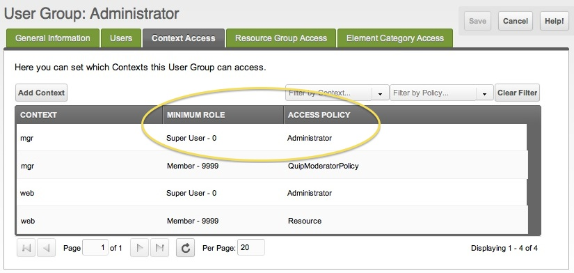

## Задача

Вы хотите, чтобы ещё один пользователь MODX Revolution имел полный доступ к менеджеру со всеми [Permissions](building-sites/client-proofing/security/policies/permissions "Permissions") администратора. Это может быть коллега или клиент. Создавая ещё одного Administrator, вы отдаёте ключи от _всего_ сайта. Сценарий упрощённый: другой админ сможет изменить или удалить вашу учётную запись, так что для вашей задачи это может не подойти. По ходу шагов страница кратко знакомит с ролями и политиками доступа.

Чтобы дать менеджеру доступ в меньшем объёме, посмотрите урок [Доступ пользователя к менеджеру](building-sites/client-proofing/security/security-tutorials/giving-a-user-manager-access "Giving a User Manager Access"). Видео Shaun McCormick [Understanding MODX Revolution Security](http://vimeo.com/13856994) подробно показывает сложные схемы прав.

## Решение

Войдите в менеджер сайта и сделайте следующее:

1. Создайте нового пользователя: иконка замка в меню пользователя → **Users** -> New User (кнопка)
2. Задайте уникальные username, password и email.
3. Перед сохранением откройте вкладку **Access Permissions** и нажмите ****Add User to Group****
    1. **User Group:**`Administrator`
    2. **Role:**`Super User`
4. Сохраните пользователя. (Позже можно вернуться в иконка замка в меню пользователя → **Users** и правым кликом обновить свойства.)
5. Проверьте вход в менеджер из другого браузера.

## Почему нельзя добавить ещё одного Administrator с другой [ролью](building-sites/client-proofing/security/roles "Roles"), например "Member"?

Попробуйте. При входе под другим именем только с ролью "Member" доступ отклонят. Почему? Дело в [Context Access](building-sites/contexts "Contexts") и [Access Policies](building-sites/client-proofing/security/policies "Policies"). Они быстро усложняются. Откройте иконка замка в меню пользователя → **Access Control Lists**, правым кликом по группе Administrator выберите Update User Group, затем вкладку **Context Access**. Увидите примерно такое:

По умолчанию в MODX Revolution два контекста: **web** (front-end) и **mgr** (back-end). Из таблицы видно два факта: минимальная роль это Super User, а Access Policy для этого контекста это "Administrator". Даже если смысл всего этого ещё не ясен, с этой точки удобно начинать разбираться в правах.

### Minimum Role

На экране Context Access видно: нужна как минимум роль "Super User". Одной роли "Member" недостаточно. Поэтому вход не проходит у администраторов только с ролью "Member".

### Roles

Зачем давать другому пользователю другую роль, если у него будут _те же_ привилегии, что у вас? Если привилегии совпадают, роль по сути эквивалентна вашей. Новая роль не нужна.

Думая о ролях, смотрите на access policy. Политика говорит, что пользователь с назначенной ролью может и чего не может.

## Смотрите также

1. [Безопасность (ACLs)](building-sites/client-proofing/security)
2. [Пользователи](building-sites/client-proofing/security/users)
3. [Группы пользователей](building-sites/client-proofing/security/user-groups)
4. [Группы ресурсов](building-sites/client-proofing/security/resource-groups)
5. [Роли](building-sites/client-proofing/security/roles)
6. [Политики](building-sites/client-proofing/security/policies)
    1. [Разрешения](building-sites/client-proofing/security/policies/permissions)
        1. [Политика администратора](building-sites/client-proofing/security/policies/permissions/administrator-policy)
        2. [Ресурсная политика](building-sites/client-proofing/security/policies/permissions/resource-policy)
    2. [ACL](building-sites/client-proofing/security/policies/acls)
    3. [Шаблоны политик](building-sites/client-proofing/security/policies/policytemplates)
7. [Учебники по безопасности](building-sites/client-proofing/security/security-tutorials)
    1. [Доступ менеджера](building-sites/client-proofing/security/security-tutorials/giving-a-user-manager-access)
    2. [Страницы только для участников](building-sites/client-proofing/security/security-tutorials/making-member-only-pages)
    3. [Второй суперпользователь](building-sites/client-proofing/security/security-tutorials/creating-a-second-super-admin-user)
    4. [Ограничение элемента](building-sites/client-proofing/security/security-tutorials/restricting-an-element-from-users)
    5. [Об анонимном пользователе](building-sites/client-proofing/security/security-tutorials/more-on-the-anonymous-user-group)
8. [Диагностика безопасности](building-sites/client-proofing/security/troubleshooting-security)
    1. [Ручной сброс пароля пользователя](building-sites/client-proofing/security/troubleshooting-security/resetting-a-user-password-manually)
