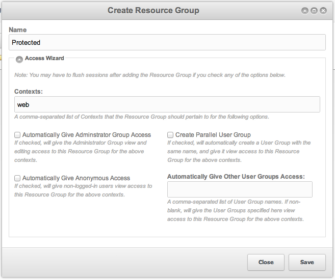
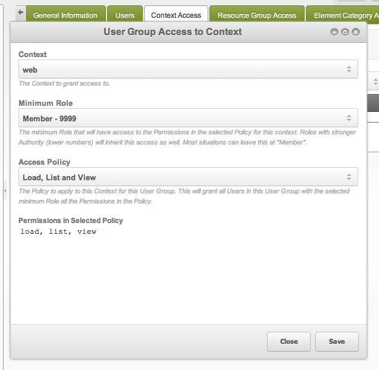

## Шаги

Эти шаги закрывают страницы сайта так, чтобы их видели только определённые пользователи. Считается, что регистрация и вход уже сделаны пакетом [Login](/extras/login "Login"). На то, какие ресурсы пользователь видит или правит в менеджере, шаги не влияют.

1. Создайте группу ресурсов (иконка замка в меню пользователя → **Resource Groups** → **Create Resource Group**)
2. Привяжите ресурс «только для участников» к группе ресурсов. (Через редактирование ресурса или перетаскиванием из дерева ресурсов вправо)
3. Создайте группу пользователей (иконка замка в меню пользователя → **Контроль доступа** → вкладка **Группы пользователей & Пользователи** → New User Group)
4. На вкладке Resource Group Access добавьте запись (context: web, minimum role: Member (9999), access policy: Resource)
5. Добавьте пользователей в группу с ролью Member. (иконка замка в меню пользователя → **Пользователи**)
6. Сбросьте права (**Перезагрузить права доступа**) и проверьте в другом браузере (не в другом окне того же браузера: в другом браузере)

## Access Wizard

Мастер группы ресурсов проводит по всему процессу. Результат тот же, что при ручной настройке каждого шага.

### 1. Создайте группу ресурсов

[Группа ресурсов](building-sites/client-proofing/security/resource-groups "Группы ресурсов") собирает ресурсы, которые можно связать с группами пользователей и записями доступа.

Откройте иконку замка в меню пользователя → **Resource Groups** и нажмите **Create Resource Group**. Появится окно примерно такое: 

| Section                                       | Explanation                                                                                                                                                                                                                                                                                                                                                                                                                                          | Tutorial Default |
| --------------------------------------------- | ---------------------------------------------------------------------------------------------------------------------------------------------------------------------------------------------------------------------------------------------------------------------------------------------------------------------------------------------------------------------------------------------------------------------------------------------------- | ---------------- |
| Name                                          | Имя создаваемой группы ресурсов. Сделайте его понятным и лёгким для запоминания.                                                                                                                                                                                                                                                                                                                                              | Protected        |
| Contexts                                      | Контекст, в котором действуют правила. В этом уроке один контекст, "web", и скрывать нужно только там.                                                                                                                                                                                                                                                                                                    | web              |
| Automatically give Administrator Group Access | Если отметить, все пользователи группы administrator по умолчанию получат доступ к группе ресурсов. Пользователь admin по умолчанию помечен как "sudo", а sudo обходит проверки политик, поэтому он видит все группы ресурсов независимо от доступа группы administrator. Если есть другие администраторы без sudo и им нужно видеть ресурсы группы, отметьте этот пункт. | checked          |
| Automatically give Anonymous Group Access     | Если отметить, анонимный пользователь получит доступ к группе ресурсов. Посетитель без входа и есть анонимный пользователь. В этом уроке страницы закрыты от него, поэтому пункт оставляем снятым. | unchecked        |
| Create Parallel User Group                    | Не обязательно держать всех, кто видит страницы «только для участников», в группе administrator (если отметили "Automatically give Administrator Group Access"). Можно создать другую группу пользователей с доступом к ресурсам этой группы ресурсов. Отметьте: участники не администраторы.                                                                                                  | checked          |
| Automatically Give Other User Groups Access   | Если до урока у вас уже были группы пользователей, которым нужен доступ, перечислите их здесь.                                                                                                                                                                                                                                                                                                           |                  |

### 2. Добавьте ресурсы в группу ресурсов

Укажите MODX, какие ресурсы защищать. Оставайтесь на странице из шага 1 (иконка замка в меню пользователя → **Resource Groups**). Справа откройте контекст web, чтобы видеть страницы сайта. Перетащите их из правой колонки в группу ресурсов. Либо откройте каждый ресурс, вкладку **Resource Groups** (**Группы ресурсов**) и отметьте **Access** (**Доступ**) в строке "Protected".

### 3. Добавьте пользователей в группу пользователей

Откройте иконку замка → **Контроль доступа**. На вкладке **Группы пользователей & Пользователи** виден список групп. Щёлкните правой кнопкой группу «Protected» и выберите **Добавить пользователя в группу**. В "Name" выберите пользователя. В Role пока поставьте "Member". Роли задают, что пользователь может внутри группы, но для урока такая тонкость не нужна. Нажмите Save.

Ресурс защищён, когда он (1) назначен в одну или несколько групп ресурсов и (2) группа связана с группой пользователей через контроль доступа. Такие страницы не показываются пользователям вне этой связи. По умолчанию это страница 404. Чтобы вернуть 401, дайте анонимному пользователю разрешение "load" на группу ресурсов. Подробнее в другом уроке. Сейчас страница ещё не видна: вы ещё не добавили её в группу пользователей.

Если регистрация идёт через сниппет, проверьте, что новые пользователи попадают в нужную группу.

У созданной группы нет доступа к контексту web. Если бы контекст был доступен, были бы доступны и защищённые ресурсы. Сейчас контекст недоступен. Добавьте этот доступ следующим шагом.

### 4. Добавьте доступ к контексту

Откройте иконку замка → **Контроль доступа**. Щёлкните правой кнопкой защищённую группу и выберите **Редактировать группу пользователя**. Откройте вкладку **Контексты** и нажмите **Добавить доступ к контексту**. В диалоге такие поля: 

| Section       | Explanation                                                                                                                                                                                                                            | Tutorial Default |
| ------------- | -------------------------------------------------------------------------------------------------------------------------------------------------------------------------------------------------------------------------------------- | ---------------- |
| Context       | Контекст, к которому даёте доступ. Базовый случай: web и mgr. Web это публичная часть сайта, mgr это менеджер, в котором вы вошли. | web              |
| Minimum Role  | К каким ролям применяется правило. Если ко всем в группе, выберите "Member - 9999". Здесь как раз та тонкая настройка, о которой речь выше.                                | Member - 9999    |
| Access Policy | Какие разрешения получают пользователи. Разные политики дают группам разные возможности.                                                                                                           | Administrator    |

Сделайте одно правило: "web", "Member - 9999" и "Load, List and View". Чтобы пользователи видели менеджер, добавьте второе правило для mgr: "mgr", "Member - 9999" и "Administrator". У этих пользователей будет доступ администратора. Чтобы сузить права, выберите "Content Editor" или "Developer". Свою политику можно создать на вкладке **Политики доступа** в **Контроль доступа**.

### 5. Перезагрузите права доступа

Чтобы увидеть изменения, сбросьте, что видят и делают отдельные пользователи. Откройте иконку замка → **Перезагрузить права доступа**. На сайте проверяйте в другом браузере. Большая часть сбоев идёт от проверки в том же браузере или от пропуска этого сброса.

Иногда нужно очистить кэш сайта, особенно для контекста mgr: элементы и ресурсы могут кэшировать права.

## Всё ещё не работает?

Проверьте шаги и сброс прав. Если страницы всё ещё не открываются, спросите на [MODX Community](https://community.modx.com).

Два источника помогут разобраться в самих правах. [Руководство Bob по правам](http://bobsguides.com/revolution-permissions.html) подробно раскрывает модель. Урок [Login.Basic Setup](/extras/login/login.tutorials/basic-setup "Login.Basic Setup") показывает базовую зону "Members Only" на Login Snippet.

## Смотрите также

1. [Безопасность (ACLs)](building-sites/client-proofing/security)
2. [Пользователи](building-sites/client-proofing/security/users)
3. [Группы пользователей](building-sites/client-proofing/security/user-groups)
4. [Группы ресурсов](building-sites/client-proofing/security/resource-groups)
5. [Роли](building-sites/client-proofing/security/roles)
6. [Политики](building-sites/client-proofing/security/policies)
    1. [Разрешения](building-sites/client-proofing/security/policies/permissions)
        1. [Политика администратора](building-sites/client-proofing/security/policies/permissions/administrator-policy)
        2. [Ресурсная политика](building-sites/client-proofing/security/policies/permissions/resource-policy)
    2. [ACL](building-sites/client-proofing/security/policies/acls)
    3. [Шаблоны политик](building-sites/client-proofing/security/policies/policytemplates)
7. [Учебники по безопасности](building-sites/client-proofing/security/security-tutorials)
    1. [Доступ менеджера](building-sites/client-proofing/security/security-tutorials/giving-a-user-manager-access)
    2. [Страницы только для участников](building-sites/client-proofing/security/security-tutorials/making-member-only-pages)
    3. [Второй суперпользователь](building-sites/client-proofing/security/security-tutorials/creating-a-second-super-admin-user)
    4. [Ограничение элемента](building-sites/client-proofing/security/security-tutorials/restricting-an-element-from-users)
    5. [Об анонимном пользователе](building-sites/client-proofing/security/security-tutorials/more-on-the-anonymous-user-group)
8. [Диагностика безопасности](building-sites/client-proofing/security/troubleshooting-security)
    1. [Ручной сброс пароля пользователя](building-sites/client-proofing/security/troubleshooting-security/resetting-a-user-password-manually)
