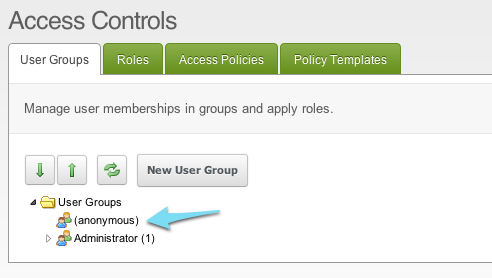
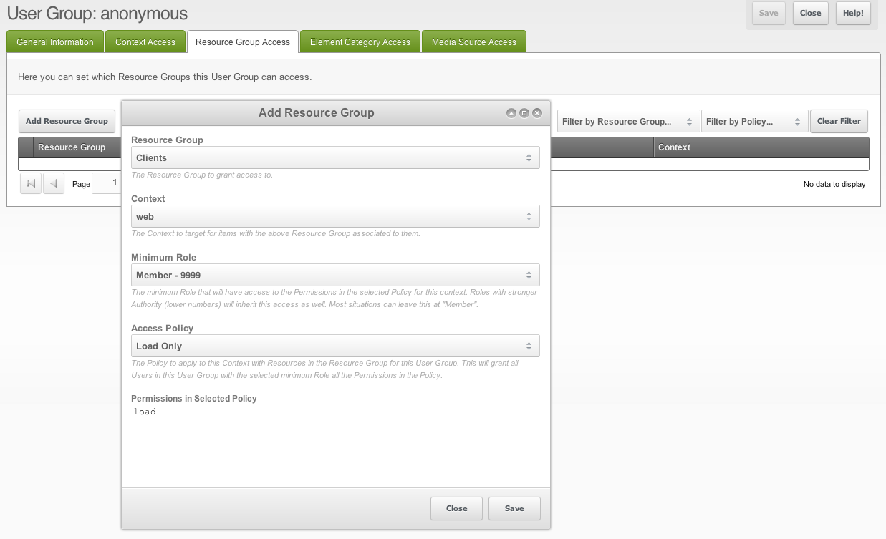

## Кто такой Anonymous?

Любой посетитель сайта без входа — это анонимный пользователь.

**Анонимный пользователь — не группа пользователей**
В базе нет группы «Anonymous». Анонимный пользователь — это список контроля доступа с principal `0`, а в дереве групп он показан псевдоузлом «(Anonymous)». Этот узел можно править так же, как любую группу, но меняете вы при этом доступ анонимного пользователя, а не группы.

Чтобы его открыть, пройдите по пути **иконка замка в меню пользователя → Access Control Lists**, вкладка **User Groups & Users**. Кликните правой кнопкой по записи «(Anonymous)» и выберите **Update User Group**. 

## Что может Anonymous?

По умолчанию анонимный пользователь получает Load Only во всех [Context](building-sites/contexts "Contexts"), кроме `mgr`. Без Load Only запрос к Context вернёт 404 Page Not Found.

Load Only не означает, что ресурс можно View (см. ниже).

Пример: вы создаёте [Resource Group](building-sites/client-proofing/security/resource-groups "Resource Groups") и даёте доступ конкретной User Group. Anonymous эту Resource Group не увидит. На этом строится [создание страниц только для участников](building-sites/client-proofing/security/security-tutorials/making-member-only-pages "Making Member-Only Pages").

### 401 против 404 на защищённых страницах

Для защищённых Resource Groups у Anonymous по умолчанию нет Load. Ответ будет 404 Page Not Found. Если нужен 401 Unauthorized, дайте Anonymous доступ к Resource Group с политикой Load Only.

Это делается на вкладке Resource Group Access при редактировании Anonymous.

Нажмите **Add Resource Group**, выберите защищённую Resource Group, Context (не `mgr`) и Access Policy Load Only. Сохраните.

View по ресурсам в этой группе всё ещё закрыт. Доступен только Load и ответ 401. Кастомную Unauthorized-страницу задайте через [Unauthorized Page System Setting](building-sites/settings/unauthorized_page "unauthorized_page").

## Смотрите также

1. [Пользователи](building-sites/client-proofing/security/users)
2. [Группы пользователей](building-sites/client-proofing/security/user-groups)
3. [Группы ресурсов](building-sites/client-proofing/security/resource-groups)
4. [Роли](building-sites/client-proofing/security/roles)
5. [Политики](building-sites/client-proofing/security/policies)
    1. [Разрешения](building-sites/client-proofing/security/policies/permissions)
        1. [Разрешения - Политика администратора](building-sites/client-proofing/security/policies/permissions/administrator-policy)
        2. [Разрешения - Ресурсная политика](building-sites/client-proofing/security/policies/permissions/resource-policy)
    2. [ACL](building-sites/client-proofing/security/policies/acls)
    3. [Шаблоны политик](building-sites/client-proofing/security/policies/policytemplates)
6. [Учебники по безопасности](building-sites/client-proofing/security/security-tutorials)
    1. [Доступ менеджера](building-sites/client-proofing/security/security-tutorials/giving-a-user-manager-access)
    2. [Страницы только для участников](building-sites/client-proofing/security/security-tutorials/making-member-only-pages)
    3. [Второй суперпользователь](building-sites/client-proofing/security/security-tutorials/creating-a-second-super-admin-user)
    4. [Ограничение элемента](building-sites/client-proofing/security/security-tutorials/restricting-an-element-from-users)
    5. [Об анонимном пользователе](building-sites/client-proofing/security/security-tutorials/more-on-the-anonymous-user-group)
7. [Диагностика безопасности](building-sites/client-proofing/security/troubleshooting-security)
    1. [Ручной сброс пароля пользователя](building-sites/client-proofing/security/troubleshooting-security/resetting-a-user-password-manually)
