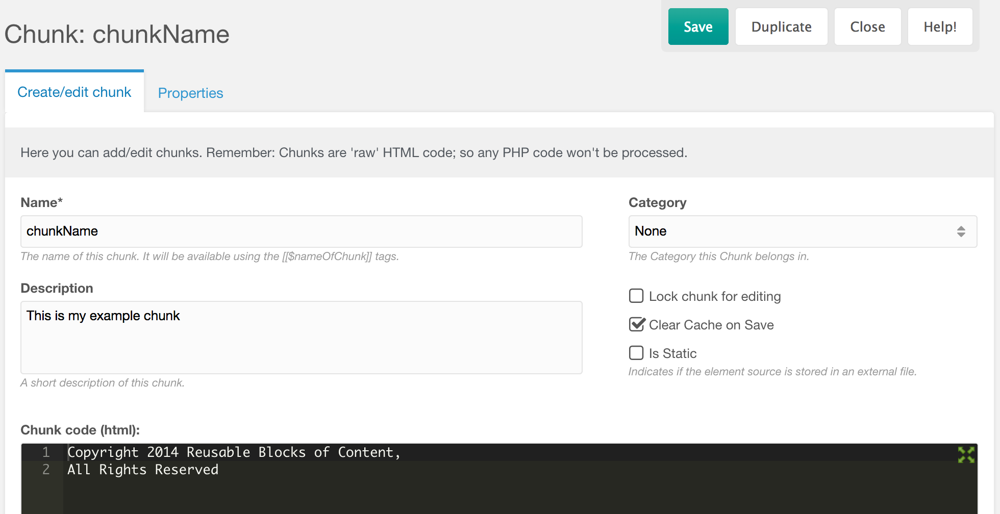

Чанк это кусок статического текста, который можно вставить на сайт снова. Так часто кладут контакт или строку об авторском праве. Логики в чанке нет. Внутри может быть вызов [сниппета](extending-modx/snippets "Сниппеты").

## Создание

Прежде чем использовать чанк, создайте его в дереве элементов: **Элементы** → **Чанки** → **Создать чанк**.



## Использование

Вызовите чанк по имени в шаблоне или в содержимом ресурса:

``` php
[[$chunkName]]
```

MODX подставляет вместо тега содержимое чанка.

В чанк можно передать свойства. Чанк `intro`:

> Привет, `[[+name]]`. У тебя есть `[[+messageCount]]` сообщений.

``` php
[[$intro? &name=`George` &messageCount=`12`]]
```

> Привет, George. У тебя есть 12 сообщений.

Те же плейсхолдеры можно взять из [переменной шаблона](building-sites/elements/template-variables "Переменные шаблона"):

``` php
[[!$intro? &name=`[[*usersName]]` &messageCount=`[[*messageCount]]`]]
```

Или поставить теги ресурса в сам чанк:

``` php
Привет, [[*usersName]]. У тебя есть [[*messageCount]] сообщений.
```

## Смотрите также

- [modChunk](extending-modx/core-model/modchunk "modChunk")
