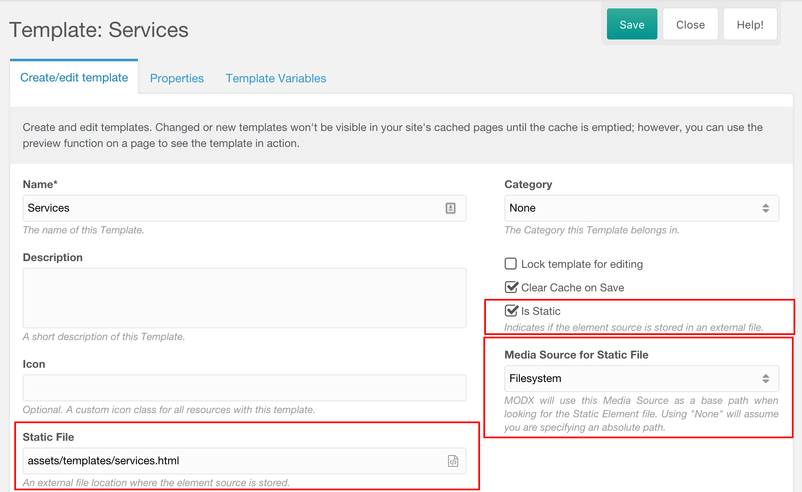

Шаблон, TV, чанк, сниппет или плагин может брать исходный код из файла. Сохранение элемента в менеджере записывает этот файл.

## Создание статического элемента

Отметьте **Статичный**, выберите **Источник файлов** и укажите путь в поле **Статичный файл**. Путь считается от этого источника.

Иконка папки в **Статичный файл** открывает браузер, только если источник файловый. При пункте **(Не указано)** поле обычное текстовое. Путь вводите сами.

Те же поля есть у каждого типа элемента.

### Источник файлов (Не указано)

Выберите **(Не указано)** в **Источник файлов**, если путь хотите набрать сами.

Абсолютный путь используется как написан, если файл уже есть. Если файла ещё нет, MODX создаёт его в каталоге из системной настройки `element_static_path`. Этой настройки в поставке MODX нет. Создайте её, иначе новые файлы попадут в `core/components/`.

`static_elements_basepath` не этот каталог. Это префикс, который автоматика пишет в **Статичный файл**.

## Файлы и база данных

MODX всё равно хранит копию исходного кода в базе. Кешируемый чанк или шаблон внутри кеша ресурса держит старый код, пока вы не очистите кеш или не вызовете элемент без кеша (`[[!$name]]`). Сниппет или плагин, который реально выполняется, подхватывает более новый файл по времени изменения. Плагины не кешируются.

Некоторые дополнения создают элемент сами или очищают кеш. Эта страница их не называет.

## Автоматические статические файлы

Менеджер может сам отметить элемент статичным и заполнить **Статичный файл**.

Откройте **Админ** → **Системные настройки** и отфильтруйте область **Статические элементы**.

1. Включите `static_elements_automate_templates`, `static_elements_automate_tvs`, `static_elements_automate_chunks`, `static_elements_automate_snippets` или `static_elements_automate_plugins` для нужных типов.
2. В `static_elements_default_mediasource` укажите id источника файлов для новых элементов.
3. В `static_elements_basepath` укажите префикс внутри этого источника, например `components/static/elements/`. При **(Не указано)** префикс `components/` склеится с `core/components/` и даст каталог `core/components/components/`.
4. При желании задайте `static_elements_default_category`.

### Куда пишется файл

Путь: `{basepath}/{type}/{category}/{name}{suffix}`.

Имя и категория переводятся в нижний регистр, пробелы становятся `-`. `--` в категории становится `/`.

| Тип | Суффикс |
| --- | --- |
| templates | `.template` плюс `static_elements_html_extension` (по умолчанию `.tpl`) |
| tvs | `.tv` плюс то же расширение |
| chunks | `.chunk` плюс то же расширение |
| snippets | `.snippet.php` |
| plugins | `.plugin.php` |

`static_elements_html_extension` к сниппетам и плагинам не добавляется.

Чанк `my-footer` в категории `html`, с базой `components/site/elements/` и файловым источником, лежит как `components/site/elements/chunks/html/my-footer.chunk.tpl`.

### Когда файл удаляется

При включённой автоматике этого типа сохранение нового пути удаляет прежний файл. Удаление элемента снимает файл, только если автоматика включена и источник файловый. При **(Не указано)** файл остаётся на диске. Удалите его сами. Если тот же статичный файл указан у другого элемента, файл сохраняется.

После перетаскивания элемента в другую категорию файл может оказаться не в том каталоге, который показала бы форма. Откройте элемент и сохраните его, чтобы менеджер пересчитал путь.

## Настройки статических элементов

| Настройка | По умолчанию | Что делает |
| --- | --- | --- |
| `static_elements_automate_templates` | `false` | Заполнять статичный файл у новых шаблонов. |
| `static_elements_automate_tvs` | `false` | Заполнять статичный файл у новых TV. |
| `static_elements_automate_chunks` | `false` | Заполнять статичный файл у новых чанков. |
| `static_elements_automate_snippets` | `false` | Заполнять статичный файл у новых сниппетов. |
| `static_elements_automate_plugins` | `false` | Заполнять статичный файл у новых плагинов. |
| `static_elements_default_mediasource` | `0` | Id источника файлов у нового автоматического элемента. |
| `static_elements_default_category` | `0` | Id категории у нового автоматического элемента. |
| `static_elements_basepath` | `''` | Префикс в поле **Статичный файл**, внутри выбранного источника. |
| `static_elements_html_extension` | `.tpl` | Расширение после `.template`, `.tv` и `.chunk`. |
