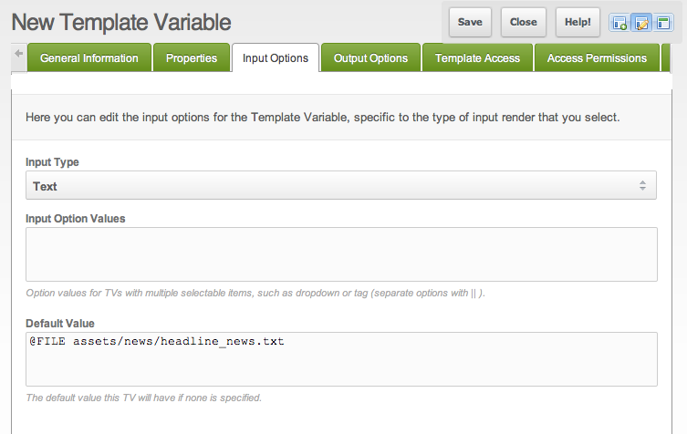
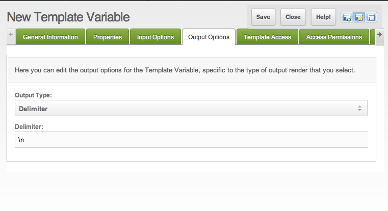

## Что такое @FILE привязка?

Привязка @FILE возвращает содержимое любого указанного файла.

## Синтаксис

```php
@FILE file_path
```

Привязывает переменную к файлу. MODX открывает путь ровно так, как вы его написали. Корень сайта он не подставляет, в отличие от `@DIRECTORY`. Путь вроде `assets/news/headline_news.txt` сработает, только если такой путь существует как написан. Если файл не открылся, TV выводит ` Could not retrieve document '…'.`, с пробелом перед `Could`.

В файле `||` и `==` могут стоять разделителями между значениями.

## Использование

Создайте переменную шаблона и впишите `@FILE` в **Значение по умолчанию**, с путём к файлу:

> @FILE assets/news/headline_news.txt

Привязка возвращает текст файла одной строкой. Перевод строки в файле остаётся переводом строки. Тип вывода Delimiter режет эту строку по `||`.





## Смотрите также

-   [Переменные шаблона](building-sites/elements/template-variables "Переменные шаблона")
-   [Привязки](building-sites/elements/template-variables/bindings "Привязки")
