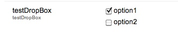
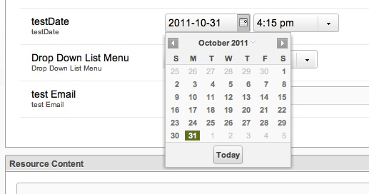
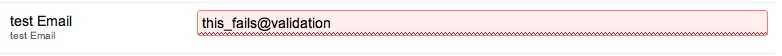
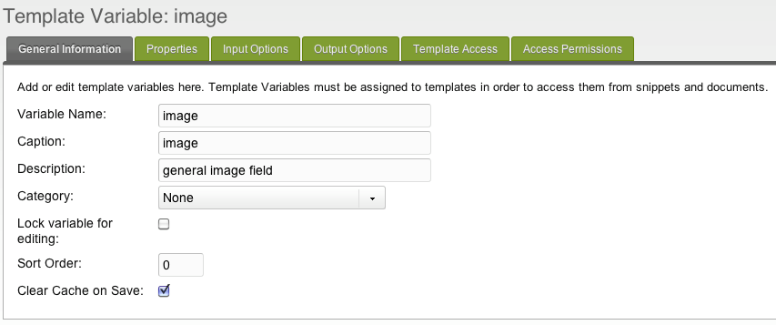
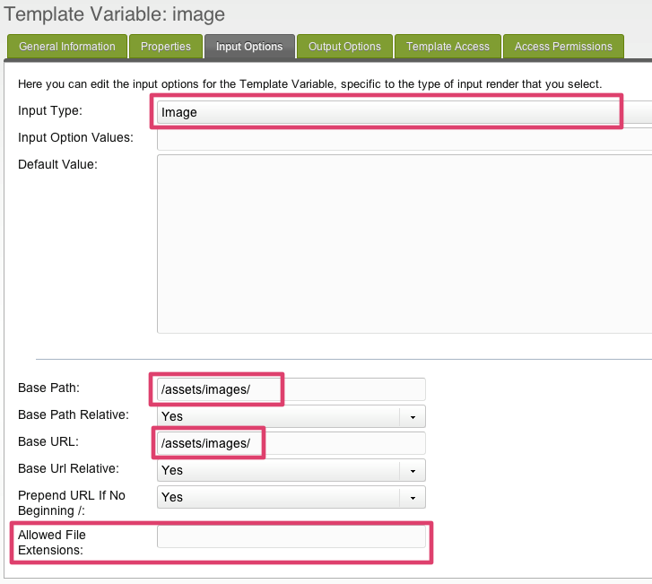
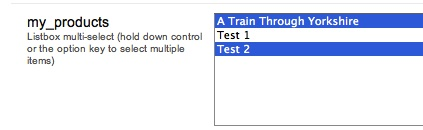
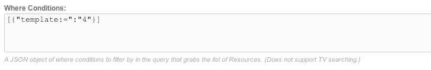
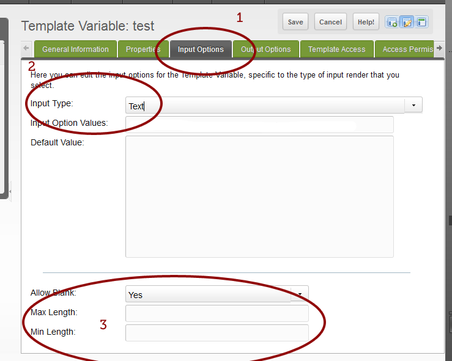
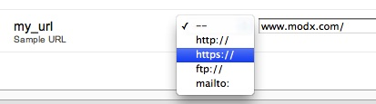

В MODX есть несколько встроенных типов шаблонных переменных (TV).

Некоторые типы ввода устарели в зависимости от версии MODX.

Для TV с пользовательскими списками (listbox, checkbox, radio и т. п.) лучше вводить несколько значений параметра ввода в одной строке без перевода строки.

## Типы ввода

### Автоматический тег (autotag)

Автоматический тег удобен для тегов в блоге, когда ресурс может относиться к нескольким категориям, или когда нужен список ранее использованных тегов. При каждом редактировании или создании ресурса с доступом к такой TV вы увидите уже использованные теги и сможете выбрать их одним кликом.

**Auto-Tag** сохраняет список через запятую. Тип вывода Delimiter режет только `||`, поэтому эти теги он не разделяет. Режьте список по запятой в сниппете или фильтре вывода.

Чтобы каждый тег вёл на ресурс и передавался в GET-параметре, используйте фильтр вывода (сниппет):

```php
if ($input == '') { return 'Error'; } // In case the TV is empty
$tags = explode(', ',$input); // Based on a delimiter of ", " this will split each one up in an array
foreach ($tags as $key => $value) { // Loop through the tags
    $output[] = '<a href="'.$modx->makeurl(9, '', array('tag' => $value)).'">'.$value.'</a>'; // Add it to an output array, with a link to resource 9 and the get parameter.
}
return implode(', ',$output); // Merge the output array and output
```

#### Шаблон JSON-параметров ввода

```json
{
    "allowBlank": "true",
    "maxLength": "",
    "minLength": "",
    "regex": "",
    "regexText": ""
}
```

### Флажок (checkbox)

#### Простое использование

Базовый сценарий: поле с одним флажком. Отметку по умолчанию задают через поля «Значения параметра ввода» и «Значение по умолчанию».

##### Отмечен по умолчанию

-   Значения параметра ввода: `My Option==1`
-   Значение по умолчанию: 1

##### Не отмечен по умолчанию

-   Значения параметра ввода: `My Option==1`
-   Значение по умолчанию: 0

Флажок будет отмечен, пока значение после `==` совпадает со значением по умолчанию. Для нескольких значений по умолчанию разделите их разделителем `||`.

#### Расширенное использование

Ключи и значения разделяют двойным равенством и двойными вертикальными чертами:

```php
option1==value1||option2==value2
```

#### Ещё более сложное использование

Тип «Флажок» позволяет показать несколько флажков в одной TV. Задайте значения параметра ввода в формате `option1==value1||option2==value2`. Чтобы отметить флажки по умолчанию, укажите в поле значения по умолчанию имена опций через `||`. Можно использовать [@SELECT](building-sites/elements/template-variables/bindings/select-binding "SELECT Binding") для выборки из базы, например **Значения параметра ввода:**

```sql
@SELECT pagetitle, id FROM modx_site_content WHERE parent=35
```



При нескольких флажках задайте **Тип вывода** «Разделитель» (например, запятую), чтобы различать значения каждого флажка.

### Дата (date)

Позволяет задать дату и время.



Для даты по умолчанию поместите одно из ключевых слов ниже в поле значения по умолчанию.

| Значение по умолчанию | Что получится |
| --- | --- |
| `yesterday` | Предыдущий день в полночь. Подпись в менеджере: **Вчера (полуночь)**. |
| `today` | Сегодня в полночь. Подпись в менеджере: **Сегодня (полуночь)**. |
| `now` | Сегодня, текущее время. Подпись в менеджере: **Сегодня с текущим временем**. |
| `tomorrow` | Следующий день в полночь. Подпись в менеджере: **Завтра (полуночь)**. |

Строка даты передаётся в PHP `strtotime`. `+72` не значит «72 часа назад». Подсказка менеджера всё ещё говорит про часы. Пишите строку, которую понимает `strtotime`, например `-72 hours`, или саму дату.

| Значение | Что получится |
| --- | --- |
| `-72 hours` | На 72 часа раньше текущего времени |
| `+72 hours` | На 72 часа позже текущего времени |
| `2026-07-01 14:00` | 1 июля 2026, 14:00 |

Формат на странице задаёт [тип вывода Date](building-sites/elements/template-variables/output-types/date). Этот тип вызывает `strftime`. Оговорка про журнал стоит на той странице.

#### Шаблон JSON-параметров ввода

```json
{
    "allowBlank": "true",
    "disabledDates": "",
    "disabledDays": "",
    "minDateValue": "",
    "minTimeValue": "",
    "maxDateValue": "",
    "maxTimeValue": "",
    "startDay": "0",
    "timeIncrement": "15",
    "hideTime": "false"
}
```

### Email

Текстовое поле со встроенной проверкой: принимается только текст в корректном формате email.



#### Шаблон JSON-параметров ввода

```json
{
    "allowBlank": "true",
    "maxLength": "",
    "minLength": ""
}
```

### Файл

Создаёт поле выбора файла для просмотра файлов на сервере. Загрузка: через файловый менеджер MODX. Файл по умолчанию задаётся путём к нему.

При дружественных URL обратите внимание на относительные пути к файлам.

#### Шаблон JSON-параметров ввода

```json
{
    "allowBlank": "true"
}
```

### Скрытое поле (hidden)

Скрытое поле не отображается в менеджере, поэтому его редко используют. Можно задать значение по умолчанию и получать его на всех страницах с этой переменной. Другой вариант: сохранить сниппет, который принимает ID страницы.

### Изображение (image)



Создаёт поле выбора изображения для просмотра файлов на сервере. Загрузка: через файловый менеджер MODX.

В MODX 2.2+ у Image TV больше нет параметров ввода. Перейдите на вкладку «Источники медиа» и назначьте источник этой TV для каждого контекста. Базовые пути и другие настройки задаются в [Источнике медиа](building-sites/media-sources "Media Sources").



1. Файл по умолчанию задаётся путём к изображению.

2. Чтобы ограничить изображения для этой TV одной папкой, укажите (с Revolution 2.1) base-path и base-url. Можно задать относительные или абсолютные пути. При дружественных URL обратите внимание на относительные пути. Для корректного отображения на фронтенде и в бэкенде проверьте настройки `base_url` и `base_path`.

3. Можно добавить URL, если путь к файлу не начинается с косой черты.

4. Можно указать допустимые расширения файлов.

Этот тип ввода возвращает ссылку (для атрибута src). Можно также задать [html-img-tag как тип вывода](making-sites-with-modx/customizing-content/template-variables/template-variable-output-types/image-tv-output-type "Image TV Output Type").

### Listbox (одиночный выбор) (listbox)

Те же параметры, что у Listbox (множественный выбор): см. ниже.

### Listbox (множественный выбор) (listbox-multiple)

Работает как флажки: можно выбрать несколько элементов, а поле может питаться привязкой @SELECT в «Значения параметра ввода». Как и для флажков, задайте тип вывода «Разделитель», чтобы различать значения.



#### Простое использование

Как у флажков, укажите список значений через `||`:

```php
Man||Bear||Pig
```

#### Отдельные подписи и значения

Часто нужна более читаемая подпись. Можно показать понятный текст и сохранить другое значение в формате двойного равенства и `||`, как у флажков:

```php
Option 1==value1||Option 2==value2
```

#### Шаблон JSON-параметров ввода

```json
{
    "allowBlank": "true",
    "listWidth": "",
    "title": "",
    "typeAhead": "false",
    "typeAheadDelay": "250",
    "listEmptyText": "",
    "stackItems": "false"
}
```

### Число (number)

Текстовое поле с предварительной проверкой. Можно вводить только цифры 0-9, минус (-) и точку (десятичный разделитель). Ошибка появится при более чем одной точке или минусе. Комплексные числа (радикалы `^` или `e`) **не** поддерживаются.

Конечные нули обрезаются: 4.50 становится 4.5. Для денежных полей этот тип может не подойти.

#### Шаблон JSON-параметров ввода

```json
{
    "allowBlank": "true",
    "allowDecimals": "Yes",
    "allowNegative": "Yes",
    "decimalPrecision": "2",
    "decimalSeparator": ".",
    "maxValue": "",
    "minValue": ""
}
```

### Переключатели (option)

#### Простое использование

Базовый сценарий: список переключателей. Вариант по умолчанию задают через «Значения параметра ввода» и «Значение по умолчанию».

##### Выбран по умолчанию

-   Значения параметра ввода: My Option==1
-   Значение по умолчанию: 1

Опция будет выбрана, пока значение после `==` совпадает со значением по умолчанию.

#### Расширенное использование

Переключатели могут выводить не только числа. Например, ими выбирают чанк для боковой панели.

Задайте значения параметра ввода в формате **Title==value**, а в качестве value используйте плейсхолдеры чанков. Несколько опций разделяйте `||` после value, перед следующим title.

##### Пример боковой панели (Revolution)

-   Значения параметра ввода: `[[$my_related_chunk]]||Content==[[*sidebar-txt]]||Twitter==[[$my_twitter_chunk]]`
-   Значение по умолчанию: `[[$my_related_chunk]]`

В этих примерах можно вывести чанк или другую TV без дополнительного сниппета.

#### Шаблон JSON-параметров ввода

```json
{
    "allowBlank": "true",
    "columns": "1",
    "columnDirection": "vertical",
    "columnWidth": "medium",
    "wrapColumnText": "false"
}
```

### Список ресурсов (resourcelist)

Один список ресурсов. Сохраняется id выбранного ресурса. Список строится по полю **Родители**. Если **Родители** пустое, список не ограничен детьми одного ресурса. Глубина с самого начала равна 10.

Пустой пункт с подписью `-` в списке есть всегда.

Фильтр `where` можно добавить. Примеры ниже не являются значением по умолчанию. По умолчанию фильтра нет.



Другой пример:

```php
[{"pagetitle:!=":"Home"}]
```

#### Шаблон JSON-параметров ввода

```json
{
    "allowBlank": "1",
    "parents": "",
    "depth": "10",
    "includeParent": "1",
    "limitRelatedContext": "0",
    "where": "",
    "limit": "0",
    "typeAhead": "false",
    "typeAheadDelay": "250",
    "forceSelection": "false",
    "listEmptyText": ""
}
```

### Rich Text

Небольшое поле редактора, если редактор установлен. Во входных свойствах только `allowBlank`.

```json
{
    "allowBlank": "true"
}
```

### Тег (tag)

**Tag** сохраняет список через запятую. Тип вывода Delimiter режет только `||`, поэтому эти теги он не разделяет. **Check Box** и **Listbox (Multi-Select)** хранят `||`, и Delimiter их разделяет.

#### Шаблон JSON-параметров ввода

```json
{
    "allowBlank": "1"
}
```

### Текст (text)

Обычное текстовое поле.

С MODX 2.1 для этой TV доступны три параметра ввода:

-   Allow Blank: да/нет. При «нет» ресурс нельзя сохранить с пустым полем.
-   Max length: максимальное число символов.
-   Min Length: минимальное число символов. Часто используют вместе с Allow Blank «нет».



#### Шаблон JSON-параметров ввода

```json
{
    "allowBlank": "true",
    "maxLength": "",
    "minLength": "",
    "regex": "",
    "regexText": ""
}
```

### Текстовая область (textarea)

Обычное поле textarea. **Высота** задаётся в пикселях и с самого начала равна 140.

#### Шаблон JSON-параметров ввода

```json
{
    "allowBlank": "true",
    "inputHeight": "140",
    "textareaGrow": "false",
    "textareaResizable": "false"
}
```

### URL

Поле из списка префиксов и текста. Префиксы: **(Не указано)**, `http://`, `https://`, `ftp://` и `mailto:`. **(Не указано)** сохраняется как `--`. Формат адреса не проверяется.

При сохранении MODX убирает из текстовой части `http://` и `ftp://`, затем добавляет выбранный префикс. `https://` и `mailto:` в тексте остаются. Если такой префикс уже выбран, сохранённое значение может содержать его дважды. Схему в текстовой части не оставляйте.



## Динамически задаваемые параметры ввода

Этот раздел про определение самой TV, а не про пользовательские опции (пары ключ-значение) listbox и похожих типов.

Вне обычной формы менеджера, например в MIGX, параметры ввода задают JSON-объектом.

Теги в этом JSON остаются обычным текстом. Предел вводите в полях **Ранняя дата** и **Поздняя дата**. Чтобы посчитать значение TV, вызовите сниппет. Тег сниппета внутри этого JSON не выполняется.
