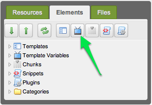
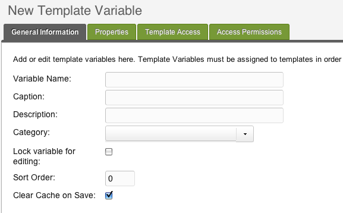
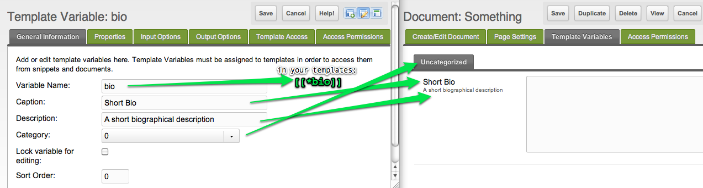

Эта страница определяет переменную шаблона. Что такое TV: [Переменные шаблона](building-sites/elements/template-variables "Template Variables").

## Объяснение

«Создать переменную шаблона» может значить две вещи:

- вписать значение в своё поле, пока вы правите ресурс
- определить это поле, чтобы ресурсы могли его использовать

Здесь второе. Определение служит чертежом. Своё значение потом хранит каждый ресурс.

## Создание переменной шаблона

### 1. Войдите в менеджер MODX

Войдите в менеджер как администратор или как пользователь с тем же доступом.

### 2. Добавьте переменную шаблона

В левой панели дерева ресурсов откройте вкладку **Elements**.



### 3. Заполните общую информацию

При определении TV нужно задать много параметров поведения поля. Вкладка **General Information** содержит базовые настройки.



- **Название**: плейсхолдер в шаблонах, например **bio** = `[[*bio]]`. Имя должно быть уникальным.

> [!WARNING]
> **Название** не может совпадать с полем ресурса. MODX отклонит `id`, `type`, `pagetitle`, `longtitle`, `description`, `alias`, `alias_visible`, `link_attributes`, `published`, `pub_date`, `unpub_date`, `parent`, `isfolder`, `introtext`, `content`, `richtext`, `template`, `menuindex`, `searchable`, `cacheable`, `createdby`, `createdon`, `editedby`, `editedon`, `deleted`, `deletedby`, `deletedon`, `publishedon`, `publishedby`, `menutitle`, `content_dispo`, `hidemenu`, `class_key`, `context_key`, `content_type`, `uri`, `uri_override`, `hide_children_in_tree`, `show_in_tree` и `properties`.

- **Caption**: основная подпись TV при редактировании ресурса
- **Description**: дополнительная подпись
- **Category**: вкладка, на которой TV появится в редакторе
- **Sort Order**: порядок среди нескольких TV (1 сверху, большие числа опускаются ниже)



Имя должно быть уникальным. На рисунке те же поля видны у ресурса.

### 4. Настройте параметры ввода

Откройте вкладку **Input Options**. Выберите тип поля: текст, выпадающий список, WYSIWYG и т.д. Полный список см. на странице [Типы ввода переменных шаблона](building-sites/elements/template-variables/input-types "Template Variable Input Types").

- **Input Type**: текстовое поле, выпадающий список, ссылка на другую страницу и другие варианты.
- **Input Options**: некоторые типы игнорируют это поле, другим оно нужно. Например, выпадающий список требует перечень значений. Подробнее см. [Типы ввода переменных шаблона](building-sites/elements/template-variables/input-types "Template Variable Input Types").
- **Default**: значение по умолчанию. Это может быть простое значение или одна из [привязок](building-sites/elements/template-variables/bindings "Bindings") MODX для выборки из БД или наследования от родительской страницы.


### 5. Настройте доступ к шаблонам

Откройте вкладку **Template Access**. Укажите, какие шаблоны будут использовать это поле.

Когда вы создаёте ресурс с шаблоном, к которому привязана TV, TV доступна для редактирования. **Привяжите TV хотя бы к одному шаблону.**

### 6. Сохраните определение TV

При редактировании страницы с шаблоном, связанным с этой TV, вы сможете заполнить поле TV.

### 7. Используйте TV: создайте ресурс

После определения TV и привязки к шаблону создайте ресурс. В дереве ресурсов щёлкните правой кнопкой и выберите **Создать** → **Документ**. Выберите шаблон, к которому привязана эта TV.

### 8. Измените значение

Когда ресурс использует шаблон с вашей TV, откройте вкладку **Template Variables** на странице редактирования и заполните поле.

## Параметры вывода

Выберите тип вывода, например Date. Под выбором появляются дополнительные поля. Набор полей зависит от типа вывода:


Эти поля задают параметры выбранного типа вывода.

## Свойства

У TV могут быть свойства по умолчанию. Textarea TV с именем `viewingSS` может содержать:

``` php
Viewing: [[+subsection]]
```

Добавьте свойство `subsection` в таблицу. Набор свойств может его перекрыть. Создайте набор `CarsSectionTVPS`, поставьте `subsection` равным `Cars` и подключите набор там, где используется TV:

``` php
[[*viewingSS@CarsSectionTVPS]]
```

TV выведет:

> Viewing: Cars

## Доступ к шаблонам и группам ресурсов

Назначьте TV [шаблону](building-sites/elements/templates "Templates"). Ресурсы с этим шаблоном смогут править TV.

Ограничьте TV группами ресурсов в таблице **Access Permissions**.

## Смотрите также

1. [Создание переменной шаблона](building-sites/elements/template-variables/step-by-step)
2. [Привязки](building-sites/elements/template-variables/bindings)
   1. [CHUNK Binding](building-sites/elements/template-variables/bindings/chunk-binding)
   2. [DIRECTORY Binding](building-sites/elements/template-variables/bindings/directory-binding)
   3. [FILE Binding](building-sites/elements/template-variables/bindings/file-binding)
   4. [INHERIT Binding](building-sites/elements/template-variables/bindings/inherit-binding)
   5. [RESOURCE Binding](building-sites/elements/template-variables/bindings/resource-binding)
   6. [SELECT Binding](building-sites/elements/template-variables/bindings/select-binding)
3. [Типы ввода переменных шаблона](building-sites/elements/template-variables/input-types)
4. [Типы вывода переменных шаблона](building-sites/elements/template-variables/output-types)
   1. [Date TV Output Type](building-sites/elements/template-variables/output-types/date)
   2. [Delimiter TV Output Type](building-sites/elements/template-variables/output-types/delimiter)
   3. [HTML Tag TV Output Type](building-sites/elements/template-variables/output-types/html)
   4. [Image TV Output Type](building-sites/elements/template-variables/output-types/image)
   5. [URL TV Output Type](building-sites/elements/template-variables/output-types/url)
5. [Добавление пользовательского типа TV - MODX 2.2](extending-modx/custom-tvs)
6. [Multi-select для связанных страниц в шаблоне](building-sites/tutorials/multiselect-related-pages)
7. [Доступ к значениям TV через API](extending-modx/snippets/accessing-tvs)
